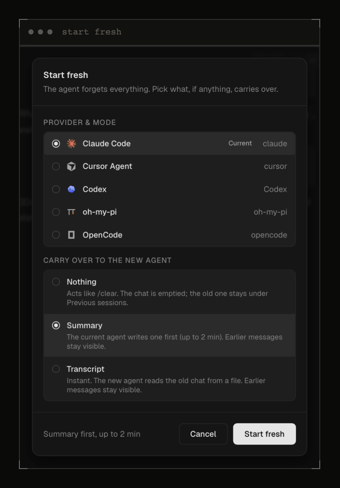
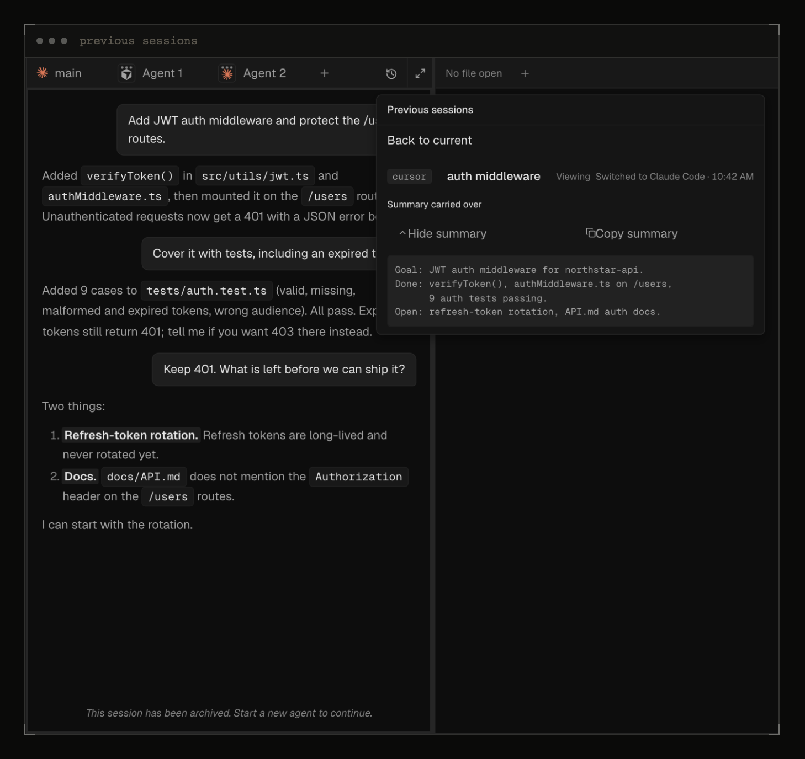
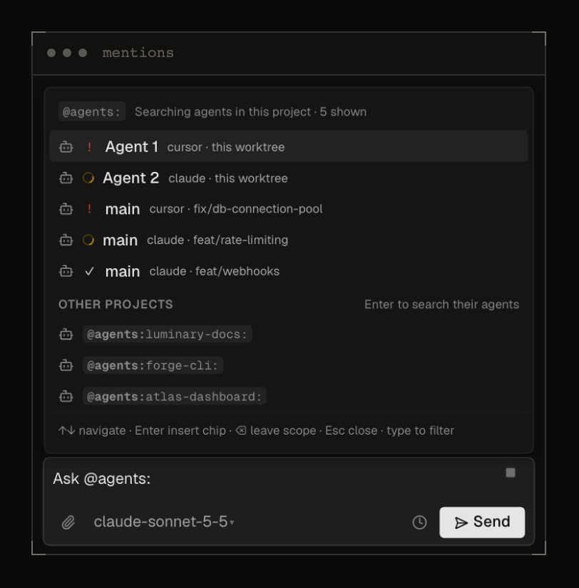
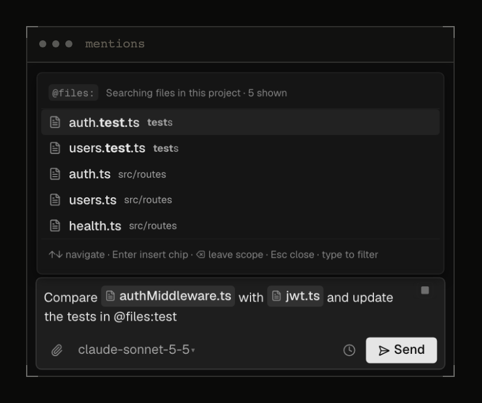
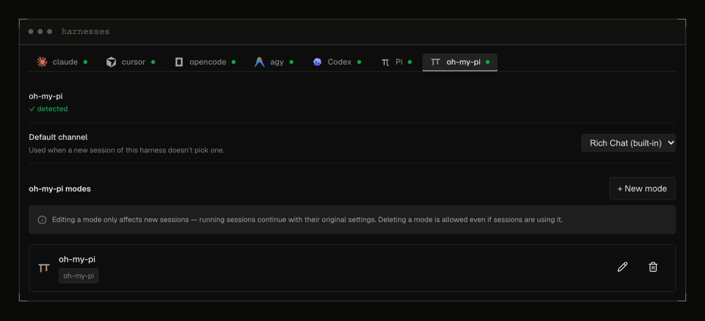
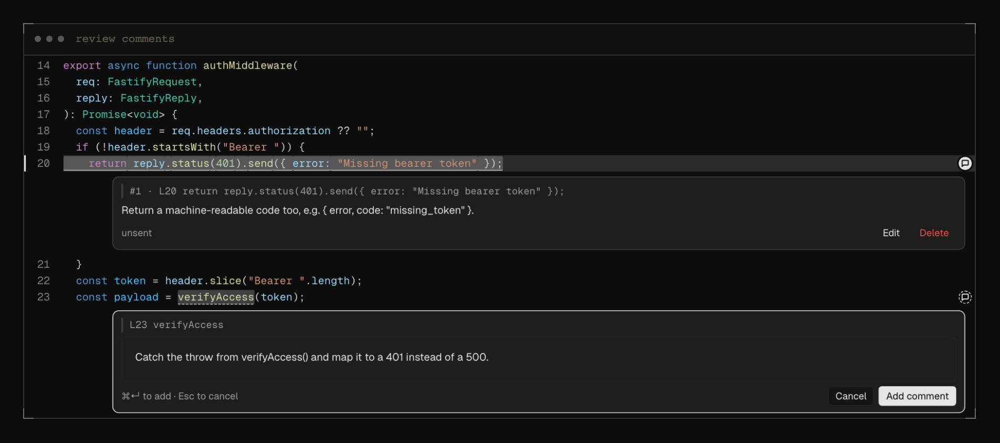
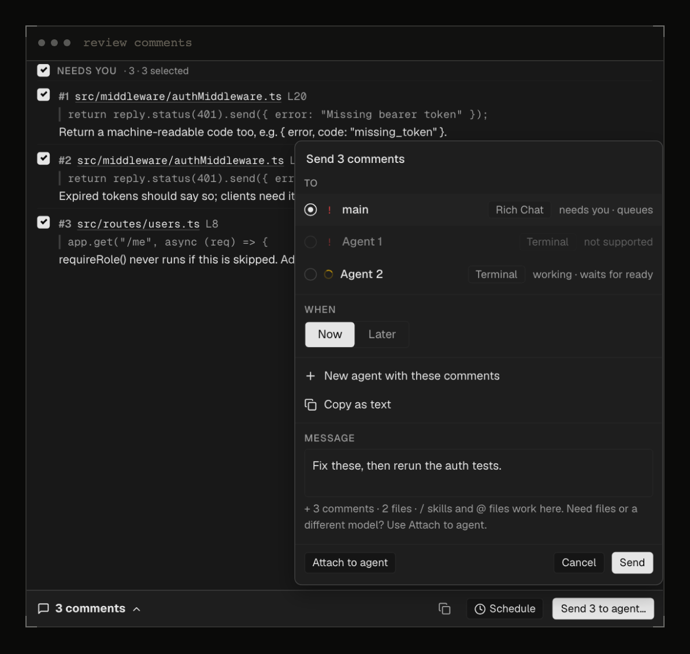
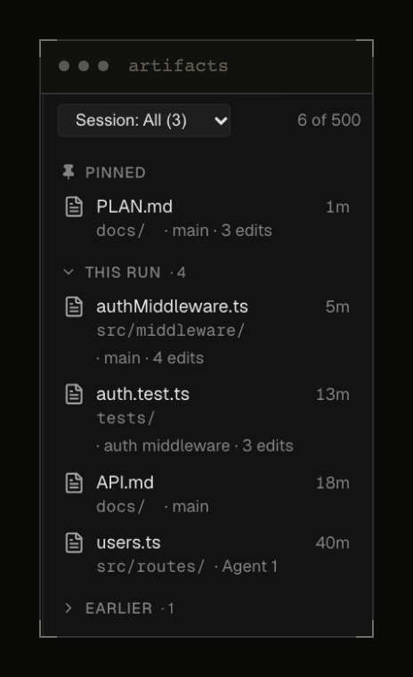

### Agents and chat

- Start fresh or switch provider and mode, carrying over nothing, a summary or the transcript.
- The old chat stays reachable under Previous sessions, and `vst agent start-fresh` does the same from the CLI.

- A task tray shows background work in Rich Chat, and a running task keeps the agent marked as working.
- `@` mentions in the composer reference files, worktrees and agents, including ones in other projects.

- Oh-my-pi (omp) is a new harness in Terminal and Rich Chat, and Antigravity Rich Chat is back.

- Schedule a message to a Terminal agent, as you already could in Rich Chat.

### Review and workspace

- Leave comments on code and rendered previews, then send them to an agent in Rich Chat or Terminal.

- The Artifacts tab collects the files your agents write, with preview, filter and pin.

- The tools rail and list panel moved to the right edge, and Diff is now called Changes.
- Dashboard cards keep their order until something is over 3 minutes newer, and they animate when they move.
- PR status and diff counts update on events and say when they are stale or signed out.

### Install and setup

- Claude and Codex adapters are now native binaries, so the desktop app no longer needs `bun`.
- Adapters ship as pinned, checksum-verified binaries, and release builds are size-optimised.
- The desktop app no longer bundles `cloudflared`; Remote Access detects it and shows install steps.
- `vst --help` and `install.sh --help` print real usage, including when piped.
- macOS builds are not notarized yet; right-click the app and choose Open on first launch.

### Fixes

- Closed WebSocket connections no longer leak sockets.
- A forced send waits for the cancelled turn to finish instead of racing it.
- A dead opencode pane now fails with a clear error instead of a silent success.
- The model dropdown header is no longer clipped, and its actions stay pinned below the list.
- Session frames render faster.
