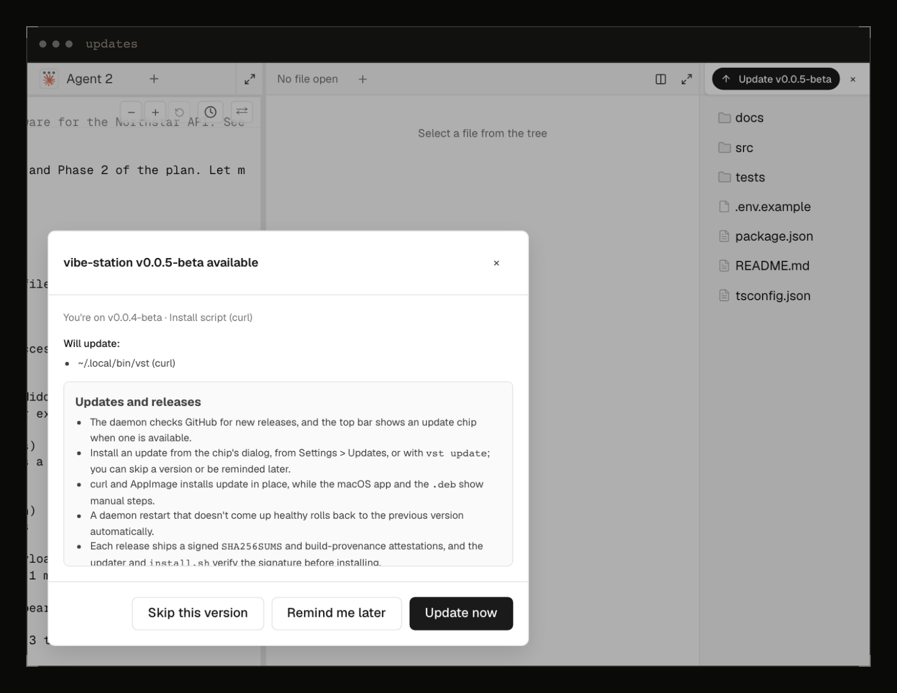

### Updates and releases

- The daemon checks GitHub for new releases, and the top bar shows an update chip when one is available.
- Install an update from the chip's dialog, from Settings > Updates, or with `vst update`; you can skip a version or be reminded later.
- curl and AppImage installs update in place, while the macOS app and the `.deb` show manual steps.
- A daemon restart that doesn't come up healthy rolls back to the previous version automatically.
- Each release ships a signed `SHA256SUMS` and build-provenance attestations, and the updater and `install.sh` verify the signature before installing.
- The macOS app is now Developer ID signed and notarized, so the dmg opens without the "damaged" warning.

### Daemon and agents

- The macOS app's daemon adopts your login-shell PATH, so it finds `tmux` and `gh`.
- A terminal agent that exits records why, and tmux targets are exact so one name can't match another.
- Agents are told never to kill processes by name.
- One failed transcript open no longer breaks Rich Chat for every session.
- A failed project import now shows as a degraded language-server status.

### Files and preview

- Replaced file tabs no longer come back, and Close all clears the open files.
- The file preview no longer flickers, and tabs no longer hang, when many files change at once.
- Comments on rendered markdown no longer move the preview when you create one or hover a pin.
