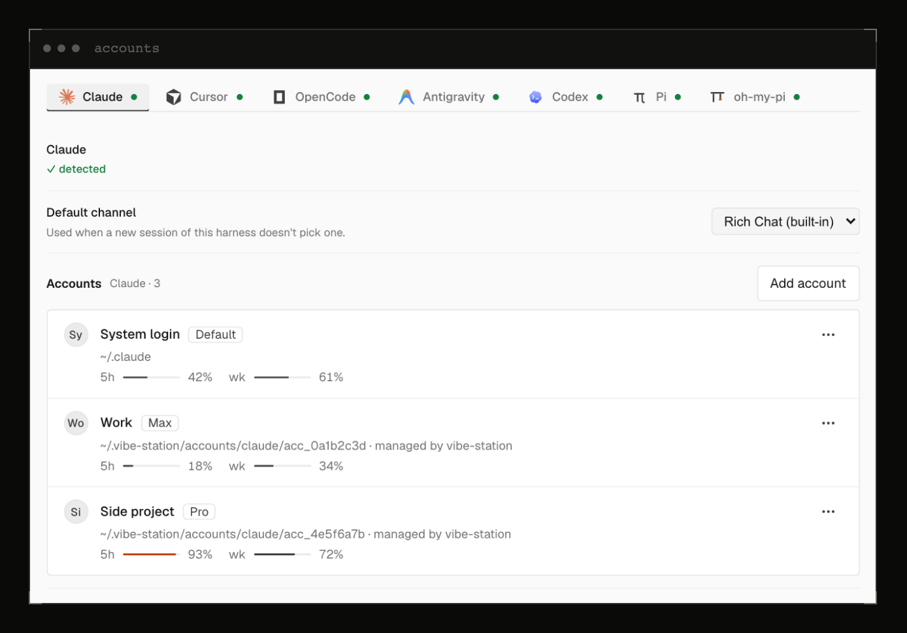
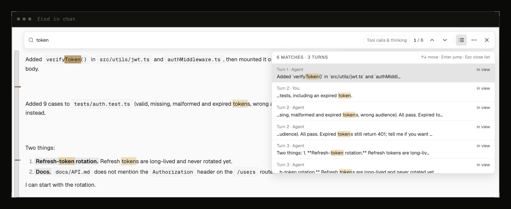
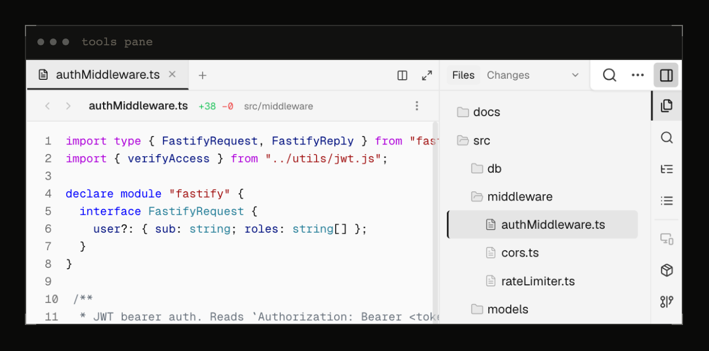

### Accounts and limits

- Sign in to several accounts for each coding CLI from Settings > Accounts, except Antigravity, which has no accounts yet.
- Pick an account when you start an agent, and see it as a badge in the sidebar.
- Switch a running session to another account; its conversation carries over, with a break card in the chat.
- Each account has its own limits chips, and banners warn when one hits its limit or is signed out.
- `vst agent` takes `--account` flags for the same choices.
- Claude limits now show every plan bucket, including scoped meters like Fable and dollar-based ones.

### Rich Chat and files

- Find in chat searches the whole transcript, with highlighting and a jump to history that isn't loaded yet.
- Rich Chat shows a chain of labelled turn nodes, with a labels panel on hover or touch.
- File previews show scrollbar marks or an optional minimap.

### Tools pane

- Headers are quieter, with a Files and Changes switch and a vs-HEAD dropdown.
- The file strip has back and forward, the file name and +/- counts.
- The VCS view caches results, refreshes the base branch in the background, and docks its commit list into a two-level sidebar.
- Artifacts are one-line rows with an agent picker and a chip for the agent that wrote each file.
- Right-click or long-press a file or artifact to open a Details dialog.
- Phone layouts and light-theme contrast are fixed.

