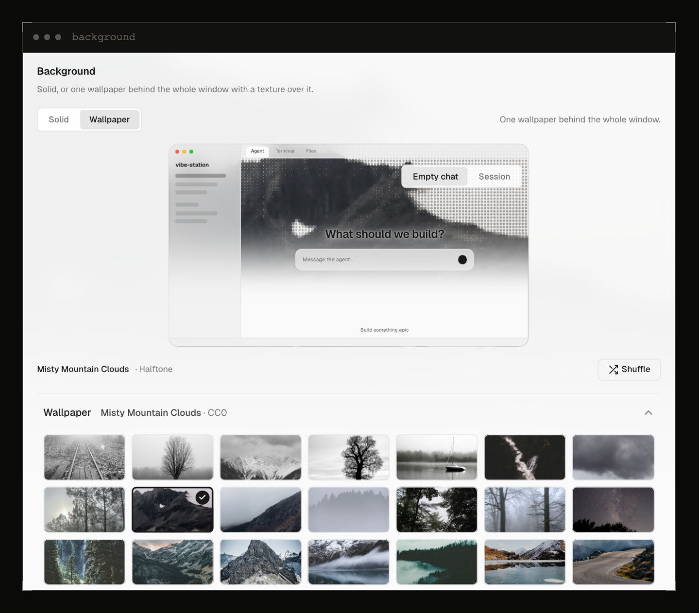
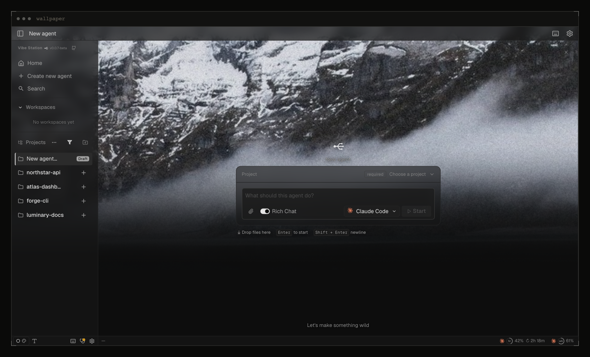
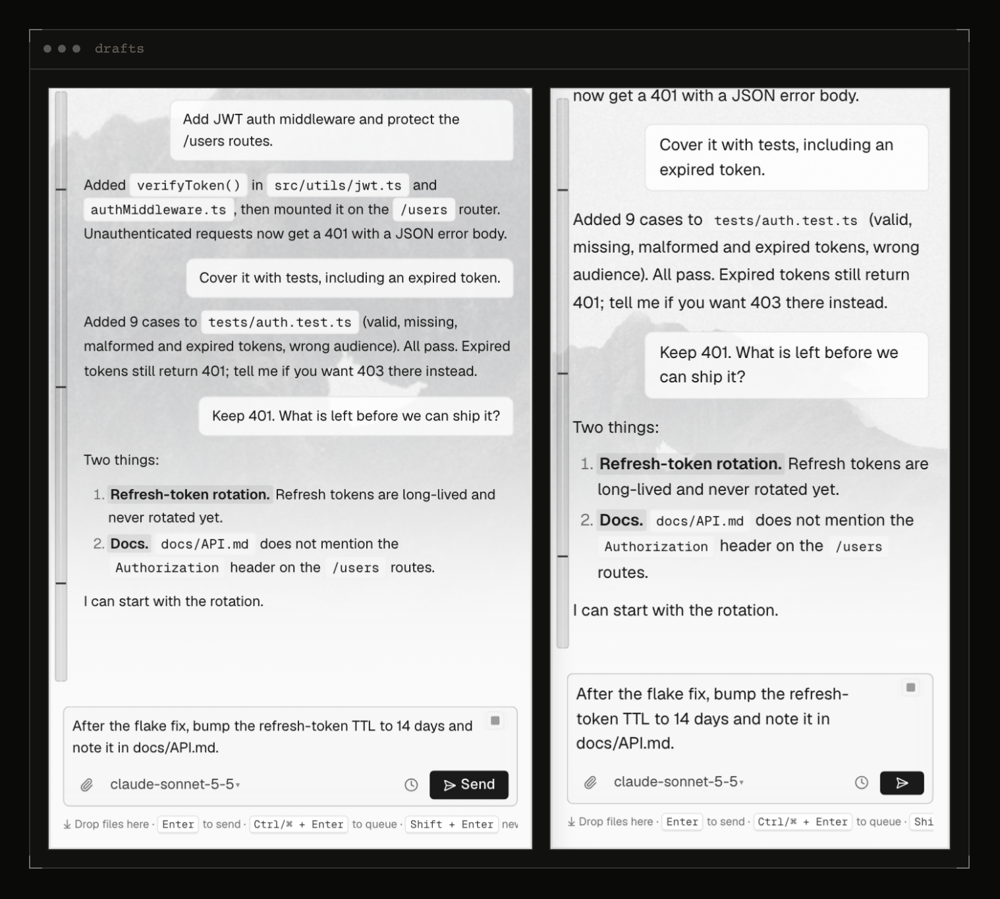
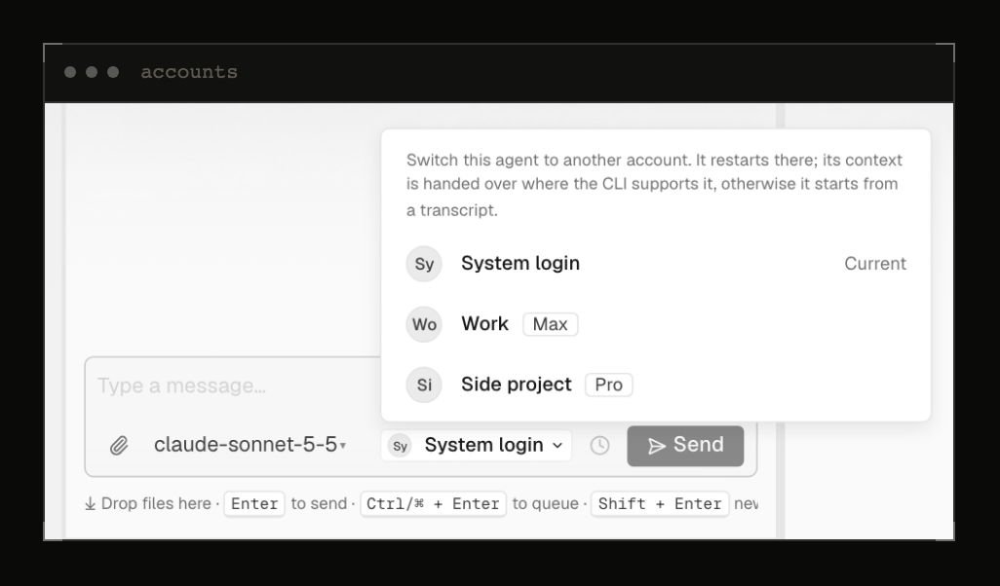

### Wallpapers

- Set a wallpaper behind the whole window, with panels that stay readable over it.
- Choose from a bundled catalog of 31 CC0 images.
- Add a texture effect and pick a gradient preset; Soft fade is the default.
- Change it from onboarding, Settings > Background, or per worktree and project.

### Drafts

- Composer drafts now follow you across devices and browser tabs.
- This covers the Rich Chat composer, the new-agent draft composer and the review message.
- Edits made while offline are kept and synced when you reconnect.

### Resume and accounts

- Resume now reopens the session's own conversation, not a sibling's.
- Resume no longer fails when the stored conversation is gone, and it shows the reason when it does fail.
- Agents no longer wait 15 seconds to start.
- The account picker moved into the chat composer, and the sidebar only marks non-default accounts.

