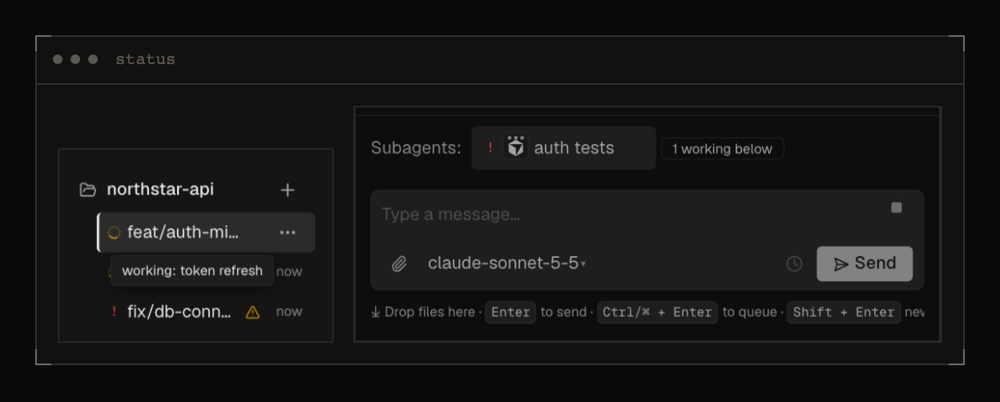
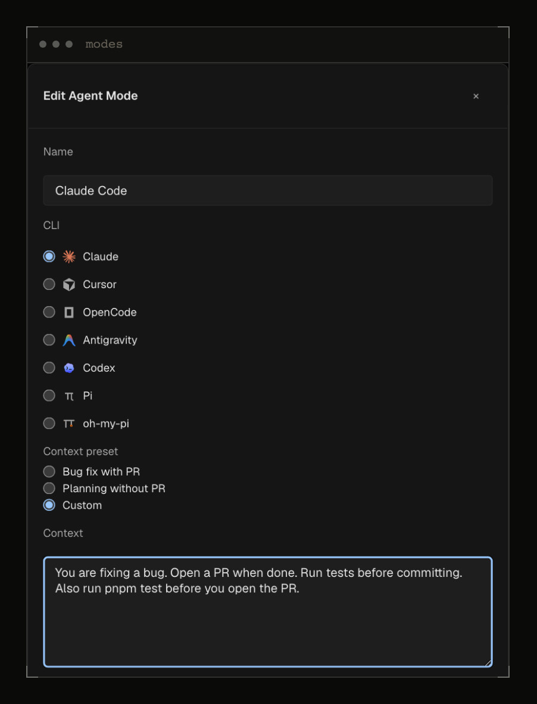

### Reliability

- The daemon no longer runs out of open files when you keep many chats around.
- Agents that sit idle for 2 hours are shut down and resume on your next message.
- A message you send twice, or retry after a dropped connection, is posted only once.
- A broken `modes.json` now shows an error instead of being silently overwritten.

### Sidebar and status

- Pinned worktrees and agents keep their order across devices, newest pin first.
- Project order is saved on the daemon and follows you between clients.
- A worktree that shows "working" now names the agents behind it in a tooltip.
- Agent rows show "N working below" and open the most recently active agent.

### Modes

- Typing in a mode's context box switches the preset to Custom, and Custom keeps your text.
- The Edit mode dialog now has the same presets as New.
- Errors from creating a mode are shown in the dialog.

