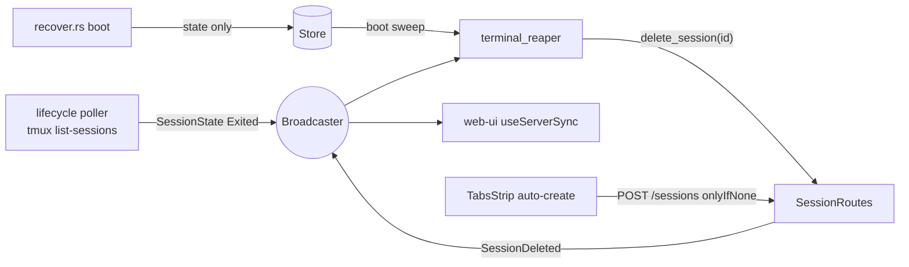

<!--
RULES — read before writing or implementing:
1. FORMAT: Bullets, tables, code, diagrams ONLY — no prose paragraphs
2. REQUIREMENTS: One crisp line each — no verbose descriptions
3. CHECKLIST: Mark items [x] as you complete them — this is your persistent todo list
4. READING TIME: Optimize for fast human scanning — if it's hard to skim, rewrite it
-->

# Plan: Reap exited plain terminals + idempotent auto-create

> Delete plain terminal sessions when they exit, sweep stale ones on boot, and stop duplicate auto-created shells.

**Issue:** reap-exited-terminals
**Branch:** `open-terminals-ui`
**Status:** Done
**Report:** `.vibekit/reports/2026-10-24-exited-terminal-tabs.md`

**Reference files:**
- Delete path (reused as-is): `rust/vst-routes/src/sessions.rs:1580` (`delete_session`)
- Create path (guard added): `rust/vst-routes/src/sessions.rs:681-1275`
- Wiring: `rust/vst-daemon/src/run.rs:544` (starts the reaper), `rust/vst-daemon/src/server.rs:585` (`build_app` → `router_from_state`)
- UI auto-create: `web-ui/src/components/layout/TabsStrip.tsx:473-535`

---

## Problem & Concept

- Exited plain terminals (type=terminal) are never deleted; each stays as a dead tab (26 in `vibe-station-mobile`, 13 in `vibe-station-website`)
- The auto-create-first-shell effect is per-browser, so two clients (or a post-reap empty dock) can double-create
- Success: an exited terminal vanishes via the existing `session:deleted` flow; one live auto shell per project/worktree
- Full evidence + root cause: see the report above

## Out of Scope

- Agent sessions (exited agents stay resumable) — reaper matches `type == Terminal` only
- Name-counter split (`direct_session_seq` shared by direct agents + terminals)
- Request-origin logging for terminal creates
- Resume-a-dead-terminal UX (deleted instead; scrollback is already gone with tmux)
- A `use_tmux:false` terminal whose shell exits at runtime never becomes `Exited` (poller skips it, no PTY-exit callback, `lifecycle.rs:81`) — its tab persists until the next boot sweep

## Requirements

| # | Requirement |
|---|-------------|
| 1 | A terminal whose state becomes `Exited` is deleted via `SessionRoutes::delete_session` |
| 2 | On daemon boot, every already-`Exited` terminal (direct + worktree) is deleted |
| 3 | Agents are never reaped; a terminal resumed to `Working` before the delete is never reaped |
| 4 | `POST /sessions` with `onlyIfNone: true` on a terminal returns the existing live terminal instead of creating one |
| 5 | Without the flag, `POST /sessions` behaves exactly as today (CLI, `+` dialog) |
| 6 | An open terminal dock always has ≥1 terminal: open + empty → create one; emptied while open (last tab closed, or reaped) → close the dock, never re-create in place; a hidden dock never creates (its content stays mounted while hidden, so "open" = `terminalDockVisible`) |
| 7 | No schema change; the new request field has a serde default |

---

## Change Map

```
rust/vst-types/src/rest/
  sessions.rs        ~ add only_if_none
rust/vst-routes/src/
  sessions.rs        ~ guarded terminal create
  terminal_reaper.rs + reap + boot sweep
  lib.rs             ~ export module
rust/vst-daemon/src/
  server.rs          ~ router_from_state pub
  run.rs             ~ spawn + abort reaper
rust/vst-cli/src/commands/
  agent/create.rs    ~ only_if_none: None
  terminal/create.rs ~ only_if_none: None
web-ui/src/
  api/types.ts       ~ onlyIfNone on bodies
  api/mock.ts        ~ honour onlyIfNone
  components/layout/TabsStrip.tsx   ~ send flag; close dock when emptied
  hooks/useStore.ts  ~ closeTerminalDock action
  components/layout/TerminalPane.tsx ~ catch resume 404
AGENTS.md            ~ exited terminals are reaped
```

| Today | After this plan |
|-------|-----------------|
| Exited terminal record + tab live until manual Terminate | Deleted automatically, tab disappears via `session:deleted` |
| Stale exited terminals survive restarts | Swept on boot |
| Every client with an empty dock creates a shell | Daemon returns the one live shell (`onlyIfNone`) |
| Closing the last tab (dock opened non-empty) auto-creates a new shell in place | Dock closes; reopening it creates a fresh shell |
| A hidden dock on an empty worktree auto-creates a background shell | Creates nothing until the dock is opened |

---

## Research

- `rust/vst-lifecycle/src/lifecycle.rs:147-157` — `mark_session_exited` only writes state + broadcasts once (no-op if already Exited), nothing deletes — see Decision 1
- `rust/vst-lifecycle/src/lifecycle.rs:242` — tmux name missing from `list-sessions` → `Exited` (poll skips a tick if the listing fails)
- `rust/vst-git/src/recover.rs:181-198,240-271` — boot marks sessions `Exited` store-only, no broadcast — see Decision 5
- `rust/vst-routes/src/worktrees.rs:1194-1213` — worktree "done" marks its terminals `Exited` and broadcasts — see Decision 5
- `rust/vst-routes/src/sessions.rs:1580` — `delete_session` already releases runtime, cleans data dir, drops scheduled messages, broadcasts `SessionDeleted`
- `rust/vst-routes/src/sessions.rs:1023,1043` — `spawn_terminal` runs before the record is persisted (check-then-create race)
- `rust/vst-daemon/src/server.rs:305` — existing `SessionState`/`SessionDeleted` listener pattern (`broadcaster.subscribe()` loop) — see Decision 1
- `rust/vst-daemon/src/run.rs:563-611` — pollers started after `build_app`, aborted on graceful shutdown — see Decision 2
- `rust/vst-routes/src/sessions.rs:119-132` — `SessionContext` enum (`Direct`/`Worktree`/`Global`), no `.session()` accessor — see Decision 1
- `web-ui/src/components/layout/TabsStrip.tsx:474,477` — key is set only after the `sessions.length > 0` early return, so closing the last tab today re-creates a shell — see Decision 4
- **Root cause:** nothing owns "an exited plain terminal is dead weight"; creation idempotency lives in browser memory

---

## Architecture Diagram



---

## Design Details

### System Boundaries

| Boundary | Fields + types | Errors | Source of truth |
|----------|----------------|--------|-----------------|
| Client → `POST /sessions` | new `onlyIfNone?: boolean` (`only_if_none: Option<bool>`, serde default) on `CreateSessionBody` + TS `CreateSessionBody`/`CreateDirectSessionBody` | unchanged | daemon store |
| Daemon → clients | existing `session:deleted { sessionId }` | — | daemon store |
| Writers → reaper | existing `ServerEvent::SessionState { session_id, state: Exited }` from the lifecycle poller and `worktree_done`; `recover.rs` writes store-only (boot sweep catches it) | `Lagged` → full sweep | lifecycle poller / `worktree_done` / `recover.rs` write state; the reaper is the only deleter |

- Response of a guarded create that finds an existing terminal is the same `Session` shape as a fresh create; no `session:created` is broadcast

### Critical User Journeys (CUJs)

#### CUJ 1 — tmux server restarts

```
tmux dies → poller marks N terminals Exited → reaper deletes N
  → UI drops N tabs → dock empty (no auto-create)
  → user hits "+" (or reopens dock) → one fresh shell
```

- **Error path:** delete races a Resume click → `resumeSession` 404 → UI swallows it (tab already gone)
- **Edge case:** terminal resumed to `Working` between event and delete → re-check skips it

#### CUJ 2 — two clients open an empty dock

```
client A + B: POST /sessions { type: terminal, onlyIfNone: true }
  → lock → A creates → B finds A's live terminal and returns it
```

### Data Model

| Entity | Field | Type | Constraints | Notes |
|--------|-------|------|-------------|-------|
| `CreateSessionBody` | `only_if_none` | `Option<bool>` | request-only | `#[skip_serializing_none]` struct, absent ≡ false |

- **Migration:** N — nothing persisted

### API Contracts

```
POST /api/sessions
  Request:  existing body + onlyIfNone?: boolean  (honoured only when type == "terminal")
  Response: Session  (new, or the existing live terminal when onlyIfNone)
  Errors:   unchanged
```

### Key Decisions

#### Decision 1: Daemon deletes on `Exited`, not UI hiding — *with a snippet, because the re-check ordering IS the decision*

- **Decision:** a listener reaps terminals on `SessionState{Exited}`, plus a boot sweep; reuse `delete_session`
- **Ordering:** `broadcaster.subscribe()` FIRST, then the boot sweep, then the receive loop — an `Exited` sent between sweep and subscribe would be lost (`mark_session_exited` never re-sends)
- **Rationale:** many readers consume terminals without a state filter (`Workspace.tsx`, `WorkspaceCanvas.tsx`, `useStore.ts`); deleting fixes all and reuses the `session:deleted` path
- **Where:** `rust/vst-routes/src/terminal_reaper.rs` (new)

```rust
// Re-read BEFORE deleting: a Resume (or a late event) may have revived the terminal.
// Agents are filtered by type — exited agents are resumable and must never be deleted.
async fn reap_if_exited_terminal(routes: &SessionRoutes, id: &str) {
    let Some(ctx) = find_session_context(&routes.store, id).await else { return };
    let s = match &ctx {
        SessionContext::Direct { session, .. } | SessionContext::Worktree { session, .. } => session,
        SessionContext::Global { .. } => return,
    };
    if s.r#type == SessionType::Terminal && s.lifecycle.state == LifecycleState::Exited {
        let _ = routes.delete_session(id).await; // NotFound = already gone, fine
    }
}
```

#### Decision 2: Reaper started from `run.rs`, not `build_state`/`build_app`

- **Decision:** make `router_from_state(state)` `pub` (extracted from `build_app`); `run.rs` does `let state = build_state(..); let reaper = spawn_exited_terminal_reaper(state.session_routes.clone()); let router = router_from_state(state);` and aborts `reaper` beside the other poller handles
- **Rationale:** keeps background tasks out of the ~79 test `build_app`/`build_state` calls and matches AGENTS.md ("start from `run.rs`") — see Research § run.rs
- **Where:** `rust/vst-daemon/src/server.rs:585`, `rust/vst-daemon/src/run.rs:544,607`

#### Decision 3: Server-side `onlyIfNone` guard under one process-wide mutex

- **Decision:** `static TERMINAL_CREATE_LOCK: tokio::sync::Mutex<()>` held across check → spawn → persist, only when flag && type==Terminal
- **Rationale:** `spawn_terminal` precedes persistence (see Research), so the store lock alone can't close the race; contention is negligible and lock order is always this lock → store lock (no deadlock)
- **Order:** take the lock, THEN re-read `get_project` / `find_worktree_context`, then `find_live_terminal`; on a hit return `SessionOrDraft::Session(serialize_session(..existing))` with no `SessionCreated` broadcast
- **Where:** `rust/vst-routes/src/sessions.rs` (`create_direct_session`, `create_worktree_session`)
- "Live" = type Terminal, state not `Exited`/`Done`, `archived_at` none; scope = `project.direct_sessions` (direct) / that worktree's `sessions`
- A dead `use_tmux:false` terminal still reads as live (see Out of Scope) — accepted

#### Decision 4: Open dock always has ≥1 terminal — create on open-empty, close on emptied

- **Decision:** gate everything on the strip's own `layoutByWorktree[ctx].terminalDockVisible` (the dock stays mounted while hidden — `Layout.tsx:437-471`); visible + empty + never-seen → create; seen then empty → `closeTerminalDock(ctx)` (idempotent, takes the context key, not the active one); hidden → reset the per-open refs, create nothing
- **StrictMode:** a run cancelled before it issued any request releases the in-flight key and attempted ref in its cleanup, so the replay creates (otherwise dev builds never created)
- **Rationale:** reaping makes "list becomes empty" common; without this an instantly-dying shell loops create → exit → reap → create — see Research § TabsStrip, and the existing test "does not re-create when the last terminal is closed" states the same intent
- **Where:** `web-ui/src/components/layout/TabsStrip.tsx:473-480`

#### Decision 5: Agents and `useTmux:false` terminals

- **Decision:** reap by `type == Terminal` regardless of `use_tmux`; `recover.rs` marks dead pty terminals `Exited` at boot and the sweep removes them — see Research § recover.rs/worktrees.rs
- **Rationale:** state writers stay the poller, `worktree_done` and `recover.rs`; the reaper is the only deleter
- **Where:** `rust/vst-routes/src/terminal_reaper.rs`

---

## Risks / Open Questions

| # | Question | Notes |
|---|----------|-------|
| 1 | Resume of a dead terminal is lost | Fresh shell via `+`; scrollback already gone |
| 2 | Worktree "done" now removes its terminals | `delete_worktree` done-check already ignores exited terminals (`worktrees.rs:1248`) |
| 3 | Reaper clone has a snapshot `direct_ptys` map; `delete_session` never clears `direct_streams` | Same as any request clone; harmless — plain-pty terminals are reaped only at boot when that map is empty |
| 4 | Resume race: `resume_session` spawns tmux before saving `Working` (`sessions.rs:2871-2958`; its save silently matches nothing if the row is gone) | Reaper delete in that window can leave an unowned tmux pane (or kill the fresh one); accepted (rare, same as any delete racing a resume), fixing it means changing a path agents share; UI swallows the 404 |
| 5 | A "done" worktree that is reopened has lost its terminals | Accepted; terminals there were dead shells |
| 6 | Event lag could skip an `Exited` | `Lagged` triggers a full sweep |

---

## Implementation Phases

### Phase 1 — Idempotent create (types + guard)

- [x] **1.1** Add `only_if_none: Option<bool>` to `CreateSessionBody` (`rust/vst-types/src/rest/sessions.rs:80`) and to `DirectSessionBody` (`:63`, kept mirrored; never built as a literal)
- [x] **1.2** Set `only_if_none: None` in `rust/vst-cli/src/commands/agent/create.rs:149` and `terminal/create.rs:67`
- [x] **1.3** Add `find_live_terminal` + `TERMINAL_CREATE_LOCK` (both in `terminal_reaper.rs`, keeping `sessions.rs` growth to the call sites) and an early-return in `create_direct_session` (`sessions.rs:942`) / `create_worktree_session` (`:1084`); re-read the project/worktree after taking the lock
- [x] **1.4** Mirror `onlyIfNone?: boolean` in `web-ui/src/api/types.ts:1138,1152`

**Verify phase 1:**
- [x] **1.T1** Unit — `terminal_reaper::tests::live_terminal_skips_exited_done_archived_and_agents` (scope is chosen by the caller passing the right slice)
- [x] **1.T2** Integration — `rust/vst-routes/tests/terminal_reaper.rs::only_if_none_returns_existing_live_terminal`: seeded Working terminal is returned, none created, no `SessionCreated` sent
- [x] **1.T3** Integration — `terminal_reaper.rs::concurrent_only_if_none_creates_one` (`use_tmux:false`): two concurrent creates yield exactly one terminal
- [x] **1.T4** Regression — `terminal_reaper.rs::create_without_flag_adds_another`: create without the flag still adds another terminal

---

### Phase 2 — Reaper + wiring

- [x] **2.1** New `rust/vst-routes/src/terminal_reaper.rs`: `reap_if_exited_terminal`, `sweep_exited_terminals`, `spawn_exited_terminal_reaper(routes)` (subscribe first, then sweep, then receive loop; `Lagged` → sweep)
- [x] **2.2** `pub mod terminal_reaper;` in `rust/vst-routes/src/lib.rs`
- [x] **2.3** Extract `pub fn router_from_state(state)` from `build_app` (`server.rs:585`); in `run.rs:544` use `build_state` + `spawn_exited_terminal_reaper` + `router_from_state`; abort the handle at `run.rs:607-611`

**Verify phase 2:**
- [x] **2.T1** Integration — `reaps_exited_direct_and_worktree_terminal`: both deleted, `SessionDeleted` broadcast
- [x] **2.T2** Integration — `does_not_reap_exited_agent`
- [x] **2.T3** Integration — `does_not_reap_terminal_resumed_to_working`
- [x] **2.T4** Integration — `sweep_deletes_store_only_exited_terminals` (boot case, no event)
- [x] **2.T5** Integration — `listener_reaps_on_exited_event_and_sweeps_at_start`: boot sweep removes a stored-`Exited` terminal, then an `Exited` event removes another (subscribe-first ordering is by construction, not asserted)

---

### Phase 3 — Web UI

- [x] **3.1** `TabsStrip.tsx:473-535`: send `onlyIfNone: true` on both auto-create calls; mark the context as seen when it has terminals; seen + empty → `closeTerminalDock()`
- [x] **3.5** `useStore.ts`: add idempotent `closeTerminalDock(key)` beside `toggleTerminalDock` (`:1024`)
- [x] **3.2** `api/mock.ts`: honour `onlyIfNone` in `createSession` / `createDirectSession`
- [x] **3.3** `TerminalPane.tsx` `resume()`: catch a 404 (tab already reaped)
- [x] **3.4** `AGENTS.md`: note that exited plain terminals are reaped (agents unaffected)

**Verify phase 3:**
- [x] **3.T1** Unit — `TabsStrip.test.tsx`: auto-create request carries `onlyIfNone: true` (worktree `createSession` near `:513`; project `createDirectSession` near `:1683`)
- [x] **3.T2** Unit — `TabsStrip.test.tsx`: render `wt-1` (has `term-1`), terminate it, assert the dock closes and `createSession` is not called
- [x] **3.T5** Unit — `TabsStrip.test.tsx`: one mount: emptied while open → dock closes; toggled open again → creates; hidden → nothing created
- [x] **3.T7** Unit — `TabsStrip.test.tsx`: a hidden dock on an empty worktree creates nothing
- [x] **3.T8** Unit — `TabsStrip.test.tsx`: open-empty create survives StrictMode when the store is already loaded
- [x] **3.T6** Unit — `useLayout.test.ts`: `closeTerminalDock(key)` hides that context's dock, is idempotent, and leaves the active context alone
- [x] **3.T3** Regression — existing TabsStrip auto-create tests still pass
- [x] **3.T4** Unit — `TerminalPane.test.tsx`: `resume()` swallows a 404 from `resumeSession`

---

### Phase 4 — Verify end to end

- [x] **4.1** Dev sandbox: seed exited terminals, boot → swept; kill a tmux terminal → tab vanishes; two tabs open empty dock → one shell
- [x] **4.2** Local CI, verbatim: `bash scripts/check-version-sync.sh`; `mkdir -p web-ui/dist && touch web-ui/dist/index.html`; `rust/scripts/rust-gate.sh --workspace`; the two `cargo test -p vst-daemon [--features insecure-no-auth] --test main_logic -- --exact default_build_ignores_vst_no_auth` runs (each must report `1 passed`); `AGY_ACP_SKIP_CONTRACT=1 rust/scripts/agy-acp-gate.sh`; `cargo deny --manifest-path rust/Cargo.toml check`; `cargo deny --manifest-path rust/vendor/openab/agy-acp/Cargo.toml check licenses`; then `cd web-ui && pnpm typecheck && pnpm lint && pnpm test`

---

## Files & Phase Impact

| File | Status | Phase | Description / Contract Change |
|------|--------|-------|-------------------------------|
| `rust/vst-types/src/rest/sessions.rs` | **Modified** | 1.1 | Contract: `CreateSessionBody.only_if_none: Option<bool>` |
| `rust/vst-routes/src/sessions.rs` | **Modified** | 1.3 | Contract: guarded terminal create (calls `find_live_terminal`, takes `TERMINAL_CREATE_LOCK`) |
| `rust/vst-routes/src/terminal_reaper.rs` | **New** | 1.3, 2.1 | Contract: `spawn_exited_terminal_reaper(SessionRoutes) -> JoinHandle<()>`, `find_live_terminal(&[SessionRecord])`, `lock_if_guarded(bool)` · Owns: `TERMINAL_CREATE_LOCK` |
| `rust/vst-routes/src/lib.rs` | **Modified** | 2.2 | export module |
| `rust/vst-daemon/src/server.rs` | **Modified** | 2.3 | Contract: `pub fn router_from_state(AppState) -> Router` |
| `rust/vst-daemon/src/run.rs` | **Modified** | 2.3 | spawn reaper from `state.session_routes.clone()`, abort on shutdown |
| `rust/vst-cli/src/commands/agent/create.rs` | **Modified** | 1.2 | `only_if_none: None` |
| `rust/vst-cli/src/commands/terminal/create.rs` | **Modified** | 1.2 | `only_if_none: None` |
| `rust/vst-routes/tests/terminal_reaper.rs` | **New** | 1.T/2.T | reaper + guard tests |
| `web-ui/src/api/types.ts` | **Modified** | 1.4 | `onlyIfNone?: boolean` |
| `web-ui/src/api/mock.ts` | **Modified** | 3.2 | honour flag |
| `web-ui/src/components/layout/TabsStrip.tsx` | **Modified** | 3.1 | send flag; create on open-empty, close dock when emptied |
| `web-ui/src/hooks/useStore.ts` | **Modified** | 3.5 | Contract: `closeTerminalDock(key: string): void` (idempotent) |
| `web-ui/src/hooks/useLayout.test.ts` | **Modified** | 3.T6 | closeTerminalDock test |
| `web-ui/src/components/layout/TabsStrip.test.tsx` | **Modified** | 3.T | new cases |
| `web-ui/src/components/layout/TerminalPane.tsx` | **Modified** | 3.3 | catch resume 404 |
| `web-ui/src/components/layout/TerminalPane.test.tsx` | **Modified** | 3.T4 | resume-404 test |
| `AGENTS.md` | **Modified** | 3.4 | reaping note |
