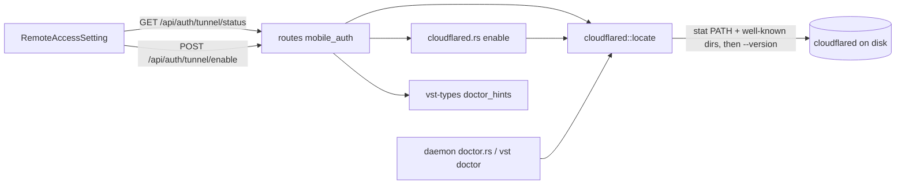

<!--
RULES — read before writing or implementing:
1. FORMAT: Bullets, tables, code, diagrams ONLY — no prose paragraphs
2. REQUIREMENTS: One crisp line each — no verbose descriptions
3. CHECKLIST: Mark items [x] as you complete them — this is your persistent todo list
4. READING TIME: Optimize for fast human scanning — if it's hard to skim, rewrite it
-->

# Plan: cloudflared-detached

> Stop bundling `cloudflared`; locate an installed one (PATH + well-known dirs), report Installed / NotInstalled / Unusable, and guide installation the way Tailscale does.

**Issue:** cloudflared-detached
**Branch:** `feat/cloudflared-detached`
**Status:** WIP
**PRD:** none (small feature)

**Reference files:**
- Locator pattern to copy: `rust/vst-lifecycle/src/tailscale_serve/locate.rs`
- Tunnel owner: `rust/vst-lifecycle/src/cloudflared.rs`
- Hint table: `rust/vst-types/src/rest/doctor_hints.rs`
- Wire types: `rust/vst-types/src/rest/mobile_auth.rs` ↔ `web-ui/src/api/types.ts`
- UI: `web-ui/src/components/settings/RemoteAccessSetting.tsx`, `web-ui/src/components/doctor/DoctorHintBlock.tsx`

---

## Problem & Concept

- Desktop bundle ships a `cloudflared` sidecar (download script, Tauri `externalBin`, CI steps, Dockerfile) — extra supply chain, licence entry, per-OS build matrix.
- `cloudflared.rs:107` spawns `VST_CLOUDFLARED_BIN` or bare `cloudflared`; a missing binary surfaces as an opaque `spawn failed: No such file` 500.
- Success: no binary bundled anywhere; Remote Access settings shows "cloudflared not installed" with per-OS commands from the hint table and a Re-check button; installing is picked up without a daemon restart.

## Out of Scope

- Auto-installing cloudflared; named/authenticated tunnels; reading cloudflared credentials/config.
- Shell-alias probing (tailscale's step 4) — cloudflared has no app-bundle/alias install path.
- Changes to `sweep_orphans` (pgrep by name stays).
- Any polling loop (push-don't-poll: fetch on mount / reconnect / Re-check only).

## Requirements

| # | Requirement |
|---|-------------|
| 1 | One owner (`cloudflared/locate.rs`) resolves path + version + state; no OS matches elsewhere |
| 2 | States: `installed{path,version}` / `not_installed` / `unusable{path,error}`; negative results never cached |
| 3 | Probe `cloudflared --version` bounded (3s timeout, `kill_on_drop`) |
| 4 | `VST_CLOUDFLARED_BIN` override still honoured and authoritative |
| 5 | `enable()` returns typed error (not spawn ENOENT) when not installed / unusable |
| 6 | Per-OS install commands only in `doctor_hints.rs` (macOS, Linux, Windows) |
| 7 | Boot restore with missing binary keeps persisted `enabled`, no crash-loop, resumes after Re-check |
| 8 | All bundling removed; dev image has no cloudflared |
| 9 | `types.ts` mirrored in the same commit as the `vst-types` change; new fields `Option` / `#[serde(default)]` |

---

## Change Map

```
rust/vst-lifecycle/src/
  cloudflared.rs            ~ use locator, typed errors
  cloudflared/locate.rs     + locate + probe + status
rust/vst-types/src/rest/
  mobile_auth.rs            ~ binary/hostOs/installHint fields
  doctor_hints.rs           ~ 3-OS cloudflared commands
rust/vst-routes/src/
  mobile_auth.rs            ~ status fills binary; typed enable error
rust/vst-daemon/src/
  doctor.rs                 ~ check from locator result
  server.rs                 ~ map new error to 409
rust/vst-cli/src/commands/
  doctor.rs                 ~ use locator not `which`
web-ui/src/
  api/types.ts              ~ mirror TunnelState fields
  components/settings/RemoteAccessSetting.tsx  ~ not-installed / unusable states
  components/settings/thirdPartyLicenses.ts    ~ drop cloudflared entry
desktop/src-tauri/src/
  main.rs                   ~ drop cloudflared path
  daemon.rs                 ~ drop VST_CLOUDFLARED_BIN env
scripts/
  download-cloudflared.sh   - deleted
  prep-sidecar.sh           ~ drop step 5
  dev-start.sh              ~ drop stub
```

`+` new file · `~` modified · `-` deleted · unmarked = context only.

| Today | After this plan |
|-------|-----------------|
| Binary = env var or bare name; missing → opaque 500 | Located from PATH + well-known dirs; missing → typed `cloudflared_not_installed` 409 |
| Desktop injects `VST_CLOUDFLARED_BIN` to bundled sidecar | Desktop relies on the locator (GUI PATH is minimal; well-known dirs cover brew) |
| Hint table has macOS-only command | macOS + Linux + Windows commands |
| Settings shows "Enable tunnel" always | Not-installed / unusable cards with commands + Re-check |
| Boot restore with missing binary logs a spawn failure | Logs once, keeps `enabled`, UI shows pending-resume |

---

## Research

- `rust/vst-lifecycle/src/cloudflared.rs:107` — only binary resolution; `:109-115` raw spawn error string.
- `rust/vst-lifecycle/src/cloudflared.rs:226-246` — `restore_on_boot` sweeps, then `enable_locked` if `enabled`; errors only logged.
- `rust/vst-lifecycle/src/tailscale_serve/locate.rs:24-60,99-156` — `Located`, pure `locate_in(...)` for tests, `effective_path` shell PATH, stat-only candidates; no negative cache for steps 1-3.
- `rust/vst-routes/src/tailscale.rs:189-190` — `NotInstalled { host_os: Some(std::env::consts::OS) }` is how the UI learns the host OS.
- `rust/vst-types/src/rest/doctor_hints.rs:155-160` — CLOUDFLARED spec macOS-only; `:~200-215` `hint_dto(name)` returns the wire `DoctorHintDto`; test at `:447-458` asserts `hint_for("cloudflared","linux") == None`.
- `web-ui/src/components/doctor/DoctorHintBlock.tsx:9-40` — renders a `DoctorHintDto` for `hostOs` (macOS/Linux switch, copy buttons); UI never hardcodes hints.
- `web-ui/src/components/settings/RemoteAccessSetting.tsx:287-360` — `TunnelCard`; `:677-690` fetch via `api.getTunnelStatus`; `:816-832` toggle; `:470-500` tailscale hardcodes its commands (do NOT copy that, use the hint block).
- `rust/vst-routes/src/mobile_auth.rs:403-445,500-525` — `enable_tunnel` / `tunnel_status`; `rust/vst-daemon/src/server.rs:~4792` maps `MobileAuthRouteError` to HTTP; `server.rs:931-933` routes (under `/api`).
- `rust/vst-daemon/src/doctor.rs:219-253` — `check_cloudflared` (env var then `which`); `:676-684` registers it via sync `with_timeout`; tailscale at `:257,687` takes a pre-located value (the pattern to copy).
- `rust/vst-cli/src/commands/doctor.rs:301` — `which("cloudflared")`; `vst-cli` already depends on `vst-lifecycle`.
- Vendor docs: macOS `brew install cloudflared` ([downloads page](https://developers.cloudflare.com/cloudflare-one/connections/connect-networks/downloads/)); apt/yum repo commands from [pkg.cloudflare.com](https://pkg.cloudflare.com/) (fetched 2026-10-29); Windows `winget install --id Cloudflare.cloudflared` is NOT on the docs page (it lists exe/msi only).

---

## Architecture Diagram



---

## Design Details

### CUJs

Not installed (happy discovery path):
```
User opens Settings → Remote Access
  → UI GET /api/auth/tunnel/status → binary.state = not_installed, installHint = {...}
  → Card shows "cloudflared isn't installed" + OS commands (DoctorHintBlock) + Re-check
  → User runs `brew install cloudflared` in a terminal, clicks Re-check
  → GET status re-runs locator → installed → "Enable tunnel" appears; no daemon restart
```
- Unusable: `binary.state = unusable` → card shows path + error (e.g. exec format, timeout) and the hint block; Enable hidden.
- Existing user, binary removed: boot restore skips, row stays `enabled=true`; UI shows not-installed + "will resume once installed"; Re-check finding it auto-calls enable once (Decision 5).
- Race: `enable` while binary vanishes between status and enable → typed 409 `cloudflared_not_installed`, UI re-fetches status.

### System Boundaries

**Module ↔ Module (in-process).** `vst_lifecycle::cloudflared::locate`:
```rust
// rust/vst-lifecycle/src/cloudflared/locate.rs
pub async fn resolve() -> CloudflaredBinary;                 // locate (stat) + probe (--version); never cached
pub fn find(override_bin: Option<&str>, path_env: &str, shell_path: &str,
            candidates: &[PathBuf]) -> FindResult;            // pure core for tests
pub fn candidates(home: Option<&Path>, os: &str) -> Vec<PathBuf>;
pub async fn probe(path: &Path, timeout: Duration) -> Result<String /*version*/, String /*error*/>;
```
- `CloudflaredBinary` lives in `vst-types` (wire type, no I/O) and is returned directly.
- Errors added to `CloudflaredError`: `NotInstalled`, `Unusable { path: String, error: String }`.

**Frontend ↔ Backend.** `GET /api/auth/tunnel/status` (existing route, extended; Re-check = same call):
```
200 TunnelStatus {
  enabled: bool, tunnelUrl: string|null, startedAt: number|null,   // unchanged
  binary?: CloudflaredBinary,        // NEW, #[serde(default)]; absent from older daemons
  hostOs?: string|null,              // NEW, std::env::consts::OS ("macos"|"linux"|"windows")
  installHint?: DoctorHintDto|null   // NEW, hint_dto("cloudflared") only when binary.state != installed
}
CloudflaredBinary =
  | { state: "installed", path: string, version: string }
  | { state: "not_installed" }
  | { state: "unusable", path: string, error: string }
```
- `POST /api/auth/tunnel/enable` new error: `409 { error: "cloudflared not installed — run: vst doctor", code: "cloudflared_not_installed" }`; unusable → `409 { error: "cloudflared at <path> is unusable: <err>", code: "cloudflared_unusable" }`. Other errors unchanged (existing 403/409/500).
- Source of truth: disk (re-evaluated per request); persisted intent: `vst_store` tunnel row (`enabled`).

### Key Decisions

#### Decision 1: Locator is a sibling module of the tunnel owner
- **Decision:** `cloudflared/locate.rs` declared `pub mod locate;` in `cloudflared.rs`; routes, doctor and CLI all call it; no OS matches outside it and the hint table.
- **Rationale:** mirrors `tailscale_serve/locate.rs`; keeps routes thin (AGENTS.md "Routes are thin").
- **Where:** `rust/vst-lifecycle/src/cloudflared.rs` (add `pub mod locate;`), `rust/vst-lifecycle/src/cloudflared/locate.rs`.

#### Decision 2: Resolution order and states
- **Decision:** (1) `VST_CLOUDFLARED_BIN` non-empty → authoritative: missing/not-executable → `unusable`, never falls through; (2) daemon `PATH` (`std::env::split_paths`, `.exe` on Windows); (3) `vst_agents::context::effective_path()` (user shell PATH, as tailscale step 2); (4) well-known: `/opt/homebrew/bin`, `/usr/local/bin`, `/usr/bin`, `$HOME/.local/bin`, Windows `%ProgramFiles%\cloudflared\`, `%ProgramFiles(x86)%\cloudflared\`, `%LOCALAPPDATA%\Microsoft\WinGet\Links\`. First executable hit is probed; no hit → `not_installed`.
- **Rationale:** a stale env var should be a visible error, not silently ignored; GUI-launched macOS daemons have a minimal PATH, hence step 4 (see Research § tailscale locate).
- **Where:** `rust/vst-lifecycle/src/cloudflared/locate.rs`.

#### Decision 3: Bounded probe, no caching
- **Decision:** `tokio::process::Command::new(path).arg("--version").kill_on_drop(true)` under `tokio::time::timeout(3s)`; exit≠0 / timeout / spawn error → `unusable{path,error}`; version = first line trimmed (tolerant parse of `cloudflared version X (built …)` → `X`, fallback whole line).
- **Rationale:** AGENTS.md "External probes are bounded"; stat+one short spawn is cheap enough per status call so a fresh install is seen immediately.
- **Where:** `locate.rs` `probe`.

#### Decision 4: Hints live only in the hint table; UI renders the DTO
- **Decision:** `CLOUDFLARED` HintSpec gets macOS `brew install cloudflared`, Windows `winget install --id Cloudflare.cloudflared` (verified: `manifests/c/Cloudflare/cloudflared` in microsoft/winget-pkgs, versions through 2026.10.x), Linux = TWO `HintOs::Linux` entries: (a) Cloudflare apt repo block (const `CLOUDFLARED_LINUX_APT`), (b) RHEL/Fedora `CLOUDFLARED_LINUX_RPM` = `curl -fsSL https://pkg.cloudflare.com/cloudflared.repo | sudo tee /etc/yum.repos.d/cloudflared.repo >/dev/null && sudo yum install cloudflared`; `docs_url` → `https://developers.cloudflare.com/cloudflare-one/networks/connectors/cloudflare-tunnel/downloads/` (current canonical URL; the older `/connections/connect-networks/downloads/` path is the pre-move one); `why` text updated. The status response carries `installHint` and `RemoteAccessSetting` renders `DoctorHintBlock` with `hostOs`.
- **Rationale:** the doctor module states "The web UI never hard-codes hint text"; avoids copying tailscale card's hardcoded commands. Two Linux entries render as two separate copy blocks (`DoctorHintBlock.commandsFor` returns every entry for the OS), so neither apt nor RHEL users paste a commented-out line.
- **Where:** `rust/vst-types/src/rest/doctor_hints.rs:155-160`, `RemoteAccessSetting.tsx`.
```
# apt block (verbatim from pkg.cloudflare.com, "Any Debian Based Distribution")
sudo mkdir -p --mode=0755 /usr/share/keyrings
curl -fsSL https://pkg.cloudflare.com/cloudflare-main.gpg | sudo tee /usr/share/keyrings/cloudflare-main.gpg >/dev/null
echo 'deb [signed-by=/usr/share/keyrings/cloudflare-main.gpg] https://pkg.cloudflare.com/cloudflared any main' | sudo tee /etc/apt/sources.list.d/cloudflared.list
sudo apt-get update && sudo apt-get install cloudflared
```

#### Decision 5: Existing users — intent kept, resume on Re-check
- **Decision:** `restore_on_boot` calls `locate::resolve()` after the sweep; if not `installed` it logs one warn and returns WITHOUT clearing the row (`enabled` stays true, no url/pid). `tunnel_status` reports `enabled:true, tunnelUrl:null` + `binary`. On the client, ONLY an explicit Re-check click that returns `binary.installed && enabled && !tunnelUrl` calls `api.enableTunnel()` once (`enable_locked` already proceeds when enabled-without-url); mount/reconnect fetches never auto-enable (several open tabs/devices must not each fire enable; a remote client would get 403). A 409 `AlreadyEnabled` from that call is treated as success (another tab won).
- **Rationale:** not silently off (intent preserved), no crash-loop (boot runs once, no retry timer), no new server poller; desktop no longer injects the env var (Decision 2 step 4 covers brew).
- **Where:** `rust/vst-lifecycle/src/cloudflared.rs:226-246`, `RemoteAccessSetting.tsx`.

#### Decision 6: Re-check is the existing GET; refetch triggers are mount + WS reconnect only
- **Decision:** no new route; `GET /auth/tunnel/status?binary=1` runs `resolve()` and fills `binary`/`hostOs`/`installHint`; WITHOUT the query the route does no probe and omits the three fields. Reason: `DashboardPanel.tsx:380-384` already polls `getTunnelStatus` every 30s for its header dot — probing there would spawn `cloudflared --version` every 30s per open dashboard. Only `RemoteAccessSetting` passes `binary=1` (`api.getTunnelStatus({ binary: true })`). UI refetches on mount, on the existing WS-reconnect signal the settings panel already uses (find via the hook `fetchTailscale` effect neighbours; if none exists, mount + Re-check only), and on the Re-check button.
- **Rationale:** one fewer route/type; no polling (AGENTS.md "Push, don't poll").
- **Where:** `rust/vst-routes/src/mobile_auth.rs:500-525`, `RemoteAccessSetting.tsx:677-690`.

#### Decision 7: Doctor checks reuse the locator result
- **Decision:** `check_cloudflared_binary(b: CloudflaredBinary) -> DoctorCheck` (pure, like `check_tailscale_binary`); caller awaits `locate::resolve()` under a 3s `tokio::time::timeout` (Timeout status on elapse) at `doctor.rs:676`. Installed → Ok "cloudflared <version> at <path>"; NotInstalled → Warn; Unusable → Warn with error. `vst doctor` replaces `which("cloudflared")` with `resolve()` and prints the same hint via `print_table_hint("cloudflared")`.
- **Where:** `rust/vst-daemon/src/doctor.rs:219-253,676-684`, `rust/vst-cli/src/commands/doctor.rs:301`.

#### Decision 8 (implemented): clippy gate uses the repo's deny groups, not `-D warnings`
- **Decision:** Phase 1 clippy is verified with `rust-gate.sh`'s args (`-D clippy::correctness -D clippy::suspicious -D clippy::complexity -D clippy::perf`) on the pinned toolchain (`rust-toolchain.toml` = 1.98.1).
- **Rationale:** `-D warnings` promotes every pedantic warn-level lint; `rust/Cargo.toml` [workspace.lints] documents Gotcha #12 (deliberately not denying the `warnings` group). The baseline already has ~40 pre-existing pedantic failures in untouched files (`vst-types/src/domain.rs`, `serde_ext.rs`, `ws.rs`, `vst-daemon/build.rs`, `vst-agy-stream-acp`), so 1.V2 as written cannot pass without unrelated edits.
- **Verified:** zero errors under the deny groups across `vst-lifecycle vst-types vst-routes vst-daemon vst-cli --all-targets`; no new warnings from any touched file.
- **Where:** `rust/scripts/rust-gate.sh`.

#### Decision 9 (implemented): route tests are deterministic via the override
- **Decision:** `GET /api/auth/tunnel/status` route tests live in `rust/vst-daemon/tests/tunnel_status_http.rs` (mounted under `/api`, per AGENTS.md) plus handle-level tests in `rust/vst-routes/tests/auth_routes.rs`. Every probe case sets `VST_CLOUDFLARED_BIN` (authoritative), so results do not depend on what is installed on the test machine; `not_installed` is covered by the pure `locate::find` unit test instead of a route test, because `effective_path()` may legitimately find a real cloudflared on a dev machine.
- **Rationale:** an env/PATH-based `not_installed` route test would be flaky on any machine with cloudflared installed.
- **Also:** the 409 body mapping (`code: "cloudflared_not_installed"` / `"cloudflared_unusable"`) is unit-tested inline in `server.rs` next to the private mapper; the HTTP test asserts the `unusable` path end-to-end.

#### Decision 10 (implemented): `restore_on_boot` split so tests never sweep processes
- **Decision:** `restore_on_boot` = `sweep_orphans_locked()` + `restore_locked(port, store)`; 1.T4 exercises `restore_locked` directly.
- **Rationale:** running the sweep from a unit test would kill a developer's own vst quick tunnel (AGENTS.md: never kill processes you didn't start).

#### Decision 11 (implemented): `find` signature kept as planned
- **Decision:** `find(override, path_env, shell_path: &str, candidates)` exactly as specified; `resolve` computes `effective_path()` inside the same `spawn_blocking` as the stat walk.
- **Rationale:** `effective_path()` is warmed once at daemon boot and cached, so the eager call is cheap; only the probe is async.

#### Decision 12 (implemented): sweep predicate also requires the `cloudflared` name
- **Decision:** `is_vst_quick_tunnel_args` = args contain `cloudflared` AND `tunnel --url http://127.0.0.1:`.
- **Rationale:** pgrep already guarantees the name, but the pure predicate is also used by the unit test with arbitrary args. A user running the identical quick-tunnel shape by hand is indistinguishable from ours and is still swept (documented on the predicate).

#### Decision 13 (implemented, phase 2): deviations taken while implementing 2.1-2.9 / 2.T*
- **`DoctorHintBlock` gained a Windows default** (`web-ui/src/components/doctor/DoctorHintBlock.tsx`): its macOS/Linux switch fell back to `linux` for any non-macOS host, so a Windows daemon would have been shown the apt commands instead of `winget install --id Cloudflare.cloudflared`. `selected = picked ?? (hostOs === "windows" ? "windows" : …)`; the macOS/Linux switch still overrides. Required by 2.T1 (and a latent bug for the existing doctor page on Windows).
- **2.T6 assertion excludes two known timers:** spying `setInterval` globally also sees the component's pre-existing 30s session-presence refresh and testing-library's own 50ms `waitFor` waiter (`checkRealTimersCallback`). The test asserts no *other* interval shorter than 30s — i.e. the tunnel status is never polled. A blanket "setInterval was not called" would fail on unrelated, pre-existing timers.
- **`prep-sidecar.sh` steps renumbered** (old 6/7 → 5/6) after deleting step 5, so the header list and the two `── Step N:` banners stay coherent. Pure comment edits; no script logic changed.
- **`dev.Dockerfile` keeps `ARG TARGETARCH`** — later harness-install `RUN`s (opencode/agy/cursor-agent) use `${TARGETARCH}`, so deleting the `ARG` would break them. Only the cloudflared `RUN` was deleted and its comment shortened to say what the arg is still for.
- **`desktop/src-tauri/src/daemon.rs:151` comment kept** (mentions cloudflared as a possible boot-blocker): still accurate — `restore_on_boot` probes the binary (3s) and may spawn before the ready line. 2.V2's grep therefore returns that one non-bundling comment.
- **`docs/AUTH.md` untouched** (lines 39/65 are neutral — they describe the tunnel protocol, not bundling). `README.md:298` and `docker-compose.dev.yml:107` left as planned.
- **2.V1 invocation:** the web script is already `vitest run`, so `pnpm --filter @vibestation/web test` is the run (passing `--run` is rejected by pnpm as an unknown option).
- **2.6 verification:** `cargo check` in `desktop/src-tauri` needs Tauri's build script to see the sidecar stubs and `vendor/claude-acp/node_modules`; both were created temporarily (gitignored) and removed after a clean check. Its 2 warnings (`pid` never read, deprecated `Shell::open`) are pre-existing and untouched by this phase.


---

## Risks / Open Questions

| # | Question | Notes |
|---|----------|-------|
| 1 | `winget` id `Cloudflare.cloudflared` not on the official docs page | Resolved in review: `microsoft/winget-pkgs/manifests/c/Cloudflare/cloudflared` exists, kept current (2026.10.x). No Windows daemon/desktop build ships today, so the Windows entry is informational |
| 2 | Linux hint is a multi-line apt block; RHEL users see apt text | Add RHEL line in the same command string; `docs_url` links the full page |
| 3 | In-flight branch edits `tauri.conf.json`, `prep-sidecar.sh`, workflows, `dev.Dockerfile`, README | Keep each edit a minimal line-local deletion to avoid conflicts |
| 4 | Process-env tests (`VST_CLOUDFLARED_BIN`) race other tests | Locator core takes the override as an argument; only the thin wrapper reads env |
| 6 | **(open, reviewer: HIGH)** `sweep_orphans` (`cloudflared.rs:248-280`) kills EVERY process named `cloudflared` at each daemon boot (`pgrep -x` + `ps -o comm=`). With the bundled copy gone, vst now spawns the user's own system cloudflared — exactly the users likely to run their own named tunnel (`brew services start cloudflared`, `cloudflared tunnel run`) as the same uid. Each vst boot would kill it | Recommend un-scoping: match `ps -o args=` for our quick-tunnel signature (`tunnel --url http://127.0.0.1:`) before killing; update `benchmarks/vstbench:48-53` comment. Author decides; if kept out of scope, state it in README's Remote Access section |
| 7 | Desktop reusing a still-running OLD daemon after app update keeps `VST_CLOUDFLARED_BIN` pointing into the replaced bundle → authoritative override → `unusable` card until daemon restart | Acceptable (visible state); make the `unusable` error text for an override say "set by VST_CLOUDFLARED_BIN — unset it or restart the daemon" |
| 5 | Existing test `RemoteAccessSetting.test.tsx:46` expects message "cloudflared not found" | Keep the 409 message text containing "cloudflared not found"-style wording only for generic errors; add new tests for code-based states |

---

## Implementation Phases

### Phase 1 — Backend: locator, status, hints, doctor, boot restore, types mirror

- [x] **1.1** `rust/vst-types/src/rest/mobile_auth.rs`: add `CloudflaredBinary` (`#[serde(tag="state", rename_all="snake_case")]`, variants `Installed{path,version}`, `NotInstalled`, `Unusable{path,error}`, camelCase fields) and extend `TunnelStatus` (line 32) with `#[serde(default, skip_serializing_if = "Option::is_none")] pub binary: Option<CloudflaredBinary>`, same attrs on `host_os: Option<String>` and `install_hint: Option<DoctorHintDto>` (import from `super::doctor`). `skip_serializing_if` is REQUIRED (the struct is deliberately not `skip_serializing_none` for its three old fields): it keeps the plain `GET /auth/tunnel/status` body byte-identical to `rust/vst-daemon/tests/fixtures/node_parity_fixtures.json:52-55`, which `tests/parity_harness.rs` compares byte-for-byte. Update every `TunnelStatus { .. }` literal (grep) with the new fields.
- [x] **1.2** `web-ui/src/api/types.ts:3-8`: add `CloudflaredBinary` union and optional `binary?`, `hostOs?: string | null`, `installHint?: DoctorHintDto | null` to `TunnelState` (same commit as 1.1).
- [x] **1.3** Create `rust/vst-lifecycle/src/cloudflared/locate.rs` per Decisions 1-3 (`resolve`, pure `find`, `candidates`, `probe`); add `pub mod locate;` to `rust/vst-lifecycle/src/cloudflared.rs`. `resolve` reads `VST_CLOUDFLARED_BIN`, `PATH`, `HOME`, `vst_agents::context::effective_path`; uses `is_executable` (unix mode bit / windows `is_file`) like tailscale's `locate.rs:155-165`. The stat walk + `effective_path()` (which may synchronously spawn the user's shell on first use, 5s bound) run inside `tokio::task::spawn_blocking` (as tailscale's `locate_async`), never directly on a runtime worker; only `probe` is async. Add `/opt/local/bin` (MacPorts) to unix candidates; Windows candidates behind `cfg!(windows)`/`os == "windows"` only (no Windows build ships today, so keep them minimal).
- [x] **1.4** `rust/vst-lifecycle/src/cloudflared.rs`: add `CloudflaredError::{NotInstalled, Unusable{path,error}}`; split so the binary is injectable: `enable(port, store)` = lock + `locate::resolve()` + `enable_with_binary_locked(port, store, bin: CloudflaredBinary)`; the latter (replacing the env/bare-name lookup at line 107) returns the typed errors before any spawn and spawns `bin.path` when installed. Keep the existing "already enabled with url → return url" check BEFORE resolving, so an active tunnel never needs a probe. Update module doc comment (remove "VST_CLOUDFLARED_BIN env var overrides" wording to "located via `locate`").
- [x] **1.5** `restore_on_boot` (same file, ~226): after the sweep, `resolve()`; if not installed, `tracing::warn!` once and return without touching the store row (Decision 5).
- [x] **1.5b** (Review finding 1, now IN SCOPE) `sweep_orphans_locked` / `is_likely_cloudflared_process` in `rust/vst-lifecycle/src/cloudflared.rs`: only kill a process whose `ps -o args=` contains vst's own quick-tunnel command line (`tunnel --url http://127.0.0.1:`), so a user's own `brew services`/`cloudflared tunnel run` is never killed at boot. Add a unit test on the pure args-matching predicate (vst quick-tunnel args -> true; `cloudflared tunnel run foo` -> false). Update the comment in `benchmarks/vstbench:48-53` if it describes the old behaviour.
- [x] **1.6** `rust/vst-types/src/rest/doctor_hints.rs:155-160`: new `CLOUDFLARED_LINUX_APT` const, three-OS `commands`, updated `why` and `docs_url` (Decision 4); update the test at ~447-458.
- [x] **1.7** `rust/vst-routes/src/mobile_auth.rs`: `tunnel_status(include_binary: bool)` (~460); only when `include_binary` it calls `resolve()`, fills `binary`, `host_os: Some(std::env::consts::OS.into())`, `install_hint: hint_dto("cloudflared")` when not installed (also in the `store: None` early-return branch); otherwise the three fields are `None`. `server.rs:4491` `handle_auth_tunnel_status` parses `Query<{ binary: Option<String> }>` (`"1"`/`"true"` → true). `web-ui/src/api/client.ts:1913` `getTunnelStatus(opts?: { binary?: boolean })` appends `?binary=1` (+ `mock.ts:2572` signature). Add `MobileAuthRouteError::{CloudflaredNotInstalled, CloudflaredUnusable{path,error}}` (error codes `conflict`), map `CloudflaredError::NotInstalled/Unusable` in `enable_tunnel` (~434).
- [x] **1.8** `rust/vst-daemon/src/server.rs` (~4792 `MobileAuthRouteError` match): both new variants -> `409` with `{error, code}` bodies per System Boundaries.
- [x] **1.9** `rust/vst-daemon/src/doctor.rs`: replace `check_cloudflared` with pure `check_cloudflared_binary(CloudflaredBinary)`; at ~676 call `locate::resolve()` under `tokio::time::timeout(3s)` (copy the tailscale block at ~687); update module comment line 8 and the comment at 676.
- [x] **1.10** `rust/vst-cli/src/commands/doctor.rs:301`: use `vst_lifecycle::cloudflared::locate::resolve().await` (installed -> ✓ with path/version; else ✗ + `print_table_hint("cloudflared")`).
- [x] **1.T1** Unit — `locate::find` (tempdir fake bins): override pointing at an executable -> found; override pointing at a missing path -> unusable (no fallthrough); PATH hit; shell-path hit; injected well-known dir hit; empty everything -> not found; file without exec bit is skipped (unix).
- [x] **1.T2** Unit — `locate::resolve`/`probe` with a tempdir shell script: prints `cloudflared version 2025.1.0 (built x)` -> `Installed{version:"2025.1.0"}`; exits 1 -> `Unusable`; `sleep 30` script -> `Unusable` within ~4s (timeout, child killed); non-executable (0644) file via override -> `Unusable`.
- [x] **1.T3** Unit — `enable_with_binary_locked` (tempdir store, binary injected, no env mutation): `NotInstalled` -> `CloudflaredError::NotInstalled`, `Unusable{..}` -> `CloudflaredError::Unusable`; asserts no store write and no process spawned; with a row `enabled=true,current_url=Some(..)` it returns the url without consulting the binary.
- [x] **1.T4** Unit — `restore_on_boot` with `enabled=true` row and missing binary: row still `enabled=true` afterwards, returns promptly.
- [x] **1.T5** Unit — `doctor_hints` : `hint_for("cloudflared", "macos"|"linux"|"windows")` return `brew install cloudflared` / string containing `pkg.cloudflare.com` / `winget install --id Cloudflare.cloudflared`; `hint_dto("cloudflared").commands` has all three OS tags and two `linux` entries (apt + `cloudflared.repo`); `docs_url` is the canonical `/cloudflare-one/networks/connectors/cloudflare-tunnel/downloads/` URL.
- [x] **1.T6** Unit — `check_cloudflared_binary`: Installed -> Ok with `resolved_path`; NotInstalled -> Warn, `required=false`; Unusable -> Warn, message contains the error. Replace `check_cloudflared_with_bundled_env_var` / `..._unset_falls_through_to_path` (`doctor.rs:~919-950`) accordingly.
- [x] **1.T7** Route — `rust/vst-routes/tests/auth_routes.rs`: mounted under `/api`, `GET /api/auth/tunnel/status` with the override env pointing at a fake bin returns `binary.state="installed"` + `hostOs`; with an empty-dir `PATH` and no override returns `not_installed` plus `installHint.commands` non-empty; `POST /api/auth/tunnel/enable` returns 409 `code:"cloudflared_not_installed"`. Serialise env mutation (mutex or `serial_test` if already a dev-dep).
- [x] **1.T7b** Regression — `rust/vst-daemon/tests/parity_harness.rs` passes UNCHANGED (plain `GET /auth/tunnel/status` body still `{"enabled":false,"tunnelUrl":null,"startedAt":null}`); do NOT add the URL to `is_structural_only` to make it pass. Add a route test that `?binary=1` includes `binary` and the plain call omits it.
- [x] **1.T8** Regression — `rust/vst-daemon/tests/doctor_routes_http.rs:93` still lists the `cloudflared` check; `rust/vst-daemon/tests/async_startup.rs` still passes (remove its `env_remove("VST_CLOUDFLARED_BIN")` only if the variable is no longer meaningful; leaving it is harmless).

**Verify phase 1:**
- [x] **1.V1** `cd rust && cargo test -p vst-lifecycle -p vst-types -p vst-routes -p vst-daemon` passes.
- [x] **1.V2** `cd rust && cargo clippy -p vst-lifecycle -p vst-types -p vst-routes -p vst-daemon -p vst-cli --all-targets -- -D warnings` clean; `cargo build -p vst-cli` succeeds.
- [x] **1.V3** `grep -rn "VST_CLOUDFLARED_BIN" rust --include=*.rs` shows only `locate.rs` (+ its tests, + optional `async_startup.rs`). Done: the only production read is `locate.rs`; other hits are doc comments and test-only overrides (`cloudflared.rs` tests, `vst-routes`/`vst-daemon` tests).

### Phase 2 — UI, bundling removal, docs, licences

- [x] **2.1** `web-ui/src/components/settings/RemoteAccessSetting.tsx`: extend `TunnelCard` (line 287) props with `binary`, `hostOs`, `installHint`, `onRecheck`, `rechecking`. When `binary?.state === "not_installed"`: info `StatusBox` "cloudflared isn't installed on this machine.", `<DoctorHintBlock hint={installHint} hostOs={hostOs ?? "linux"} />`, a "Re-check" button, and hide "Enable tunnel". When `unusable`: warn `StatusBox` with `binary.path` + `binary.error`, same hint block + Re-check. When `installed` or `binary` absent (older daemon): current behaviour. If `enabled && !tunnelUrl` and not installed, add text "Your tunnel will resume once cloudflared is installed."
- [x] **2.2** Same file, tunnel fetch (~677-690): store full `TunnelState` (incl. new fields); refetch on mount and on WS reconnect (reuse the reconnect signal this panel or its siblings already use; if none, mount + Re-check only); no `setInterval`/`setTimeout` loop. `handleRecheck` = fetch status; if the result is `binary.installed && enabled && !tunnelUrl`, call `api.enableTunnel()` once (Decision 5; Re-check click only, never on mount/reconnect; 409 already-enabled = success). Fix `handleToggleTunnel` (~816): branch on `tunnel.enabled && tunnel.tunnelUrl` (today a pending row `enabled:true,tunnelUrl:null` renders "Enable tunnel" but the click calls `disableTunnel`); `setTunnel` merges (`prev => ({ ...prev, ... })`) so `binary`/`hostOs`/`installHint` survive a toggle. Handle 409 body `code: "cloudflared_not_installed"|"cloudflared_unusable"` from `enableTunnel` by refetching status instead of only showing a toast.
- [x] **2.2b** `web-ui/src/components/layout/DashboardPanel.tsx:376`: `setTunnelEnabled(tunnelState.enabled && !!tunnelState.tunnelUrl)` (one line) — after upgrade, every former bundled-binary user has `enabled:true` with no running tunnel; the header must not claim a tunnel is up. Keep its existing call WITHOUT `binary` (no probe on the 30s poll).
- [x] **2.3** `web-ui/src/components/settings/thirdPartyLicenses.ts:27-32`: delete the `cloudflared` entry.
- [x] **2.4** Delete `scripts/download-cloudflared.sh`; `scripts/prep-sidecar.sh`: remove step 5 (lines ~125-129), header comment lines 2 and 18-19, and any final summary mention; `scripts/dev-start.sh`: remove the `CF_STUB` block (~lines 50-57).
- [x] **2.5** `desktop/src-tauri/tauri.conf.json:46`: `"externalBin": ["binaries/vst", "binaries/codex-acp"]`; `desktop/src-tauri/capabilities/default.json:17`: delete the `cloudflared` sidecar entry (mind JSON commas).
- [x] **2.6** `desktop/src-tauri/src/main.rs` (~27-40, 81): remove `cloudflared_bin` resolution and the argument; `desktop/src-tauri/src/daemon.rs` (~77-105): drop the `cloudflared_bin` parameter, its doc line, the UTF-8 conversion and `.env("VST_CLOUDFLARED_BIN", ...)`; fix the comment at ~160 only if it names cloudflared as a boot-blocker. Verify with `cd desktop/src-tauri && cargo check` if it builds locally.
- [x] **2.7** `.github/workflows/desktop-build.yml` (~80-84 comments, plus any step/arg that downloads/places cloudflared); grep `release.yml` too (currently no match) — line-local deletions only.
- [x] **2.8** `dev.Dockerfile:49-53`: delete the cloudflared `RUN` (lines 51-53) and its `ARG TARGETARCH` comment ONLY if no later line in the file uses `TARGETARCH` (grep first; keep the `ARG` if used). Image must not contain cloudflared afterwards. Leave `docker-compose.dev.yml:107` comment (it is about the tunnel target, not the binary).
- [x] **2.9** Docs: `README.md` lines 106, 172, 347, 385, 401 ("bundled"/"ships" -> "install separately, e.g. `brew install cloudflared`; the Remote Access page and `vst doctor` guide you"; line 347 drop `cloudflared` and `scripts/download-cloudflared.sh`); `docs/ARCHITECTURE.md` lines 62, 95, 120 (remove "bundled"/sidecar and the copy of `cloudflared` into binaries); `docs/AUTH.md` only if wording says "bundled" (lines 39, 65 appear neutral; leave if so). Also the doc comment at `RemoteAccessSetting.tsx:36` (quotes the old "cloudflared not found" 500). Neutral, leave: `README.md:298`, `web-ui/src/api/client.ts:2013`, `docker-compose.dev.yml:107`, `benchmarks/vstbench:48-53` (unless Risk 6 narrows the sweep — then update its comment), `rust/.gate/*.log` (stale gate logs).
- [x] **2.T1** UI — `RemoteAccessSetting.test.tsx`: `getTunnelStatus` resolves `{binary:{state:"not_installed"}, hostOs:"macos", installHint:{...3 OS commands}}` -> text "cloudflared isn't installed" and `brew install cloudflared` shown, "Enable tunnel" absent; repeat with `hostOs:"linux"` (apt block, `pkg.cloudflare.com`) and `"windows"` (`winget install --id Cloudflare.cloudflared`).
- [x] **2.T2** UI — Re-check: not-installed first, then installed on second `getTunnelStatus` -> clicking "Re-check" calls it again (2 calls total, assert `toHaveBeenCalledTimes`) and "Enable tunnel" appears.
- [x] **2.T3** UI — pending resume: first `{enabled:true,tunnelUrl:null,binary:not_installed}`, after Re-check `{enabled:true,tunnelUrl:null,binary:installed}` -> `enableTunnel` called exactly once; and not called when binary is still not installed.
- [x] **2.T4** UI — unusable: shows the path and error text, hint block, no Enable button.
- [x] **2.T5** UI regression — status without `binary` (older daemon) and `installed` render the existing Enable/active cards; existing tests in the file that mention the old "cloudflared not found" 500 text (line ~46-52) keep passing or are updated to the 409 `code` shape.
- [x] **2.T6** UI — no timers: spying `setInterval` is not called by the not-installed card (guards push-don't-poll).
- [x] **2.T7** UI — pending row (`enabled:true,tunnelUrl:null`, installed): clicking "Enable tunnel" calls `enableTunnel`, NOT `disableTunnel`; mount alone never calls `enableTunnel`; `getTunnelStatus` called with `{ binary: true }`.
- [x] **2.T8** UI — `DashboardPanel` header: `{enabled:true,tunnelUrl:null}` does not show the tunnel-on indicator; its `getTunnelStatus` call has no `binary` option.

**Verify phase 2:**
- [x] **2.V1** `pnpm --filter @vibestation/web exec tsc --noEmit && pnpm --filter @vibestation/web test --run` passes.
- [x] **2.V2** `grep -rIn -i "cloudflared" desktop scripts .github dev.Dockerfile web-ui/src/components/settings/thirdPartyLicenses.ts` returns no bundling references (only an intentional README/docs "install separately" mention).
- [x] **2.V3** `cd rust && cargo test -p vst-lifecycle -p vst-types -p vst-routes -p vst-daemon` still passes (Phase 1 gate unchanged).
- [ ] **2.V4** Manual (sandbox, `scripts/dev-sandbox.sh up`, image now has no cloudflared): Settings -> Remote Access shows the not-installed card with Linux commands (apt + RHEL blocks); dropping a fake `cloudflared` script (prints `cloudflared version 2026.1.0 (built x)`) into `$HOME/.local/bin` in the container (no root needed) and clicking Re-check flips to "Enable tunnel" without a restart. Note the sandbox runs `VST_NO_AUTH=1`, so actually enabling returns the existing NoAuthMode 409 — verify enable on a native authed daemon (isolated HOME/port per AGENTS.md "Killing processes") with a real `brew install cloudflared`.

---

## Files & Phase Impact

| File | Status | Phase | Description / Contract Change |
|------|--------|-------|-------------------------------|
| `rust/vst-types/src/rest/mobile_auth.rs` | **Modified** | 1.1 | Contract: `CloudflaredBinary` enum; `TunnelStatus` + `binary`, `host_os`, `install_hint` (all `#[serde(default)]`) |
| `web-ui/src/api/types.ts` | **Modified** | 1.2 | Mirror of the above on `TunnelState` |
| `rust/vst-lifecycle/src/cloudflared/locate.rs` | **New** | 1.3 | Contract: `async resolve() -> CloudflaredBinary`, pure `find(...)`, `candidates(...)`, `probe(...)` · Owns: nothing (stateless, no cache) |
| `rust/vst-lifecycle/src/cloudflared.rs` | **Modified** | 1.3-1.5 | `pub mod locate;`; `CloudflaredError::{NotInstalled,Unusable}`; enable/restore use the locator · Owns: tunnel lock (unchanged) |
| `rust/vst-types/src/rest/doctor_hints.rs` | **Modified** | 1.6 | CLOUDFLARED HintSpec: macOS + Linux + Windows commands, docs_url |
| `rust/vst-routes/src/mobile_auth.rs` | **Modified** | 1.7 | `tunnel_status` fills new fields; new `MobileAuthRouteError` variants |
| `rust/vst-daemon/src/server.rs` | **Modified** | 1.8 | 409 mapping with `code` for new variants |
| `rust/vst-daemon/src/doctor.rs` | **Modified** | 1.9 | `check_cloudflared_binary(CloudflaredBinary)` replaces env/`which` check |
| `rust/vst-cli/src/commands/doctor.rs` | **Modified** | 1.10 | `resolve()` instead of `which("cloudflared")` |
| `rust/vst-lifecycle/src/cloudflared/locate.rs` tests (inline `#[cfg(test)]`) | **New** | 1.T1-1.T2 | locator unit tests |
| `rust/vst-lifecycle/src/cloudflared.rs` tests (inline) | **Modified** | 1.T3-1.T4 | enable/restore typed-error tests |
| `rust/vst-types/src/rest/doctor_hints.rs` tests (inline) | **Modified** | 1.T5 | 3-OS assertions replace `linux == None` |
| `rust/vst-daemon/src/doctor.rs` tests (inline) | **Modified** | 1.T6 | replace bundled-env tests |
| `rust/vst-routes/tests/auth_routes.rs` | **Modified** | 1.T7 | status + enable route tests under `/api` |
| `rust/vst-daemon/tests/tunnel_status_http.rs` | **New** | 1.T7/1.T7b | HTTP route tests under `/api`: plain status body byte-identical, `?binary=1` probe, 409 `code` on enable |
| `rust/vst-daemon/tests/doctor_routes_http.rs`, `async_startup.rs` | **Unchanged/Modified** | 1.T8 | regression; optional env_remove cleanup |
| `web-ui/src/components/settings/RemoteAccessSetting.tsx` | **Modified** | 2.1-2.2 | not-installed/unusable states, Re-check, one-shot resume · no timers |
| `web-ui/src/components/settings/RemoteAccessSetting.test.tsx` | **Modified** | 2.T1-2.T6 | new UI tests; adjust old cloudflared-not-found test |
| `web-ui/src/components/settings/thirdPartyLicenses.ts` | **Modified** | 2.3 | remove cloudflared entry |
| `web-ui/src/api/client.ts`, `web-ui/src/api/mock.ts` | **Modified** | 1.7 | `getTunnelStatus({ binary })` → `?binary=1` |
| `web-ui/src/components/layout/DashboardPanel.tsx` | **Modified** | 2.2b | header dot = `enabled && tunnelUrl` (one line) |
| `rust/vst-daemon/tests/parity_harness.rs` + fixture | **Unchanged** | 1.T7b | must still pass byte-for-byte |
| `scripts/download-cloudflared.sh` | **Deleted** | 2.4 | no longer bundled |
| `scripts/prep-sidecar.sh` | **Modified** | 2.4 | drop step 5 + header lines |
| `scripts/dev-start.sh` | **Modified** | 2.4 | drop cloudflared stub |
| `desktop/src-tauri/tauri.conf.json` | **Modified** | 2.5 | `externalBin` without cloudflared |
| `desktop/src-tauri/capabilities/default.json` | **Modified** | 2.5 | drop sidecar permission |
| `desktop/src-tauri/src/main.rs` | **Modified** | 2.6 | drop `cloudflared_bin` |
| `desktop/src-tauri/src/daemon.rs` | **Modified** | 2.6 | drop param + `VST_CLOUDFLARED_BIN` env |
| `.github/workflows/desktop-build.yml` | **Modified** | 2.7 | remove cloudflared mentions/steps (line-local) |
| `dev.Dockerfile` | **Modified** | 2.8 | remove cloudflared download RUN |
| `README.md`, `docs/ARCHITECTURE.md`, `docs/AUTH.md` | **Modified** | 2.9 | "install separately" wording |
| `docs/STATUS-INDICATORS.md` | **Unchanged** | - | not a session-status change |

**Gate (both phases):**
- `cd rust && cargo test -p vst-lifecycle -p vst-types -p vst-routes -p vst-daemon`
- `pnpm --filter @vibestation/web exec tsc --noEmit && pnpm --filter @vibestation/web test --run`

---

## Review

Reviewer pass 2026-10-29 (repo source + Cloudflare docs, pkg.cloudflare.com, microsoft/winget-pkgs). Edits made in place:

- Decision 4 / 1.T5: `docs_url` → current canonical `developers.cloudflare.com/cloudflare-one/networks/connectors/cloudflare-tunnel/downloads/`; Linux hint = two entries (apt + RHEL `cloudflared.repo`), not a comment-prefixed line; winget id verified (Risk 1 resolved).
- Decision 6 / 1.1 / 1.7 / 1.T7b: probe only on `GET /auth/tunnel/status?binary=1`. `DashboardPanel` polls this route every 30s, and an unconditional probe would spawn `cloudflared --version` on every poll. The new fields use `skip_serializing_if`, so `parity_harness.rs` (a byte-for-byte check against the Node fixture) still passes; as first written, the plan would have failed 1.V1.
- 1.3: the locator's stat walk and `effective_path()` run in `spawn_blocking`; MacPorts dir added; Windows candidates gated.
- 1.4 / 1.T3: the resolved binary is injected through `enable_with_binary_locked`, so tests need no PATH/env mutation; an active tunnel skips the probe.
- Decision 5 / 2.2 / 2.T7: auto-resume only on an explicit Re-check click, and 409 already-enabled counts as success. Fixed an existing toggle bug that a pending row (`enabled:true,tunnelUrl:null`) exposes: "Enable tunnel" called `disableTunnel`. State updates are now merged.
- 2.2b / 2.T8: the Dashboard header dot shows `enabled && tunnelUrl`. Upgraders keep `enabled:true` with no tunnel running.
- 2.9: added the leftover references (the `RemoteAccessSetting.tsx:36` comment) and listed the neutral ones on purpose.
- 2.V4: the sandbox is `VST_NO_AUTH`, so enable always 409s there. The fake binary goes in `~/.local/bin`, and enable is checked on a native authed daemon.
- Risks 6 and 7 added (judgement calls, not resolved by the reviewer).
