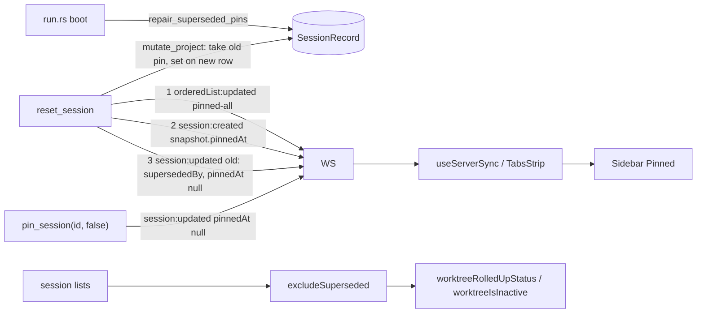

<!--
RULES — read before writing or implementing:
1. FORMAT: Bullets, tables, code, diagrams ONLY — no prose paragraphs
2. REQUIREMENTS: One crisp line each — no verbose descriptions
3. CHECKLIST: Mark items [x] as you complete them — this is your persistent todo list
4. READING TIME: Optimize for fast human scanning — if it's hard to skim, rewrite it
-->

# Plan 02: Reset keeps pins + status rollups ignore superseded sessions

> Follow-up to `plan-reset-handoff-fix.md`: the pin follows the conversation onto the reset replacement (live, and repaired for already-reset data), and no status dot/rollup is driven by a hidden superseded session.

**Issue:** reset-handoff-fix
**Branch:** `fix/reset-handoff-timeout-and-previous-sessions`
**Status:** Complete
**PRD:** none (bug fix)
**Parent:** `plan-reset-handoff-fix.md` (base commit `24b22cb5`)

**Reference files:**
- Reset: `rust/vst-routes/src/sessions.rs` (`reset_session` 2981, `new_session` 3107, `pinned_at: None` 3151, `mutate_project` 3166, `archive` closure 3172, `SessionCreated` 3247, old-row `SessionUpdated` 3259)
- Pin handler: `rust/vst-routes/src/sessions.rs` (`pin_session` 2345, broadcast ~2373, `MutateError` 5488)
- Wire: `rust/vst-types/src/events.rs` (`SessionUpdated` 56, `pinned_at` 58-59, `parent_session_id` tri-state pattern 74-75), `rust/vst-types/src/ws.rs` (`SessionUpdated` 130, `pinned_at` 132-133, `parent_session_id` 151-152, snapshot `pinned_at` 386/459), `rust/vst-ws/src/broadcaster.rs` (190-218, maps fields by name)
- Ordered list: `rust/vst-store/src/ordered_lists.rs` (`get_ordered_list` 42, `set_ordered_list` 64), `rust/vst-types/src/rest/ordered_lists.rs` (`PINNED_ALL` 36), event `ServerEvent::OrderedListUpdated`
- Boot hook: `rust/vst-daemon/src/run.rs` (411, `backfill_session_mode_icons` call), model: `rust/vst-routes/src/modes.rs` (`backfill_session_mode_icons` 175)
- Client sync: `web-ui/src/hooks/useServerSync.ts` (`session:updated` 385-411), `web-ui/src/components/layout/TabsStrip.tsx` (local handler 553-575), `web-ui/src/api/mock.ts` (`resetSession` ~931-972), `web-ui/src/api/types.ts` (`pinnedAt?: string | null` 698)
- Rollups: `web-ui/src/lib/worktreeStatus.ts` (`worktreeRolledUpStatus` 61), `web-ui/src/lib/sessionVisibility.ts` (`isSupersededSession`), `web-ui/src/components/layout/LeftSidebar.tsx` (`worktreeIsInactive` 192)
- Docs: `docs/STATUS-INDICATORS.md` (§ Where each surface reads from, line 124)
- Rules: `AGENTS.md` — status axes rule (status change = update `docs/STATUS-INDICATORS.md` in same commit); `sessionStates[id] ?? session.state`

---

## Problem & Concept

- Defect A: `reset_session` builds the replacement with `pinned_at: None` (`sessions.rs:3151`) and the sidebar hides the old (superseded) pinned row, so resetting a pinned agent silently drops it from Pinned.
- Defect A2: the wire cannot express an unpin (`pinned_at: None` is skipped on serialize), so neither `pin_session(false)` nor a pin move reaches clients live.
- Defect B: `worktreeRolledUpStatus` / `worktreeIsInactive` iterate every agent in the worktree incl. superseded rows, so a worktree dot (and "Hide done") can be driven by an agent with no visible row.
- Success: pin moves to the replacement with the same `pinned_at` (also for already-reset data); unpin/clear is visible live; rollups see only visible agents.

## Out of Scope

- `archivedAt` / `done` semantics in rollups, dashboard bucketing, `worktreePrStatus` — unchanged (superseded rows are never `isMain`, so PR resolution is unaffected).
- Other reset-like creators: none exist (see Research).
- Pinned WORKTREE sessions get only a pin glyph (`LeftSidebar.tsx:2526/2918`), not a Pinned-section row — the `pinned-all` swap is a no-op for them (the id is never in that list; only direct sessions and worktrees are).

## Requirements

| # | Requirement |
|---|-------------|
| 1 | Reset of a pinned session (worktree or direct) gives the replacement the old row's exact `pinned_at`; reset-of-a-reset (a→b→c) ends with the pin on c only |
| 2 | The old row's `pinned_at` is cleared in the SAME `mutate_project` call (single pin owner, race-safe under the project lock) |
| 3 | `SessionCreated` snapshot carries the carried `pinnedAt`; old row's `session:updated` carries `pinnedAt: null` iff a pin moved |
| 4 | `session:updated.pinnedAt` can express a clear (tri-state): `pin_session(false)` is now seen live by every client |
| 5 | If the old id is in `pinned-all`, the replacement takes its slot and `orderedList:updated` is broadcast BEFORE `session:created` |
| 6 | Unpinned old session: replacement unpinned, no ordered-list touch, no `pinnedAt` in the old row's event |
| 7 | `pin_session` on a superseded id acts on the live head of the `superseded_by` chain (never creates a second pin owner) |
| 8 | Boot repair: already-reset data (pin stranded on a hidden superseded row) is moved to the chain head, idempotently |
| 9 | `worktreeRolledUpStatus` / `worktreeIsInactive` ignore a session iff `supersededBy != null` AND that id is present in the same list; dangling `supersededBy` still counts |
| 10 | One shared helper; callers need no per-site patching |

---

## Change Map

```
rust/vst-types/src/
  events.rs                ~ pinned_at tri-state
  ws.rs                    ~ pinned_at tri-state
rust/vst-routes/src/
  sessions.rs              ~ carry pin, pin chain, repair fn
rust/vst-daemon/src/
  run.rs                   ~ call boot repair
web-ui/src/lib/
  sessionVisibility.ts     ~ add excludeSuperseded helper
  worktreeStatus.ts        ~ rollup uses helper
web-ui/src/hooks/
  useServerSync.ts         ~ supersededBy clears pin
web-ui/src/components/layout/
  TabsStrip.tsx            ~ supersededBy clears pin
  LeftSidebar.tsx          ~ worktreeIsInactive uses helper
web-ui/src/api/
  mock.ts                  ~ resetSession carries pin
docs/
  STATUS-INDICATORS.md     ~ document rollup exclusion
```

`+` new file · `~` modified · unmarked = context only.

| Today | After this plan |
|-------|-----------------|
| Reset replacement is unpinned; old pinned row hidden → agent vanishes from Pinned | Replacement keeps `pinned_at`; old row unpinned; Pinned row (and drag position) preserved |
| Unpin (and any pin clear) never reaches other clients or the pinner's own sidebar (`LeftSidebar.tsx:3305` has no optimistic update) | `session:updated { pinnedAt: null }` clears live |
| Previously-reset pinned agents stay stranded on hidden rows | Boot repair moves the pin to the live head once |
| Rollup/"Hide done" count superseded agents (an old `exited` row blocks a `done` worktree being "inactive") | Superseded agents with an existing replacement contribute nothing |

---

## Research

- `sessions.rs:3151` — replacement hardcodes `pinned_at: None`; the `archive` closure (3172-3181) never touches `pinned_at`.
- `sessions.rs:3166-3231` — `mutate_project` result is discarded; it returns the updated `ProjectRecord`, usable to read the authoritative carried pin. Its closure is `FnOnce` (`vst-store/src/lib.rs:221`), so no `Arc<Mutex<>>` is needed.
- `sessions.rs:3247-3274` — `SessionCreated.snapshot` is built from the in-memory `new_session` (3107), so its `pinned_at` must be set before serializing.
- `events.rs:58-59` / `ws.rs:132-133` — `pinned_at: Option<String>` with `skip_serializing_if = "Option::is_none"`: `None` omits the key, so a clear is unrepresentable. `parent_session_id: Option<Option<String>>` with `#[serde(default, skip_serializing_if = "Option::is_none")]` (events.rs:74-75, ws.rs:151-152) already solves exactly this and `wire.rs:171-182` tests it.
- `broadcaster.rs:190-218` — `SessionUpdated` mapped by field name; type change needs no edit there. `types.ts:698` already `pinnedAt?: string | null`; `useServerSync.ts:394` and `TabsStrip.tsx:562` already do `ev.pinnedAt ?? null`.
- `LeftSidebar.tsx:344-346,396-402,528-536` — Pinned sorts by `pinnedAt` DESC then `applyLocalSortOrder(sortOrders["pinned-all"], ids)` (152-160), which puts ids absent from the stored order LAST → replacement jumps to the end of a hand-ordered list unless the stored id is swapped.
- `rust/vst-routes/src/ordered_lists.rs:80-92` — PUT persists with `store.set_ordered_list` then broadcasts `OrderedListUpdated { scope_key, item_ids, updated_at }`; `reset_session` has `self.store`/`self.broadcaster` and can do the same.
- `run.rs:411` — existing boot-time idempotent backfill (`backfill_session_mode_icons`) with `mutate_project` per project, failures logged non-fatally; the right home for the pin repair. No generic migration framework exists (`grep migrate|repair` → only manifest→SQLite migration).
- `grep superseded_by = ` in `rust/` (non-test) — only `sessions.rs:3179`; no other archive+replace creator.
- `b1.rs:895-914` — `pin_session` idempotency test; `session.superseded_by` is available on the `ctx` row in `pin_session` (2345-2360).
- Rollup callers: `LeftSidebar.tsx:1840`, `:2722` (dot, `sessionMap[w.id]` full list), `:2583` (`worktreeIsInactive`), `CollapsedProjectRail.tsx:110` (`projectStatus`: direct list already filtered, worktree lists not), `:367` (flyout row), `WorkspaceCanvas.tsx:536` (already pre-filters `archivedAt == null`).
- **Root cause A:** reset never carries `pinned_at`; the wire can't carry clears. **Root cause B:** rollups predate "superseded rows are hidden" and filter only by type.

---

## Architecture Diagram



---

## Design Details

### System Boundaries

| Boundary | Contract | Errors | Source of truth |
|----------|----------|--------|-----------------|
| Daemon → clients (WS) | `session:updated.pinnedAt`: key absent = no change · `string` = pinned · `null` = cleared (tri-state; Rust `Option<Option<String>>`, `Some(None)` serializes `"pinnedAt": null`; serde reads `null` back as outer `None`, no Rust consumer deserializes this event) | none new | daemon store |
| Daemon → clients (WS) | `session:created.snapshot.pinnedAt: string \| null` = carried pin | none | daemon store |
| REST `PATCH /sessions/:id/pin` | response `{ ok, pinnedAt: string \| null }` unchanged; id may be a superseded session — the response/broadcast refer to the live head | `404` unchanged | daemon store |
| REST lists | old row `pinnedAt: null`, replacement `pinnedAt: <old value>` | none | daemon store |

### Key Decisions

1. **Clear the old row's pin (single pin owner).** Where: `sessions.rs` `archive` closure.
   - Leaving it lets a hidden row hold a pin (ghost after unpinning the replacement; reappears pinned if the replacement is deleted).
   - Orphan case (replacement deleted → old row reappears, dangling `supersededBy`): old row is UNPINNED; the user can re-pin. Accepted.
2. **Carry inside the locked mutation; read back from the returned project.** Where: `sessions.rs:3166-3231`.
   - `archive` becomes `Result<Option<String>, StoreError>` returning `s.pinned_at.take()`; then `let mut rec = new_rec.clone(); rec.pinned_at = carried.clone(); push(rec)` in both branches (3196, 3214); the closure's result is returned out via a local captured by the `FnOnce`/via the returned project.
   - After `.await`, look the new row up by `new_id` in the returned `ProjectRecord` (worktree sessions or `direct_sessions`) and set `new_session.pinned_at` from it; all downstream steps (swap, snapshot, spawn opts) key off this authoritative `carried`, never the pre-read `session.pinned_at` (3107).
3. **Make `session:updated.pinned_at` tri-state (pattern of `parent_session_id`).** Where: `events.rs:58-59`, `ws.rs:132-133`.
   - `#[serde(default, skip_serializing_if = "Option::is_none")] pinned_at: Option<Option<String>>`.
   - `pin_session` (~2373) sends `pinned_at: Some(next_pinned_at.clone())` (pin → `Some(Some(ts))`, unpin → `Some(None)`).
   - Reset's old-row `SessionUpdated` (3259) sends `Some(None)` ONLY when a pin actually moved (`carried.is_some()`); every other `SessionUpdated` site stays `pinned_at: None` (compile fix-ups: `pr_poller.rs`, `broadcaster.rs` pass-through, `b1.rs`, `wire.rs:144,174` literals).
   - Client: no handler change needed for the wire (`ev.pinnedAt ?? null` exists). The extra `if (ev.supersededBy) patch.pinnedAt = null` in `useServerSync`/`TabsStrip` is kept as belt-and-braces for an older daemon/ordering and costs one line.
4. **Event order: `OrderedListUpdated` → `SessionCreated` → `SessionUpdated(old)`.** Where: `sessions.rs` after the mutation.
   - The list is already updated when the new id first renders, so the replacement lands in its slot; `SessionCreated` still precedes the old-row update (clients need the new id before following `supersededBy`, existing comment at 3257).
   - Swap runs only when `carried.is_some()`: `get_ordered_list(PINNED_ALL)`; if it contains `old_id`, replace in place, `set_ordered_list`, broadcast; absent → no-op.
5. **`pin_session` on a superseded id resolves to the live head (not 409).** Where: `sessions.rs:2345`.
   - Walk `superseded_by` via `find_session_context` (hop cap 32, stop on missing/dangling → act on the last existing row); then pin/unpin the head and broadcast with the head's id.
   - Justification: stale clients/CLI holding the old id mean "this conversation"; a 409 would strand the user, a no-op would mislead. Never writes a pin onto a hidden row.
6. **Boot repair `repair_superseded_pins(store) -> Vec<String>` (option a).** Where: `sessions.rs` (pub fn) called from `run.rs:411` next to `backfill_session_mode_icons`.
   - Per project, one `mutate_project` only if any superseded row has `pinned_at`: for each such row follow `superseded_by` (within the project, cycle/hop guarded) to the head = last EXISTING row in the chain; if the chain ends at a dangling id the row itself is the head → untouched.
   - If head has no pin, it takes the latest `pinned_at` among the chain's pinned superseded rows; superseded rows' pins are always cleared (single owner). Head already pinned → just clear stale pins.
   - Then swap old id → head id in `pinned-all` if present (drop the old id if the head id is already there). No broadcast (boot, no clients). Idempotent: a second run finds no pinned superseded rows.
   - Why (a): a clean precedent boot hook exists (`run.rs:411`), the repair is small, and without it every existing user's already-reset pinned agent stays lost.
7. **Rollup exclusion in one pure helper, applied inside `worktreeStatus.ts`.** Where: `sessionVisibility.ts`, `worktreeStatus.ts:61`, `LeftSidebar.tsx:192`.
   - `excludeSuperseded(sessions)` resolves `supersededBy` against the list it is GIVEN (per worktree / per project via `isSupersededSession`); matches the sidebar's global `sessionById` because reset never moves a session across worktrees/projects; dangling kept.
   - Cycle `a↔b` → both dropped → `none`; cannot arise from reset.

### Caller coverage (Defect B)

| Caller | Input list | Covered by |
|--------|-----------|------------|
| `LeftSidebar.tsx:1840`, `:2722` | `sessionMap[w.id]` (full worktree list) | `worktreeRolledUpStatus` internal filter |
| `LeftSidebar.tsx:2583` | same | `worktreeIsInactive` internal filter |
| `CollapsedProjectRail.tsx:110` (project dot), `:367` (flyout row) | direct (already filtered) + worktree lists | `worktreeRolledUpStatus` internal filter |
| `WorkspaceCanvas.tsx:536` | live non-archived agents | already excluded (archived); filter is a no-op |
| `DashboardPanel.tsx`, `ProjectHomeTab.tsx` | per-session, `archivedAt == null` | no lifecycle rollup; unchanged |
| `worktreePrStatus` (`statusColor.ts:17`) | `isMain` only | superseded rows have `isMain=false`; unchanged |

---

## Risks / Open Questions

| # | Question | Notes |
|---|----------|-------|
| 1 | Reset while another client toggles the pin | Safe: head resolution and write both happen under the project lock. |
| 2 | Other `session:updated` consumers of `pinnedAt` | Only `useServerSync.ts` and `TabsStrip.tsx` patch it; grep `ev.pinnedAt` before finishing. |
| 3 | Accepted: each WS message renders separately | 1-2 frames of transient ordering in Pinned (list update, created, old-row clear). |
| 4 | Accepted: a drag `PUT pinned-all` built from a pre-reset view can write the old id back after the swap | Replacement goes to the end of Pinned; self-heals on the next drag. |
| 5 | Boot repair vs. a user who deliberately kept a hidden pin | Not possible: superseded rows are hidden in every UI surface, so a pin there is never user-visible intent. |
| 6 | `worktreeIsInactive`/rollup change for worktrees with an old `exited` superseded row | Intended: replacement `done` now makes the worktree inactive (2.T3). |

---

## Implementation Phases

### Phase 1 — Daemon: wire, reset carry, pin chain, boot repair (Defects A, A2)

- [x] **1.1** `rust/vst-routes/src/sessions.rs` `reset_session`: change `archive` (3172) to return `Result<Option<String>, StoreError>` (`Ok(s.pinned_at.take())`); in both branches (3196, 3214) push `{ let mut rec = new_rec.clone(); rec.pinned_at = carried.clone(); rec }`; keep `pinned_at: None` at 3151.
- [x] **1.1a** Same fn: capture the returned `ProjectRecord` from `mutate_project`, find the new row by `new_id` (worktree sessions or `direct_sessions`), set `new_session.pinned_at` from it (authoritative `carried`).
- [x] **1.1b** `pin_session` (2345): resolve `ctx` to the live head along `superseded_by` (Decision 5) before the idempotency check, mutation and broadcast; use the head's id everywhere below.
- [x] **1.2** `rust/vst-types/src/events.rs:58-59` and `ws.rs:132-133`: `pinned_at: Option<Option<String>>` with `#[serde(default, skip_serializing_if = "Option::is_none")]`; fix every constructor (`pin_session` → `Some(next_pinned_at.clone())`; all others `None`).
- [x] **1.3** Reset ordering after the mutation, only when `carried.is_some()`: swap `old_id`→`new_id` in `pinned-all` and broadcast `OrderedListUpdated` (import `PINNED_ALL`), THEN `SessionCreated`, THEN old-row `SessionUpdated` with `pinned_at: carried.is_some().then_some(None)`.
- [x] **1.4** `repair_superseded_pins(store: &StoreHandle) -> Vec<String>` in `sessions.rs` (Decision 6) and call it from `rust/vst-daemon/src/run.rs` right after the `backfill_session_mode_icons` loop (411), logging failures with `tracing::warn!` non-fatally.

**Verify phase 1:**
- [x] **1.T1** Integration — `sessions_group_b2.rs` `reset_carries_pin_to_replacement_in_worktree`: pinned worktree main (`pinned_at = Some("2026-02-02T00:00:00.000Z")`) resets; assert on the PERSISTED rows via `store.get_project`: new row same `pinned_at`, old row `None`, old `superseded_by == new`.
- [x] **1.T2** Integration — `reset_carries_pin_to_replacement_direct`: same in `project.direct_sessions` (persisted).
- [x] **1.T3** Integration — `reset_unpinned_stays_unpinned`: both rows `None`; `pinned-all` (seeded with another id) unchanged; old row's `SessionUpdated` has `pinned_at == None`.
- [x] **1.T4** Integration — `reset_pinned_swaps_id_and_orders_events`: seed `pinned-all = ["x","s1","y"]`; after reset persisted list is `["x", new, "y"]`; scanning `r.broadcaster.subscribe()` (pattern b2.rs:346) assert relative order `OrderedListUpdated` → `SessionCreated(snapshot.pinned_at == Some)` → `SessionUpdated(old, superseded_by, pinned_at == Some(None))` (scan, not adjacency).
- [x] **1.T5** Integration — `reset_of_a_reset_moves_pin_to_c`: a→b→c from a pinned `a`; persisted: c pinned with original timestamp, a and b `None`.
- [x] **1.T6** Integration — `sessions_group_b1.rs`: `pin_session(false)` broadcasts `pinned_at == Some(None)`, `pin_session(true)` broadcasts `Some(Some(ts))`; and `pin_superseded_id_pins_live_head`: after a reset, `pin_session(old_id, true)` pins the replacement, old row stays `None` (no second owner), response/broadcast use the head's id.
- [x] **1.T7** Unit — `rust/vst-types/tests/wire.rs`: `SessionUpdated { pinned_at: Some(None) }` serializes with `"pinnedAt": null`; `None` omits the key; `Some(Some("t"))` serializes the string.
- [x] **1.T8** Integration — repair (`sessions_group_b2.rs`): seed a hidden superseded pinned row `a→b` (b unpinned) + `pinned-all=["a"]`; `repair_superseded_pins` → b pinned with a's timestamp, a `None`, list `["b"]`; second call is a no-op (no mutation); dangling `superseded_by` row untouched; head already pinned → head kept, stale pin cleared.
- [x] **1.T9** Regression — commands (repo root): `rust/scripts/rust-gate.sh vst-types`, `rust/scripts/rust-gate.sh vst-routes`, `rust/scripts/rust-gate.sh vst-daemon` (fmt + clippy + tests; create `web-ui/dist/index.html` first if missing, as `.github/workflows/rust-ci.yml` does); targeted: `cd rust && cargo test -p vst-routes --test sessions_group_b2 --test sessions_group_b1`, `cargo test -p vst-types --test wire`; also `cargo test -p vst-ws -p vst-lifecycle` (SessionUpdated constructors).

**Phase 1 deviations / notes:**
- 1.1b per M1: head resolution + write happen inside one `mutate_project` closure (helper `resolve_superseded_head`, hop cap 32); a pre-lock fast path on the snapshot's head skips the write/broadcast when already in the requested state.
- Unpin/pin on a superseded id broadcasts with the head's id; `PinResult.pinned_at` is the head's persisted value.
- 1.4 per M3/M4: `repair_pins_in_project` (candidate = pinned AND `superseded_by` resolves to an existing row); `swap_pinned_all_id` shared by reset and repair (removes old id if new already present). Pairs for the list swap come from a dry run on a clone of the boot snapshot; the real mutation re-derives under the lock.
- 1.T6/M5: `pin_superseded_id_pins_live_head` + `unpin_superseded_id_unpins_head` live in `sessions_group_b2.rs`; tri-state broadcast test `pin_broadcasts_tri_state_pinned_at` in `sessions_group_b1.rs`. No changes needed in `broadcaster.rs`/`pr_poller.rs` (pass-through / `None` already type-compatible).


### Phase 2 — Web-ui: pin sync + mock, rollups, docs (Defects A client, B)

- [x] **2.1** `web-ui/src/hooks/useServerSync.ts:399`: after the `supersededBy` patch add `if (ev.supersededBy) patch.pinnedAt = null;` (belt-and-braces, Decision 3); same one-liner in `web-ui/src/components/layout/TabsStrip.tsx:563`.
- [x] **2.1b** `web-ui/src/api/mock.ts` `resetSession` (~931-972): copy `s.pinnedAt` to `newSession` (replace the `pinnedAt: null` override at ~955 with the carried value), set `s.pinnedAt = null` on the old row, add `pinnedAt: null` to the emitted `session:updated` only when a pin moved.
- [x] **2.2** `web-ui/src/lib/sessionVisibility.ts`: export `excludeSuperseded(sessions: Session[]): Session[]` (`Map` by id from the given list; filter with `isSupersededSession`); no import from `worktreeStatus.ts`.
- [x] **2.3** `web-ui/src/lib/worktreeStatus.ts:61`: first line `const agents = excludeSuperseded(sessions).filter((s) => s.type === "agent");`; update JSDoc.
- [x] **2.4** `web-ui/src/components/layout/LeftSidebar.tsx:192-193`: `worktreeIsInactive` uses `excludeSuperseded(sessions).filter(...)` (import beside `isSupersededSession`, line 43).
- [x] **2.5** `docs/STATUS-INDICATORS.md` § Where each surface reads from (~124-132): rollups (`worktreeRolledUpStatus`, `worktreeIsInactive`) exclude superseded sessions whose replacement exists IN THE LIST GIVEN (per worktree / per project — equivalent to the sidebar's global lookup because reset never moves a session across worktrees/projects); dangling `supersededBy` still counts; `done`/`archived` semantics unchanged. Same commit as 2.3.

**Verify phase 2:**
- [x] **2.T1** Unit — `useServerSync.test.ts`: pinned session; `session:updated { pinnedAt: null }` → store `pinnedAt === null`; `{ supersededBy: "new", archivedAt }` → `pinnedAt === null`; `{ pinnedAt: "t" }` alone still applied.
- [x] **2.T2** Unit — `worktreeStatus.test.ts`: `[old(supersededBy:"new", working), new(idle)]` → `idle`; `[old(supersededBy:"new", exited), new(done)]` → `done`; dangling `supersededBy:"gone"` + `working` → `working`; `live[old]="working"` for a superseded row ignored.
- [x] **2.T3** Unit — `sessionVisibility.test.ts`: `excludeSuperseded` drops superseded-with-replacement, keeps dangling and non-superseded, does not mutate input. `LeftSidebar.test.tsx`: worktree with live `done` agent + superseded `exited` row is hidden under "Hide done"; worktree dot shows the replacement's status.
- [x] **2.T4** Unit — new `web-ui/src/components/layout/CollapsedProjectRail.test.tsx` (no test file exists): project dot and flyout row ignore a superseded `working` row; `mock.ts`: `resetSession` of a pinned session leaves replacement pinned and old unpinned (extend the existing mock/api test if one exists, else cover via 2.T1's harness).
- [x] **2.T5** Regression — commands: `cd web-ui && npx vitest run src/hooks/useServerSync.test.ts src/lib/worktreeStatus.test.ts src/lib/sessionVisibility.test.ts src/components/layout/LeftSidebar.test.tsx src/components/layout/TabsStrip.test.tsx src/components/layout/CollapsedProjectRail.test.tsx src/components/layout/WorkspaceCanvas.test.tsx src/lib/prWorktreeRollup.test.ts`, then `npm run typecheck` (`tsc -b --noEmit`), `npm run lint` (eslint), finally full `npx vitest run` once.

---

**Phase 2 deviations / notes:**
- 2.1b per M6: `pinSession` in mock now emits `session:updated {pinnedAt}` and acts on the live head via `resolveSupersededChain`; `resetSession` emits in daemon order (pinned-all swap → session:created → old-row session:updated, `pinnedAt: null` only when a pin moved). Previously the old-row update came BEFORE session:created.
- 2.T4: mock reset-carry test added to `mock.test.ts` (existing file) rather than via the useServerSync harness.
- 2.T3 LeftSidebar tests live in the existing "superseded sessions visibility" describe.

## Files & Phase Impact

| File | Status | Phase | Description / Contract Change |
|------|--------|-------|-------------------------------|
| `rust/vst-types/src/events.rs` | **Modified** | 1.2 | Contract: `SessionUpdated.pinned_at: Option<Option<String>>` (serde default + skip-if-none) |
| `rust/vst-types/src/ws.rs` | **Modified** | 1.2 | Contract: `ServerMessage::SessionUpdated.pinned_at: Option<Option<String>>`; `Some(None)` → `"pinnedAt": null` |
| `rust/vst-routes/src/sessions.rs` | **Modified** | 1.1-1.4 | Contract: `reset_session` moves `pinned_at` old→new under the project lock, swaps `pinned-all`, orders events; `pin_session` resolves superseded chain to head, broadcasts `Some(next)`; `pub async fn repair_superseded_pins(&StoreHandle) -> Vec<String>` |
| `rust/vst-daemon/src/run.rs` | **Modified** | 1.4 | call `repair_superseded_pins` after the mode-icon backfill; log failures |
| `rust/vst-lifecycle/src/pr_poller.rs`, `rust/vst-ws/src/broadcaster.rs` | **Modified** | 1.2 | constructor/pass-through fix-ups only if the type change breaks compile |
| `rust/vst-routes/tests/sessions_group_b2.rs` | **Modified** | 1.T1-1.T5, 1.T8 | pin carry (worktree, direct, chain), unpinned, event order, repair |
| `rust/vst-routes/tests/sessions_group_b1.rs` | **Modified** | 1.T6 | tri-state pin broadcast; pin on superseded id → head |
| `rust/vst-types/tests/wire.rs` | **Modified** | 1.T7 | tri-state serialization |
| `web-ui/src/hooks/useServerSync.ts` | **Modified** | 2.1 | `supersededBy` also sets `pinnedAt = null` |
| `web-ui/src/components/layout/TabsStrip.tsx` | **Modified** | 2.1 | same in local handler |
| `web-ui/src/api/mock.ts` | **Modified** | 2.1b | `resetSession` carries pin, clears old, emits `pinnedAt: null` |
| `web-ui/src/lib/sessionVisibility.ts` | **Modified** | 2.2 | Contract: `excludeSuperseded(sessions: Session[]): Session[]` — pure |
| `web-ui/src/lib/worktreeStatus.ts` | **Modified** | 2.3 | rollup ignores superseded-with-replacement |
| `web-ui/src/components/layout/LeftSidebar.tsx` | **Modified** | 2.4 | `worktreeIsInactive` uses `excludeSuperseded` |
| `docs/STATUS-INDICATORS.md` | **Modified** | 2.5 | document rollup exclusion + scope of lookup |
| `web-ui/src/hooks/useServerSync.test.ts` | **Modified** | 2.T1 | pin clear / supersededBy |
| `web-ui/src/lib/worktreeStatus.test.ts` | **Modified** | 2.T2 | superseded/dangling/live-map cases |
| `web-ui/src/lib/sessionVisibility.test.ts` | **Modified** | 2.T3 | `excludeSuperseded` |
| `web-ui/src/components/layout/LeftSidebar.test.tsx` | **Modified** | 2.T3 | Hide-done + dot |
| `web-ui/src/components/layout/CollapsedProjectRail.test.tsx` | **New** | 2.T4 | project dot / flyout ignore superseded |
| `web-ui/src/components/layout/CollapsedProjectRail.tsx` | **Unchanged** | 2.T4 | covered by helper inside `worktreeRolledUpStatus` |
| `web-ui/src/components/layout/WorkspaceCanvas.tsx` | **Unchanged** | 2.T5 | already filters `archivedAt == null` |
| `web-ui/src/components/layout/DashboardPanel.tsx`, `ProjectHomeTab.tsx` | **Unchanged** | — | per-session, archived excluded |

---

## Reviewer addenda (Opus iteration 2 — MUST be applied during implementation; they override conflicting text above)

- **M1 (pin_session head resolution under the lock):** Resolve the head INSIDE the `mutate_project` closure: walk `superseded_by` over `p`'s worktree sessions + `direct_sessions` (hop cap 32; stop at a missing id → act on the last existing row), apply the pin/unpin there, and return the head id by reading it back from the returned project. The pre-lock `find_session_context` is only used for 404/Global/project_id. Idempotency is decided on the head inside the lock. Risk #1 becomes "Safe: head resolution and write both happen under the project lock."
- **M2:** `mutate_project` requires `F: FnOnce(...) -> Result<ProjectRecord,_> + Send + 'static` — the closure cannot write a captured local. Delete any "via a local captured by the FnOnce"/`Arc<Mutex>` wording; only "read back from the returned project". `new_session` must become `let mut`.
- **M3 (repair candidate rule):** a row is a repair candidate iff `pinned_at.is_some()` AND its `superseded_by` resolves to an EXISTING row in the same project. A row whose own `superseded_by` dangles is visible and never a candidate. For a candidate, head = last existing row walking forward (the head may itself have a dangling pointer). Compute (old_id → head_id) pairs from the boot snapshot and apply in ONE `mutate_project`. Second run must be a no-op (1.T8) — including the dangling-visible-pinned case.
- **M4:** the `pinned-all` swap (reset AND repair): replace `old_id` with `new_id`; if `new_id` is already present, just remove `old_id`. Risk 4 adds: concurrent resets of two pinned sessions can lose one swap (replacement goes to end of Pinned, self-heals).
- **M5:** move test `pin_superseded_id_pins_live_head` to `sessions_group_b2.rs` (needs `home_with_mode`). Assert: broadcast `session_id == new_id`; `PinResult.pinned_at` equals the head's persisted value; old row persisted `pinned_at` is None. Add `unpin_superseded_id_unpins_head`: pin a, reset to b, `pin_session(a,false)` clears b.
- **M6 (mock.ts):** `pinSession` (~906) must emit `session:updated {sessionId, pinnedAt}` and resolve the `supersededBy` chain to the head; `resetSession` must emit in daemon order: orderedList swap → session:created → old-row session:updated; capture `s.pinnedAt` BEFORE nulling the old row (before `structuredClone(s)`).
- **M7:** use the M3 candidate/head definition wherever Decision 6 says "chain ends at a dangling id".
