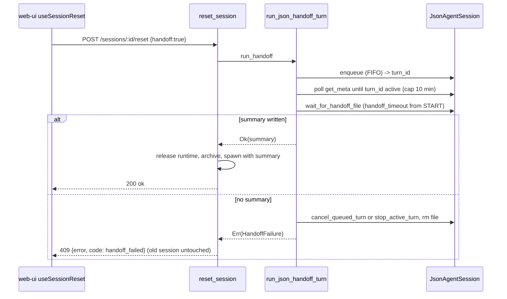

<!--
RULES — read before writing or implementing:
1. FORMAT: Bullets, tables, code, diagrams ONLY — no prose paragraphs
2. REQUIREMENTS: One crisp line each — no verbose descriptions
3. CHECKLIST: Mark items [x] as you complete them — this is your persistent todo list
4. READING TIME: Optimize for fast human scanning — if it's hard to skim, rewrite it
-->

# Plan: Reset-with-handoff fix + "Previous sessions" affordance

> Make "Reset with handoff" fail loudly (old session untouched) when no summary was produced, stop a busy agent's running turn from eating the handoff budget, and give users a way back to a superseded session's conversation without un-hiding tabs.

**Issue:** reset-handoff-fix
**Branch:** `fix/reset-handoff-timeout-and-previous-sessions`
**Status:** WIP
**PRD:** none (bug fix; source report: `/home/gb/code/fastestdevalive/vibe-station/.vibekit/reports/2026-10-06-reset-handoff-timeout-empty-agent.md`)

**Reference files:**
- Core logic: `rust/vst-routes/src/sessions.rs` (`reset_session` 2981, handoff block 3039-3048, `release_session_runtime` call 3053, `handoff_session` 3301, `run_handoff` 3336, `run_json_handoff_turn` 3352, `wait_for_handoff_file` 5256, `ResetError` 5433)
- Route mapping: `rust/vst-daemon/src/server.rs` (`handle_reset_session` mapping 3256-3279)
- Tests: `rust/vst-routes/tests/sessions_group_b2.rs`
- UI reset flow: `web-ui/src/hooks/useSessionReset.tsx`, `web-ui/src/components/layout/ResetProgressOverlay.tsx`
- UI tab strip: `web-ui/src/components/layout/TabsStrip.tsx` (~329), `web-ui/src/lib/sessionVisibility.ts`
- Project rules: `AGENTS.md` (worktree root) — `sessionStates[id] ?? session.state`; UI says "Rich Chat", code says `json`; never rename identifiers

---

## Problem & Concept

- Bug 1: Reset with handoff on a busy Rich Chat agent yields an EMPTY replacement agent — the handoff turn queues FIFO behind the running turn, the 120s budget runs from enqueue, timeout returns `None`, and `reset_session` carries on (abort + archive + spawn with `initial_prompt = None`), destroying the user's context.
- Bug 2: Superseded (reset) sessions are hidden from worktree tabs (deliberate — commit `d9483908`, test 3.T3), so the old conversation is unreachable from the UI.
- Success: a handoff that produces no summary fails the reset with a readable error and leaves the old session live; the budget starts when the handoff turn starts; old conversations are reachable from a "Previous sessions" menu without re-adding tabs.

## Out of Scope

- Bringing back always-visible archived tabs (3.T3 semantics are kept).
- Changing `steer` semantics for normal chat sends, or interrupting the running turn to run the handoff (see Decision 2).
- Persisting/restoring a superseded session as the active pane across a full page reload (reload re-validates strictly — existing Decision 9 behavior).
- Standalone `POST /sessions/:id/handoff` response shape (still `{ ok: true, handoffSummary: string|null }`).
- Terminal (tmux/pty) handoff mechanics (`vst_lifecycle::handoff::run_handoff_turn`, fixed 30s) unchanged; only its failure is now fatal for reset.
- Bounding the longer standalone `POST /sessions/:id/handoff` / `vst session reset --handoff` wait (accepted, see Risk 7).

## Requirements

| # | Requirement |
|---|-------------|
| 1 | `reset_session` with `handoff == true`, no `handoff_text`, and no summary produced returns `ResetError::HandoffFailed` BEFORE `release_session_runtime`/archive/spawn |
| 2 | On that failure the old session stays live, un-archived, un-aborted; its queued/active handoff turn is cancelled and the temp file removed |
| 3 | Handoff budget (`handoff_timeout`, 120s) starts when the handoff turn leaves the queue and starts running; waiting for the prior turn is bounded separately (10 min) |
| 4 | `POST /sessions/:id/reset` maps the failure to `409` `{ error, code: "handoff_failed" }` |
| 5 | Web UI shows the error via the existing alert path, clears the progress overlay/chip, and overlay copy no longer promises "resets without a summary" |
| 6 | "Previous sessions" menu lists the active session's predecessors (newest first) and opens one in the normal pane; superseded sessions never appear in the tab list |
| 7 | `pickWorktreeAgent` / `isTabVisibleAgent` behavior unchanged (never auto-select superseded sessions) |

---

## Change Map

```
rust/vst-routes/src/
  sessions.rs                  ~ handoff outcome + reset gate
rust/vst-daemon/src/
  server.rs                    ~ map HandoffFailed -> 409
web-ui/src/lib/
  sessionVisibility.ts         ~ add listPredecessors helper
web-ui/src/components/layout/
  PreviousSessionsMenu.tsx     + history menu button
  TabsStrip.tsx                ~ render history menu
  ResetProgressOverlay.tsx     ~ accurate failure copy
  ChatPane.tsx                 ~ empty-state history link
```

`+` new file · `~` modified · unmarked = context only.

| Today | After this plan |
|-------|-----------------|
| Handoff timeout -> reset silently continues, empty replacement agent | Reset fails 409 `handoff_failed`; old session stays live |
| 120s budget counted from enqueue (a long running turn eats it) | Budget counted from handoff turn start; queue wait capped at 10 min |
| Timed-out handoff turn lingers in the queue (cancelled only by the later teardown) | Handoff turn is cancelled/stopped at failure time, temp file removed |
| Overlay says reset proceeds "without a summary" after ~2 min | Overlay says the reset is cancelled if no summary is written |
| Old conversation unreachable once superseded | "Previous sessions" menu opens any predecessor read-only in the normal pane |

- Tree ⊆ Files & Phase Impact table (below).

---

## Research

- `rust/vst-routes/src/sessions.rs:3039-3048` — `reset_session` treats `run_handoff`'s `None` as "no summary" and proceeds; there is no failure branch.
- `rust/vst-routes/src/sessions.rs:3352-3400` — `run_json_handoff_turn` enqueues with `steer: Some(false)` and discards the returned `EnqueueChatResult.turn_id`; `wait_for_handoff_file(path, self.handoff_timeout, ...)` starts its deadline immediately.
- `rust/vst-agents/src/json_agent_chat.rs:325-373` — `enqueue_chat_turn` returns `EnqueueChatResult { turn_id, queue_position, delivery }`.
- `rust/vst-agents/src/json_agent_session/mod.rs:429-481` — public `JsonAgentSession::get_meta()` exposes `active_turn_id`, `queued_turn_ids`, `editing_turn_ids`: a turn-start signal with no new agent API.
- `rust/vst-agents/src/json_agent_session/queue.rs:185,220` — `stop_active_turn(Some(&turn_id)) -> bool` and `cancel_queued_turn(&turn_id) -> bool` (emits a `cancelled` user row) are the existing cleanup hooks.
- `rust/vst-routes/tests/sessions_group_b2.rs:534-567` — existing test `reset_json_channel_with_handoff_timeout_still_archives_and_spawns` ENCODES the bug (asserts archive + empty replacement); must be inverted.
- `rust/vst-routes/tests/sessions_group_b2.rs:846-858` — `handoff_json_enqueue_failure_returns_ok_with_no_summary` must keep passing (standalone handoff stays lenient).
- `rust/vst-routes/tests/sessions_group_b2.rs:132-148` — `routes()` builds `SessionRoutes` via struct literal; adding a struct field would force edits in 5 test files + `server.rs:442` (why Decision 2 uses a const, not a field).
- `web-ui/src/components/layout/LeftSidebar.tsx:2780,2859,2452,2516` + `web-ui/src/hooks/useWorkspaceUrlSync.ts:71-74` — the sidebar ALREADY lists superseded worktree agents (filters only `type === "agent"`, rows link `/worktree/${w.id}/${sess.id}`; direct sessions show an "archived" badge) and URL sync accepts them (Decision 9): old conversations are reachable but hard to find, so the menu is a discoverability fix and must not add a duplicate navigation path.
- `rust/vst-lifecycle/src/handoff.rs:28` — tmux/pty handoff uses a fixed 30s poll from paste (`TIMEOUT_MS`), NOT `handoff_timeout`; failure messages must not quote seconds for that path.
- `rust/vst-agents/src/json_agent_session/drain.rs:68,190` — the drain loop pops a turn and persists a row BEFORE setting `active_turn`; in that gap `cancel_queued_turn` and `stop_active_turn(Some(id))` both return false (cleanup race, Decision 3).
- `rust/vst-routes/src/sessions.rs:3026-3037` + `rust/vst-agents/src/json_agent_chat.rs:153-156` — reset skips the old `mode_id` check when a replacement `modeId` is given, but `enqueue_chat_turn` -> `resolve_mode` fails when `session.mode_id` is None: a reachable enqueue-failure test (1.T2).
- `web-ui/src/hooks/useSessionReset.tsx:68-80` — the `.catch` already alerts `resetErrorText(err)` and `.finally` always calls `useResetProgress.finish`; `ApiError.message` is the raw JSON body (`web-ui/src/api/client.ts:115-122`).
- `web-ui/src/components/layout/ResetProgressOverlay.tsx:42-44` — copy says the reset "resets without a summary" after ~2 minutes (becomes false).
- `web-ui/src/components/layout/TabsStrip.tsx:327-330` — `orderedSessions` filters `supersededBy == null`; `:340-349` already uses `ancestorIds()` (`web-ui/src/components/chat/SubagentRow.tsx:114`, cycle-guarded, newest-first, includes self).
- `web-ui/src/components/layout/TabsStrip.tsx:317` — `const sessions = isProject ? projectSessions : localSessions`: in worktree scope the strip uses its own fetched, unfiltered `localSessions` (kept current by the `session:updated` handler ~:561); the global `useServerStore` is NOT filled by the mock API in `TabsStrip.test.tsx`; in project scope `projectSessions` is narrowed to open tab ids, so `serverSessions` is the full list there.
- `web-ui/src/hooks/useWorkspaceUrlSync.ts:66-77,108-126` — a later param change to ANY listed agent is kept (`!firstApply`), and the edge guard only re-selects when the active id was previously visible, so `setActiveSession(supersededId)` sticks.
- `web-ui/src/hooks/useServerSync.ts:170-176` — reconnect relinks with `followSelection: false`, so it does not bounce a user viewing an old session.
- `web-ui/src/components/layout/TabsStrip.test.tsx:940-971` — 3.T3 asserts `getAllByRole("tab")` has length 2 and no `data-archived="true"` tab after reset.
- **Root cause:** the handoff outcome is an `Option<String>` whose `None` conflates "failed/timed out" with "none requested", and the deadline measures queue wait + run time.

---

## Architecture Diagram



---

## Design Details

### System Boundaries

| Boundary | Fields + types | Errors | Source of truth |
|----------|----------------|--------|-----------------|
| web-ui -> daemon `POST /api/sessions/:id/reset` | req `{ handoff?: bool, prompt?: string, modeId?: string }` (unchanged); res `{ ok, archivedSessionId, newSessionId }` (unchanged) | NEW `409 { error: string, code: "handoff_failed" }`; existing 404/400/500 unchanged | daemon store (old session row only mutated on success) |
| `SessionRoutes` internal `run_handoff` | `Result<String, HandoffFailure>` (was `Option<String>`) | `HandoffFailure::{ EnqueueFailed, QueueTimeout, NoSummary }` -> readable message | `JsonAgentSession` queue state |
| web-ui Previous-sessions menu -> store | `setActiveSession(id: string)` | n/a | `useServerStore.sessions` (`supersededBy` links) |

### Critical User Journeys (CUJs)

#### CUJ 1 — Reset with handoff on a busy agent, handoff succeeds

```
User picks "Reset with handoff" on a busy Rich Chat agent
  -> overlay shown; handoff turn queues behind the running turn
  -> running turn finishes, handoff turn starts, summary file written
  -> old session archived, replacement spawns with the summary as its first prompt
```

- **Error path:** handoff turn never writes a file within 120s of starting -> 409; alert shows the message; overlay clears; old agent keeps working.
- **Edge case:** prior turn runs > 10 min -> 409 "still busy"; queued handoff turn is cancelled.

#### CUJ 2 — Open the previous conversation

```
User resets session B -> C (C is the live tab)
  -> History button appears on the tab strip
  -> opens menu "Previous sessions": B (newest), A
  -> picks B -> pane shows B (archived, read-only); menu shows "Viewing previous" + "Back to current"
  -> picks "Back to current" -> pane shows C
```

- **Edge case:** active session with no predecessors -> no history button.
- **Edge case:** reload while viewing B -> strict first-apply validation lands on C (accepted).

### Data Model

- No persisted data changes (`supersededBy`, `archivedAt`, `handoffSummary` already exist).

### API Contracts

```
POST /api/sessions/:id/reset
  Request:  { handoff?: boolean, prompt?: string, modeId?: string }
  Response: { ok: true, archivedSessionId: string, newSessionId: string }
  Errors:   404 not found, 400 not-agent/archived/no_mode/mode_not_found,
            409 { error: "Handoff failed: ...", code: "handoff_failed" }   <- NEW
            500 internal
```

### Key Decisions

#### Decision 1: Typed handoff outcome, failure is fatal ONLY for reset — *with a snippet, because the ordering is the decision*

- **Decision:** `run_handoff`/`run_json_handoff_turn` return `Result<String, HandoffFailure>`; `reset_session` maps `Err` to `ResetError::HandoffFailed(msg)`; `handoff_session` maps `Err` to `Ok(HandoffResult { handoff_summary: None })` (unchanged contract).
- **Rationale:** `Option` conflated "failed" with "not requested" — see Research § root cause; a new `ResetError` variant gives the route a distinct 409 + code.
- **Where:** `rust/vst-routes/src/sessions.rs` (`reset_session` handoff block 3039-3048, `run_handoff`, `run_json_handoff_turn`, `ResetError`), `rust/vst-daemon/src/server.rs:3256-3279`.

```rust
// The gate MUST sit before release_session_runtime: that call aborts the
// running turn and cancels queued turns, which is what made the old failure
// destructive and unrecoverable.
let mut handoff_text: Option<String> = body.handoff_text.clone();
if handoff_text.is_none() && body.handoff.unwrap_or(false) {
    let handoff_path = handoff_path_for(&session.id);
    let instruction = handoff_instruction(&handoff_path);
    handoff_text = Some(
        self.run_handoff(&session, &handoff_path, &instruction)
            .await
            .map_err(|f| ResetError::HandoffFailed(f.message()))?,
    );
}
self.release_session_runtime(&session, false).await; // only reached with a summary (or no handoff requested)
```

#### Decision 2: Budget from turn start via `get_meta()` polling + 10-min queue cap const — *with a snippet*

- **Decision:** after enqueue, poll `agent.get_meta()` every 250ms until the handoff `turn_id` is no longer queued (`active_turn_id == turn_id`, or id absent from `queued_turn_ids`/`editing_turn_ids`), capped by `const HANDOFF_QUEUE_WAIT: Duration = 10 min`; THEN call the existing `wait_for_handoff_file` with `handoff_timeout` (fresh 120s).
- **Rationale:** simplest correct option — see Research § `get_meta`; no new agent API, no `SessionRoutes` field (see Research § struct literals).

| Option | Pros | Cons |
|--------|------|------|
| A. Poll `get_meta` for turn start, then fresh budget (chosen) | Non-destructive; summary includes the finished turn; no cross-crate change | Reset may take up to 10 min + 120s on a very long turn |
| B. `promote_queued_turn` (steer/send-now) | Bounded latency | Aborts the user's in-flight turn mid-work; summary misses it; destructive if the handoff then fails |
| C. Larger flat timeout | One-line | Still miscounts; long hang on failure |

- **Where:** `rust/vst-routes/src/sessions.rs` (new `HandoffTurnPhase`, `wait_for_turn_start`, `HANDOFF_QUEUE_WAIT`, called from `run_json_handoff_turn` after the `json_registry.get`).

```rust
// Injected closure keeps this unit-testable without a live agent (mirrors
// wait_for_handoff_file). Running and Gone both mean "stop waiting for the
// queue": Gone (finished between polls) is resolved by the file check next.
pub enum HandoffTurnPhase { Queued, Running, Gone }
pub async fn wait_for_turn_start<P: Fn() -> HandoffTurnPhase>(
    phase: P, timeout: Duration, poll: Duration,
) -> bool /* true = started, false = queue-wait timeout */ { /* loop + sleep(poll.min(remaining)) */ }
```

#### Decision 3: Clean up the handoff turn at failure time

- **Decision:** on any `Err` after a successful enqueue, call `agent.cancel_queued_turn(&turn_id)`; if it returns `false` (already started) call `agent.stop_active_turn(Some(&turn_id))`; if BOTH return `false` (drain-loop gap, see Research § `drain.rs`) sleep 250ms, re-read `get_meta()`, and if `active_turn_id == Some(turn_id)` call `stop_active_turn(Some(&turn_id))` once more; always `remove_file(path)`.
- **Rationale:** the old session now stays live, so a lingering handoff turn would run later unnoticed (the old code relied on `release_session_runtime` to kill it — see Research § `queue.rs`).
- **Where:** `rust/vst-routes/src/sessions.rs` `run_json_handoff_turn` (applies to standalone `handoff_session` too; its `None` result is unchanged).

#### Decision 4: HTTP 409 + `code: "handoff_failed"`, not 504

- **Decision:** `ResetError::HandoffFailed(String)` -> `409 CONFLICT` `{ error, code: "handoff_failed" }`.
- **Rationale:** 5xx gateway codes get rewritten/retried by proxies (Tailscale/Docker); the session state conflicts with the request, and `code` matches `no_mode`/`mode_not_found`.
- **Where:** `rust/vst-daemon/src/server.rs` `handle_reset_session`.

#### Decision 5: History menu hides superseded tabs but navigates with `setActiveSession`

- **Decision:** new `listPredecessors(headId, sessions)` in `sessionVisibility.ts` (cycle-guarded chain walk, newest first); `PreviousSessionsMenu` in `TabsStrip` calls `setActiveSession(id)`; "Back to current" calls it with `resolveSupersededChain`'s head. `pickWorktreeAgent`/`isTabVisibleAgent`/`orderedSessions` untouched.
- **Rationale:** keeps 3.T3 and Requirement 7; selection already tolerates a superseded active id — see Research § `useWorkspaceUrlSync`, `useServerSync`.
- **Where:** `web-ui/src/lib/sessionVisibility.ts`, `web-ui/src/components/layout/PreviousSessionsMenu.tsx`, `web-ui/src/components/layout/TabsStrip.tsx` (render beside the "+" button / before `<PaneTools>` ~line 1045).

---

## Risks / Open Questions

| # | Question | Notes |
|---|----------|-------|
| 1 | Is there an HTTP/proxy timeout shorter than 10 min + 120s? | No `TimeoutLayer` found in `rust/vst-daemon/src`; overlay is dismissible so the user is never blocked |
| 2 | Can the reset test force a real timeout without a live CLI? | In the test env the json agent never writes the file, so `None`/failure arrives via idle-grace or `with_handoff_timeout(100ms)`; assert failure + untouched session either way |
| 3 | Direct-project scope: does `setActiveSession(oldId)` stick? | `useProjectWorkspaceUrlSync.ts`: read effect skips when ref/store match (~115), guard is edge-triggered on previously visible ids (~155), write effect sets `lastAppliedRef` (~190) — verify with 3.T4b |
| 4 | Should the history menu also appear in canvas/workspace tiles? | Out of scope; TabsStrip + ChatPane empty state only |
| 5 | **ACCEPTED:** failed reset leaves the pasted handoff instruction in a busy terminal agent's TUI input | Can't un-paste; a stray summary file may be written later to a temp path; user can retry |
| 6 | **ACCEPTED:** reset-with-handoff on an exited/dead tmux session now returns 409 (previously reset with no summary) | User can reset without handoff |
| 7 | **ACCEPTED:** standalone `POST /sessions/:id/handoff` and `vst session reset --handoff` (CLI has no client timeout) can block up to ~12 min (10 min queue + 120s) instead of 120s | Messages sent to the old session during the wait queue behind the handoff and are cancelled by `release_session_runtime` if reset then succeeds (window now wider) |

---

## Implementation Phases

- Each phase ends with a **verification block**; a phase is complete only when its tests pass.
- Phases are independently committable, in order P1 -> P2 -> P3 (P2/P3 do not depend on each other).

---

### Phase 1 — Daemon: fail the reset, budget from turn start

Work from `rust/` (cargo workspace root; confirm with `ls rust/Cargo.toml`). All edits in `rust/vst-routes/src/sessions.rs` unless noted.

- [x] **1.1** Add `HandoffFailure` enum (`EnqueueFailed`, `QueueTimeout`, `NoSummary`) next to `ResetError` (~5433) with `fn message(&self) -> String` (channel-neutral, NO seconds — the tmux/pty path uses a fixed 30s, not `handoff_timeout`); messages must be user-readable: NoSummary: `"Handoff failed: the agent did not write a handoff summary in time, so the session was NOT reset. Try again, or reset without handoff."`; QueueTimeout: `"Handoff failed: the agent is still busy with its current turn, so the session was NOT reset. Stop the running turn or wait for it to finish, then try again."`; EnqueueFailed: `"Handoff failed: could not send the handoff request to the agent, so the session was NOT reset."` (1.T2 asserts the substring `could not send`).
- [x] **1.2** Add `ResetError::HandoffFailed(String)` variant (~5433).
- [x] **1.3** Add `pub const HANDOFF_QUEUE_WAIT: Duration = Duration::from_secs(600)`, `pub enum HandoffTurnPhase { Queued, Running, Gone }` and `pub async fn wait_for_turn_start<P>(phase: P, timeout: Duration, poll: Duration) -> bool` beside `wait_for_handoff_file` (~5256); poll with `tokio::time::sleep(poll.min(remaining))`; return `true` as soon as phase != `Queued`.
- [x] **1.4** Change `run_json_handoff_turn` (~3352) to return `Result<String, HandoffFailure>`: keep the archived early-exit (`Err(EnqueueFailed)`) and file pre-clean; keep `steer: Some(false)`; keep the `turn_id` from `enqueue_chat_turn`; `json_registry.get` miss -> `Err(EnqueueFailed)`; build the phase closure from `agent.get_meta()` (`active_turn_id == Some(turn_id)` -> Running; id in `queued_turn_ids` or `editing_turn_ids` -> Queued; else Gone); `wait_for_turn_start(.., HANDOFF_QUEUE_WAIT, Duration::from_millis(250))` false -> cleanup + `Err(QueueTimeout)`; then existing `wait_for_handoff_file` with `self.handoff_timeout`; `None` -> cleanup + `Err(NoSummary)`. Update the stale comments at 3372-3374 ("bounded by `handoff_timeout`") and 3386-3388 ("dies with release_session_runtime").
- [x] **1.5** Add private `async fn cleanup_failed_handoff(agent, turn_id, path)` per Decision 3 (`cancel_queued_turn`, else `stop_active_turn(Some(..))`, else if both false: sleep 250ms, re-read `get_meta()`, and if `active_turn_id == Some(turn_id)` call `stop_active_turn(Some(&turn_id))` once more; then best-effort `remove_file`).
- [x] **1.6** Change `run_handoff` (~3336) to `Result<String, HandoffFailure>`: Json -> `run_json_handoff_turn`; tmux/pty -> `Ok(true)` + non-empty `read_handoff_file_or_null` -> `Ok(text)`, anything else -> `Err(NoSummary)`. Update `handoff_session` (3301) to `.await.ok()` into `HandoffResult.handoff_summary` (still `Ok(HandoffResult{ ok: true, .. })`).
- [x] **1.7** In `reset_session` (handoff block 3039-3048) apply the Decision 1 gate (fails before `release_session_runtime` at 3053); the `handoff_text` for the archive/new-prompt path is now `Option<String>` unchanged downstream.
- [x] **1.8** In `rust/vst-daemon/src/server.rs` `handle_reset_session` (mapping at 3256-3279) add the arm: `ResetError::HandoffFailed(m) => (StatusCode::CONFLICT, Json(json!({ "error": m, "code": "handoff_failed" })))`.
- [x] **1.9** Grep for other `match` on `ResetError` / callers of `run_handoff` (`grep -rn "ResetError::\|run_handoff(" rust --include='*.rs'` excluding `rust/.gate`) and fix exhaustiveness.

**Verify phase 1:** from repo root (if `web-ui/dist` is missing first run `mkdir -p web-ui/dist && touch web-ui/dist/index.html`, as `.github/workflows/rust-ci.yml` does) — `rust/scripts/rust-gate.sh vst-routes` and `rust/scripts/rust-gate.sh vst-daemon` (fmt --check + clippy + tests; workspace lints are pedantic=warn so do NOT hand-roll `clippy -D warnings`; vst-daemon clippy uses `--all-features`). Targeted: `cd rust && cargo test -p vst-routes --test sessions_group_b2`.
- [x] **1.T1** Integration — `sessions_group_b2.rs`: REPLACE `reset_json_channel_with_handoff_timeout_still_archives_and_spawns` (534-567) with `reset_json_handoff_without_summary_fails_and_leaves_session_live`: `with_handoff_timeout(100ms)`, `handoff = Some(true)` -> `Err(ResetError::HandoffFailed(_))`; store shows 1 session, `archived_at.is_none()`, `superseded_by.is_none()`, `is_main` preserved; no replacement row; and `r.json_registry.get("s-old").map_or(true, |a| { let m = a.get_meta(); m.queued_turn_ids.is_empty() && m.editing_turn_ids.is_empty() })` (queued handoff turn cleaned up; do NOT assert `active_turn_id` — `stop_active_turn` only cancels a token).
- [x] **1.T2** Integration — `sessions_group_b2.rs`: `reset_json_handoff_enqueue_failure_fails_reset` — `home_with_mode()`; `json_session("s1","p1")` with `mode_id = None` pushed to `p.direct_sessions`; body `handoff = Some(true)`, `mode_id = Some("my-mode".into())` (replacement mode skips reset's own `NoMode` check) -> `Err(ResetError::HandoffFailed(m))` with `m.contains("could not send")`; store: `s1.archived_at`/`superseded_by` are `None`, `direct_sessions.len() == 1`.
- [x] **1.T3** Unit — `sessions_group_b2.rs`: `wait_for_turn_start` returns `true` once the closure flips `Queued -> Running`; returns `true` immediately on `Gone`; returns `false` when it stays `Queued` past a 200ms timeout (use `POLL_SLACK`-style bound as in the existing `wait_for_handoff_file_*` tests).
- [x] **1.T4** Regression — `sessions_group_b2.rs`: `reset_persists_handoff_summary_on_archived_row` (direct `handoff_text`) and `handoff_json_enqueue_failure_returns_ok_with_no_summary` still pass unchanged; existing `wait_for_handoff_file_*` tests unchanged.

---

### Phase 2 — Web UI: surface the failure, fix overlay copy

Work from `web-ui/`.

- [x] **2.1** `src/hooks/useSessionReset.tsx`: No behaviour change needed — `handoff_failed` already reaches `window.alert(resetErrorText(err))` and `needsReplacementMode` only matches `mode_not_found`/`no_mode`. Add a comment only (that `.finally` clears `inFlightResets` + `useResetProgress.finish`, so overlay/chip always clear); optionally a named `isHandoffFailed` guard used solely by tests.
- [x] **2.2** `src/components/layout/ResetProgressOverlay.tsx` (~39-44): replace the body text with accurate copy, e.g. "Waiting for the agent to finish its current turn and write a handoff summary, then a fresh session takes its place. This can take a few minutes. If no summary is written the reset is cancelled and this session keeps running. You can close this — it continues in the background."
- [x] **2.3** Check `src/api/mock.ts` `resetSession` (~931): no change required unless a test needs a `handoff_failed` rejection; if so add a `__test`-style hook only if one already exists — otherwise stub `resetSession` with `vi.fn()` in tests (as `useSessionReset.test.tsx` does).

**Verify phase 2:**
- [x] **2.T1** Unit — `src/hooks/useSessionReset.test.tsx`: "alerts the handoff_failed message, clears the progress overlay and does not open the mode dialog" — `resetSession` rejects `new ApiError(JSON.stringify({ error: "Handoff failed: ...", code: "handoff_failed" }), 409, "handoff_failed")`; expect `alert` called with the message, `useResetProgress.getState().active.s1` undefined, no "Reset with this mode" button, `onDone` called.
- [x] **2.T2** Unit — `src/hooks/useSessionReset.test.tsx`: a second reset for the same session is accepted after a `handoff_failed` (in-flight set released).
- [x] **2.T3** Unit — `src/components/layout/ResetProgressOverlay.test.tsx`: updated copy rendered (assert on "reset is cancelled" substring); existing close/inert tests still pass.
- [x] **2.T4** Regression — commands: `cd web-ui && npx vitest run src/hooks/useSessionReset.test.tsx src/components/layout/ResetProgressOverlay.test.tsx src/components/layout/ResetProgressChip.test.tsx`, `npx tsc -b --noEmit` (script: `npm run typecheck`), `npm run lint`.

---

### Phase 3 — "Previous sessions" affordance

Work from `web-ui/`. Class names: reuse existing `menu-pop` / `menu-pop__item` / `menu-pop__title` styles (as used by the reset menu in `TabsStrip.tsx` ~1135-1185). User-facing wording stays "Previous sessions"; never use `role="tab"` for menu entries (3.T3 counts tabs).

- [x] **3.1** `src/lib/sessionVisibility.ts`: add `export function listPredecessors(headId: string, sessions: Session[]): Session[]` built on the existing `ancestorIds` (`components/chat/SubagentRow.tsx:114`: cycle-guarded, newest-first, includes self) — drop `headId`, keep `type === "agent"`, map ids to sessions. If importing a component module from `lib/` is undesirable (layer inversion), move `ancestorIds` into `sessionVisibility.ts` and re-export it from `SubagentRow.tsx` (existing import in `TabsStrip.tsx:3` keeps working). Update the module header comment. Do NOT change `isTabVisibleAgent`, `pickWorktreeAgent`, `resolveSupersededChain`.
- [x] **3.2** Create `src/components/layout/PreviousSessionsMenu.tsx`: props `{ activeSession: Session | null; sessions: Session[]; onOpen: (id: string) => void }`. Compute `headId = resolveSupersededChain(activeSession.id, sessions)`; `preds = listPredecessors(headId, sessions)`; render nothing when `preds.length === 0`. Button: `aria-label="Previous sessions"`, `aria-haspopup="menu"`, `History` icon from `lucide-react`; menu `role="menu"` items `role="menuitem"` labelled with `sessionLabel(s)` (`@/lib/sessionLabel`) plus archived time when available; the entry equal to `activeSession.id` shows "Viewing"; when viewing a predecessor add a first item "Back to current" -> `onOpen(headId)`. Close on outside click / Escape (mirror TabsStrip's reset-menu effect, using `useEventTargets().doc`/`usePortalRoot` from `@/context/DemoEnv` if portaled). No live-state reads needed (no status UI) — if a status dot is added, resolve `sessionStates[id] ?? session.state` per AGENTS.md.
- [x] **3.3** `src/components/layout/TabsStrip.tsx`: render `<PreviousSessionsMenu>` only when `isAgent`, immediately before `<PaneTools .../>` (~1045). Worktree scope uses the strip's own fetched `localSessions` (`const sessions = isProject ? projectSessions : localSessions`, line 317; unfiltered, kept current by the `session:updated` handler ~561), and `projectSessions` is narrowed to open tab ids, so: `const historySessions = isProject ? serverSessions : sessions;` pass `sessions={historySessions}`, `activeSession={historySessions.find(s => s.id === activeSessionId) ?? null}`, `onOpen={(id) => setActiveSession(id)}`. Leave `orderedSessions` filter (~329) exactly as is. Do NOT `openProjectAgentTab` (it must not become a tab).
- [x] **3.4** `src/components/layout/ChatPane.tsx` empty state (381-386): when the session has predecessors (`listPredecessors(session.id, useServerStore sessions)`), add a small link-button "View previous session" under "Start chatting" that calls `useWorkspaceStore.getState().setActiveSession(preds[0].id)`. Compute predecessors via a selector/`useMemo` ABOVE the `if (!enabled)` early return at line 355 (hook-order rule; lines ~108-110 are only the pinch-ref comment). Hidden for `archived` panes. Import `useServerStore` (not yet imported in ChatPane.tsx); guard with `session ? listPredecessors(session.id, sessions) : []` since `session` can be undefined.
- [x] **3.5** Verify (by test, not code) that the active archived session renders in the normal pane read-only: `ChatPane.tsx:351` `archived` already disables the composer; if the TerminalPane (tmux) path lacks an archived affordance, note it in the PR description — do not change `TerminalPane` (AGENTS.md remount invariant).
  *Finding: ChatPane disables the composer via `archived` flag (`session?.archivedAt != null`), rendering the previous conversation read-only. In TerminalPane (tmux), terminal sessions connect to the live tmux stream or xterm viewport; superseded agent sessions on json channel render via ChatPane read-only.*

**Verify phase 3:**
- [x] **3.T1** Unit — `src/lib/sessionVisibility.test.ts` (existing file or create alongside): `listPredecessors` returns `[B, A]` for chain A->B->C with head C; `[]` for no predecessors; terminates on a cycle; ignores terminal-type sessions; `isTabVisibleAgent(A)`/`pickWorktreeAgent(.., { explicitId: "A" })` still exclude/skip superseded A (Requirement 7).
- [x] **3.T2** Component — `src/components/layout/PreviousSessionsMenu.test.tsx`: renders nothing without predecessors; lists predecessors newest-first; clicking an entry calls `onOpen(id)`; "Back to current" appears when `activeSession` is a predecessor and calls `onOpen(headId)`; Escape closes.
- [x] **3.T3** Integration — `src/components/layout/TabsStrip.test.tsx`: keep existing "3.T3 — after a real reset ..." and "a session with supersededBy set is absent from the rendered tab list" unchanged and passing; ADD "after a reset, the Previous sessions menu lists the superseded session, it is still not a tab, and picking it sets `activeSessionId` to the old id" (use `localApi.resetSession("sess-agent2", { handoff: false })` then open the menu; assert `getAllByRole("tab")` length still 2). Do NOT seed `useServerStore` — the menu must work off the strip's fetched list.
- [x] **3.T4** Integration — `src/hooks/useWorkspaceUrlSync.test.tsx` (existing): after `setActiveSession(supersededId)` the edge guard does not re-select the replacement and the URL mirrors `/worktree/:wt/:supersededId`.
- [x] **3.T4b** Integration — `src/hooks/useProjectWorkspaceUrlSync.test.ts` (existing): `setActiveSession(supersededDirectId)` sticks and the URL becomes `/project/:pid/:supersededId` (write effect sets `lastAppliedRef` ~190; read effect skips ~115; guard leaves it ~155).
- [x] **3.T5** Component — `src/components/layout/ChatPane.test.tsx` (existing): empty replacement session shows "View previous session" and clicking sets the active session to the predecessor (seed `useServerStore.setState({ sessions: [...] })` with the predecessor chain).
- [x] **3.T6** Regression — commands: `cd web-ui && npx vitest run src/lib/sessionVisibility.test.ts src/components/layout/PreviousSessionsMenu.test.tsx src/components/layout/TabsStrip.test.tsx src/components/layout/ChatPane.test.tsx src/hooks/useWorkspaceUrlSync.test.tsx src/hooks/useProjectWorkspaceUrlSync.test.ts`, then `npm run typecheck` (`tsc -b --noEmit`), `npm run lint`, and finally the full `npx vitest run` once.

---

## Files & Phase Impact

| File | Status | Phase | Description / Contract Change |
|------|--------|-------|-------------------------------|
| `rust/vst-routes/src/sessions.rs` | **Modified** | 1.1-1.7 | Contract: `run_handoff(..) -> Result<String, HandoffFailure>`; `ResetError::HandoffFailed(String)`; `wait_for_turn_start(phase, timeout, poll) -> bool`; `HANDOFF_QUEUE_WAIT = 600s`; gate before `release_session_runtime` |
| `rust/vst-daemon/src/server.rs` | **Modified** | 1.8 | `HandoffFailed` -> `409 { error, code: "handoff_failed" }` |
| `rust/vst-routes/tests/sessions_group_b2.rs` | **Modified** | 1.T1-1.T4 | Invert bug-encoding test; add failure/cleanup/turn-start tests |
| `web-ui/src/hooks/useSessionReset.tsx` | **Modified** | 2.1 | `handoff_failed` alerts message, never opens mode dialog |
| `web-ui/src/hooks/useSessionReset.test.tsx` | **Modified** | 2.T1-2.T2 | New failure-path tests |
| `web-ui/src/components/layout/ResetProgressOverlay.tsx` | **Modified** | 2.2 | Accurate "reset cancelled if no summary" copy |
| `web-ui/src/components/layout/ResetProgressOverlay.test.tsx` | **Modified** | 2.T3 | Copy assertion |
| `web-ui/src/api/mock.ts` | **Unchanged** | 2.3 | Only touched if a test needs a rejecting `resetSession` |
| `web-ui/src/lib/sessionVisibility.ts` | **Modified** | 3.1 | Contract: `listPredecessors(headId, sessions): Session[]` (pure, built on `ancestorIds`) |
| `web-ui/src/lib/sessionVisibility.test.ts` | **Modified** | 3.T1 | Predecessor-walk + selection-regression tests |
| `web-ui/src/components/layout/PreviousSessionsMenu.tsx` | **New** | 3.2 | Contract: props `{ activeSession, sessions, onOpen }`; owns menu open state |
| `web-ui/src/components/layout/PreviousSessionsMenu.test.tsx` | **New** | 3.T2 | Component tests |
| `web-ui/src/components/layout/TabsStrip.tsx` | **Modified** | 3.3 | Render menu beside `PaneTools` fed by `isProject ? serverSessions : sessions`; `orderedSessions` filter untouched |
| `web-ui/src/components/layout/TabsStrip.test.tsx` | **Modified** | 3.T3 | Keep 3.T3; add menu-after-reset test (no `useServerStore` seeding) |
| `web-ui/src/components/layout/ChatPane.tsx` | **Modified** | 3.4 | Empty-state "View previous session" link |
| `web-ui/src/components/layout/ChatPane.test.tsx` | **Modified** | 3.T5 | Link test |
| `web-ui/src/hooks/useWorkspaceUrlSync.ts` | **Unchanged** | 3.T4 | Behavior relied on, not edited (test only) |
| `web-ui/src/hooks/useWorkspaceUrlSync.test.tsx` | **Modified** | 3.T4 | Superseded active id sticks (worktree) |
| `web-ui/src/hooks/useProjectWorkspaceUrlSync.test.ts` | **Modified** | 3.T4b | Superseded active id sticks (project) |
