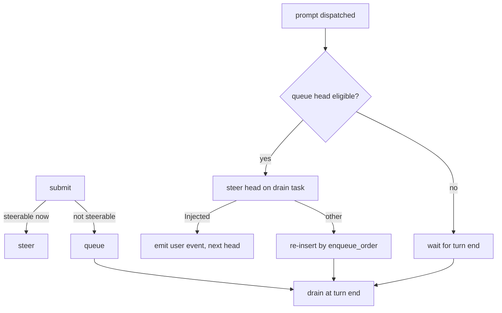

# SDLC report: queued-message-steer-on-ready

**Date:** 2026-10-15 · **Commit:** e3a7b85e · **Sub-feature(s) covered:** root

## Bugs
| # | Symptom | Where found | Severity |
|---|---------|-------------|----------|
| 1 | A message sent while steering is not yet possible is queued, and is delivered only when the whole running turn ends, even if steering becomes possible seconds later | code read: `queue.rs` `submit()` vs `drain.rs` `drain_loop()` | Medium |

## Root cause
- **Steer eligibility is checked once, at submit time** → `queue.rs:~110-125` `submit()` steers only if running, not cancelled, queue empty, no attachments, `first_turn_done`, connection alive + `supports_steering()`, plugin trusts steering; otherwise `enqueue()`
- **Nothing re-evaluates the queue when the blocker clears** → `drain.rs` `drain_loop()` pops the queue only after `run_one_turn` returns; no hook runs on the "turn became steerable" transition
- **Transition that happens mid-turn today** → the prompt being dispatched (`send_prompt`, `acp_run_turn.rs:~134`). Between `active_turn` being set and dispatch (connection setup, skill resolution) `submit()` queues; once the prompt is live the message is steerable, yet still waits for turn end
- **Not a transition (stays queued by design)** → attachments (steer carries text blocks only), queue head ahead of it (FIFO), `first_turn_done == false` (first turn), plugin `supports_mid_turn_steering() == false` (only claude returns true)
- **Existing guard** → `acp_run_turn.rs:~142` notes the Claude adapter can hang after mid-turn steering; a stuck-turn watchdog already covers that, so more steering does not add a new failure mode

## Action items
Revised after Opus review (verdict CHANGES). The first draft hooked "connection stored" (`connection.rs:173`); that is before `send_prompt` (`acp_run_turn.rs:~134`), so a steer there gets `PromptRequired` or lands ahead of the turn's own prompt.

| # | Action | Status |
|---|--------|--------|
| 1 | Real transition is "prompt dispatched": add a plugin-agnostic `on_prompt_dispatched` callback to `TurnContext`, called by `run_turn_acp` right after `conn.send_prompt`; no CLI-specific code | open |
| 2 | `run_one_turn` receives that signal inside its `select!` and runs `steer_queued_head()` on the drain task, so `drain_loop` cannot pop concurrently; the steer outcome is always awaited (10s bound, even after cancel) so a delivered message is never re-run; `PromptRequired` is retried up to 3x (100ms) | open |
| 3 | Do NOT pop-then-push_front. Keep ordering: on failure re-insert by `enqueue_order` (survives `promote_queued_turn`); before re-queue check `is_released()` and abort/clear marker, else emit the `cancelled` user event instead | open |
| 4 | One shared eligibility helper for `submit()` and queue-head steering; queue head additionally requires `fork_from_chat_id.is_none()` and no skill invocation (raw text bypasses `resolve_skill_invocations`) | open |
| 5 | Steered queued turn reuses its own `turn_id` in `emit_user_event` (so the UI queued bubble resolves); single `emit_meta` after outcome | open |
| 6 | `can_steer` (`mod.rs:~470`) means "prompt in flight" (dispatched flag on the active turn), not just "connection exists" | open |
| 7 | Tests via `fakeAcpAgent.mjs` through `run_turn_acp`: add a fake mode returning `promptRequired` when no prompt is active; cases: steered only after dispatch; turn ends during RPC keeps head before item 2; promote during RPC; abort/release during RPC; cancel during RPC; fork turn not steered; steered row keeps queued `turn_id`; first-ever turn never steers; attachment head stays queued | open |
| 8 | Doc invariant on `submit()` / `drain_loop()`: a queued turn is steered at the first moment it can be, else runs at turn end. cancel/edit/resubmit of the head mid-RPC return not-found via `steering_turn_id` | open |

## Risks
| # | Risk | Mitigation |
|---|------|------------|
| 1 | More steering triggers the Claude stuck-turn watchdog (`acp_run_turn.rs:~142`) more often | Watchdog already covers it; accepted |
| 2 | Cancel/edit of the head during the steer RPC returns not-found (`steering_turn_id`), so it cannot succeed-then-deliver | Short window; refused rather than raced |

## Diagrams

