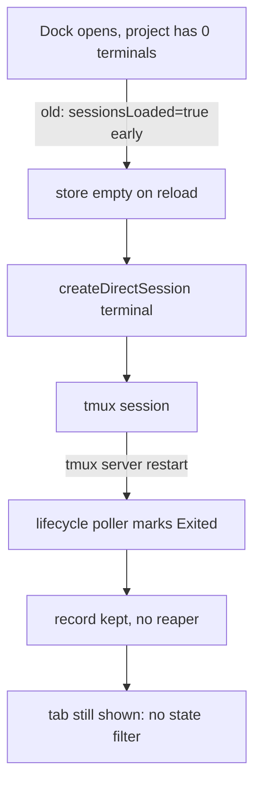

# SDLC report: exited-terminal-tabs

**Date:** 2026-10-24 · **Commit:** 953c1079 · **Sub-feature(s) covered:** n/a (investigation; project `vibe-station-mobile`)

## Bugs
| # | Symptom | Where found | Severity |
|---|---------|-------------|----------|
| 1 | Project Terminal dock shows dozens of `exited` / disconnected tabs (26 in `vibe-station-mobile`, 13 in `vibe-station-website`, 36 exited terminals across `vibe-station`) | UI + `vibe-station.db` `sessions` | medium |
| 2 | Terminals were created in bursts (Terminal 153–168 at ~10–40s intervals on Oct 15 13:19–13:26 PDT; 224/225 only 1.4s apart) | DB `sortOrder` (creation ms) | medium |
| 3 | Exited terminal records and tabs are never reaped; each needs a manual terminate | DB + `TabsStrip.tsx` | low |

## Root cause
- **Creation burst (high confidence, fixed Oct 15 18:40 PDT)** → `TabsStrip.tsx` auto-create effect (`:473-535`) used `useState(isProject)` for `sessionsLoaded` (pre-`87433154`, old line 196), so in project scope it was `true` before the server store loaded; the `existing` check read the empty store → every page load / Vite reload with the dock open created one terminal. Matches the 10–40s cadence of 153–168. Two clients loading together matches 224/225.
- **Later terminals 206–326 (unconfirmed)** → current code can't auto-create here (store `loaded` gate `useServerStore.ts:47-50`; `Terminal 3` always exists so `sessions.length > 0`). Candidates: the `+` → `NewTerminalDialog.tsx:65-71` path, an older running build, or **the mobile app** — its Terminals page auto-creates whenever it is settled and empty (`TerminalsPane.kt` LaunchedEffect → `TerminalsController.ensureTerminal` → `ServerHandleImpl.createTerminal`, unnamed `tmux` terminals like these), with only a per-process lock and no server-side idempotency. Unconfirmed (no daemon logs). `vst terminal create` always sends a worktreeId, so it is ruled out; the daemon creates nothing on its own.
- **Name counter misleads** → `Terminal N` shares `direct_session_seq` with direct agents (`sessions.rs:966,1045`; `projects.rs:1000,1058`), so "Terminal 326" ≠ 326 terminals.
- **Why they exit** → tmux server vanished; lifecycle poller marks `Exited` when the tmux name is missing (`vst-lifecycle/src/lifecycle.rs:242`). Bulk timestamps `2026-10-16T01:21:29Z` and `2026-10-20T05:18:40Z` mark two tmux restarts.
- **Why the tab stays** → only user `DELETE /sessions/:id` removes a direct session (`sessions.rs:1580-1627`); no daemon code deletes or archives an exited terminal. UI tab filter ignores state (`TabsStrip.tsx:304-308`), so every exited terminal remains a tab.

## Action items
| # | Action | Owner sub-feature | Status |
|---|--------|--------------------|--------|
| 1 | Reap or hide exited plain terminals: delete (or archive and hide) on `Exited`, or filter `state === "exited"` out of the terminal strip with a "Clear exited" button | new bundle | open |
| 2 | Server-side idempotency for auto-create (one auto terminal per project/worktree) so two clients can't double-create | new bundle | open |
| 3 | Show "Terminated — restart" affordance in `TerminalPane` for an exited terminal instead of a dead pane | new bundle | open |
| 4 | One-off cleanup: delete exited direct terminals from the DB via the UI/API (do not hand-edit the DB while the daemon runs) | user | open |
| 5 | Optional: separate name counters for direct agents vs terminals | new bundle | open |

## Diagrams

