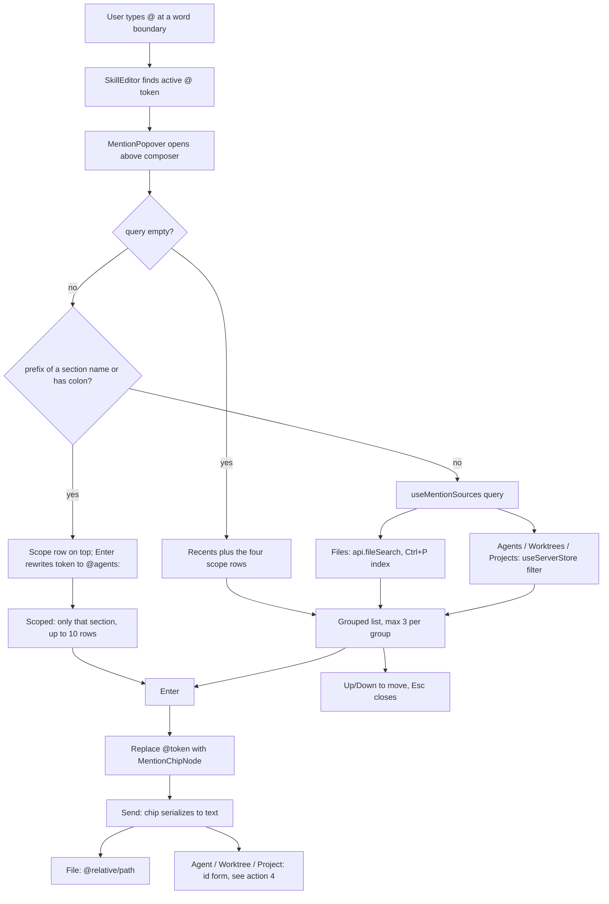
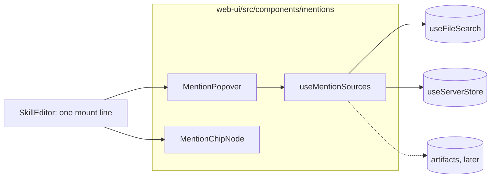

# SDLC report: at-mentions

**Date:** 2026-10-25 · **Commit:** 1bda19c7 · **Sub-feature(s) covered:** n/a (design brief, no code yet)

**UI mock:** frames 17 to 20 in the canvas https://claude.ai/artifact/RxL1NKvUQNm7KoKKa8EPhB

## Bugs
| # | Symptom | Where found | Severity |
|---|---------|-------------|----------|
| 1 | Typing `@` in any composer (draft or live) does nothing; no way to reference a file, agent, worktree or project inline | `SkillEditor.tsx` (only `/` is handled) | medium |
| 2 | Review: in project scope every keystroke-debounced query re-runs `rg --files` over the project (no cache) and matches by substring only, so ranking is worse than the worktree fuzzy search and cost grows with project size | `useFileSearch.ts` project branch, `projects.rs` `file_list` | low-medium |
| 2b | Review: worktree index freshness depends on an open tree watch (see Root cause) | `file_search.rs`, `tree_watch.rs` | medium, verify |
| 3 | Review: agent names are not unique, so a chip cannot carry the name alone | `skill/SKILL.md` ("names are not guaranteed unique") | medium |
| 4 | Review: secondary labels (#6b6b6b / #4e4e4e on #151515) are about 3.4:1 or lower, under the 4.5:1 text bar; inherited from the slash popup | frames 17-20 | low |
| 5 | Review: mock status dots use bare hexes; real rows must reuse `StatusDot` / `--status-*` tokens, not new colours | frames 17, 19, 20, `docs/STATUS-INDICATORS.md` | low |
| 6 | Review: a long scoped list needs a defined empty / loading / error state (`useFileSearch` has `loading` and `error`); the mocks show only the happy path | frames 19-20 | low |

## Root cause
- No `@` trigger → `SkillEditor.tsx` `$findActiveSlashToken` / `SkillPopover.tsx` only know the `/` token; no mention chip node exists beside `SkillChipNode`
- Agents, worktrees, projects already live client-side → `useServerStore`, no daemon work
- Files already work in both scopes, no daemon work for v1 (read from `file_search.rs`, `file_list.rs`, `projects.rs`):
  - worktree → `GET /worktrees/:id/file-search` → `FileSearchIndex` (in-memory set per worktree, filled lazily on first query by `rg --files`, gitignore-aware, 100k cap); ranking server-side with `nucleo` fuzzy (filename prefix > filename fuzzy > full-path fuzzy); patched per path by the tree watcher; evicted when the LAST tree watcher for the worktree closes, then rebuilt on next query
  - project (direct agents) → `GET /projects/:id/files` → `FileList::list_files` runs `rg --files` (or a `walkdir` fallback) on EVERY call, no cache or index; client then filters with the old 3-tier substring scoring (substring only, no fuzzy)
- Staleness risk to verify before relying on the worktree index from a composer → the index only gets incremental updates while some `tree:watch` is open, and is evicted only when a watcher closes; a worktree queried with no watcher ever attached would keep its first snapshot. Find out what holds the watch while a composer is open (Files panel?) and either hold one from the mention hook or have the route refresh
- Chip identity → store `{kind, id, label}`, show `label`; never resolve by name

## Action items
| # | Action | Owner sub-feature | Status |
|---|--------|--------------------|--------|
| 1 | `MentionChipNode` (Lexical, atomic, next to `SkillChipNode`); serializes to text | new bundle `01-mention-chip` | open |
| 2 | `@` token detection + `MentionPopover` (copy `SkillPopover` surface), mounted once in `SkillEditor` so draft and live composers both get it | `02-mention-popup` | open |
| 3 | `useMentionSources(query)`: files via `useFileSearch`, other kinds filtered from `useServerStore`, recents when query is empty; max 3 rows per group | `02-mention-popup` | open |
| 4 | Decide the wire text for non-file mentions (agent/worktree/project id form) and mirror it in the agent prompt asset | `01-mention-chip` | open |
| 5 | Section scoping: `@files` `@agents` `@worktrees` `@projects` (prefix + singular match) add a scope row; Enter rewrites token to `@agents:` and scopes search (up to 10 rows, no group headers); Backspace at the colon leaves scope; `@agents:foo` typed directly also scopes; worktrees/projects default to the current project | `02-mention-popup` | open |
| 6a | DECIDED: project search must use the same server index as worktree search, via ONE shared code path (one search service parameterised by root, one `useFileSearch` path, no client-side scoring fork); `GET /api/projects/:id/file-search` is therefore REQUIRED, not optional | `03-unified-file-search` | landed (unified-file-search plan Phase 1 & 2) |
| 6b | DECIDED: ranking prefers recently created files (newest first within a match bucket); needs a birth-time per indexed path | `03-unified-file-search` | landed (unified-file-search plan Phase 1 & 2) |
| 6 | Define empty, loading and error rows (e.g. "No agents match", "Searching files...", "File search failed"); reuse `StatusDot` for agent state | `02-mention-popup` | open |
| 7 | Future `@artifacts` (+ `@artifacts:` scope): web artifacts and files outside the project/worktree. Add as a fifth kind once artifacts ship; it needs its own source, because `resolve_inside_worktree` deliberately blocks paths outside the worktree, so file-search cannot serve them | later bundle `03-mention-artifacts` | parked until artifacts are ready |
| 8 | Tests at the public handle: `SkillEditor` typing `@`, Enter inserts chip, Backspace removes it whole, paste round-trip | both | open |

## Daemon API
| # | Change | Kind | Notes |
|---|--------|------|-------|
| 1 | `GET /api/projects/:id/file-search?q=&limit=` returns `FileSearchResult { files, truncated }` | new, REQUIRED (decided) | Not needed for v1: project scope already works through `GET /projects/:id/files` with client-side scoring. Add if large projects feel slow or if you want the same fuzzy ranking as worktrees (index keyed by project root in the existing `file_search` service, which already supports arbitrary keys + path; needs a tree watch on the project root for freshness; then `useFileSearch` switches URL; update `api/client.ts` and `api/types.ts` in the same commit) |
| 2 | `GET /api/worktrees/:id/file-search` | unchanged | Reused as is; limit default 50, scoped mode asks for 10 |
| 3 | Optional `mentions: [{kind, id, label}]` on the send-message request and echoed on stored user messages | new, additive | `#[serde(default)]` / `Option`. Lets the daemon expand agent, worktree and project mentions into prompt context and lets history restore chips (like `attachments`). Without it chips flatten to text and cannot be restored. Recommended; decision pending (action 4 above) |
| 4 | Prompt asset note for mention text forms | edit | Rust agent prompt asset describes `@path` and `@kind:id` so agents read them correctly |
| 5 | Agents / worktrees / projects lists | none | Already pushed over WS into `useServerStore` |
| 6 | `@artifacts` list route | future | Defined with the artifacts feature; not part of this work |

## Diagrams

