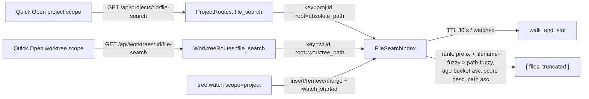

# SDLC report: unified-file-search/verification

**Date:** 2026-10-25 · **Commit:** `ab9b5673` · **Sub-feature(s) covered:** `unified-file-search` (Phase 1 + Phase 2)

## Verification results

- Sandbox: compose project `vs-284`, container `vs-284-vst-dev-1`, host `:7140` → Vite `:5173`, daemon `:7421` in-container; `VST_NO_AUTH=1`, seed `demo`.
- Daemon freshness: `GET /api/projects/<id>/file-search` returns JSON `200` (not SPA HTML) → the mounted `vst-daemon` binary is built from this checkout (Rust build ran during `up`).
- `/health` is not Vite-proxied: `curl localhost:7140/health` returns the SPA HTML; daemon health checked via `docker exec vs-284-vst-dev-1 curl -s localhost:7421/health` → `{"ok":true,"version":"0.0.3-beta","port":7421,...}`.
- Boot workarounds (environment, not feature): (a) first two `up` runs failed in the Rust build with `E0463 can't find crate` (`idna_adapter`, then `proc_macro2`/`quote`); a manual `cargo build -v` in the same image succeeded (44.6 s) and the next `up` succeeded; (b) `rust/vendor/openab` submodule is absent, so `scripts/build-agy-acp.sh` aborts `up` — a gitignored placeholder executable was placed at `rust/target/agy-acp/release/agy-acp` (agy unused by this feature).
- Test state cleanup: the temporary project `napi-checkout` was deleted (`DELETE /api/projects/napi-checkout` → `{"ok":true}`) and all probe files removed; volumes left intact by `down`.

| # | Scenario | Command / evidence | Result | Notes |
|---|----------|--------------------|--------|-------|
| 1 | Sandbox boot + route present | `scripts/dev-sandbox.sh up --port=7140`; `docker exec … curl -s localhost:7421/health` → `{"ok":true,...}`; `GET /api/projects/northstar-api/file-search?q=main` → `200` JSON | PASS | compose project `vs-284`; projects `northstar-api`/`atlas-dashboard`/`forge-cli`/`luminary-docs`, worktrees `napi-1..4`/`atls-1..3`/`frge-1..2`/`ldoc-1` |
| 2a | Project route shape | `?q=` → `{"files":["README.md"],"truncated":false}`; unknown id → `404 {"error":"Project 'does-not-exist' not found"}` | PASS | root-relative POSIX paths |
| 2a | `limit` truncation | `napi-checkout` (23 entries): `?q=&limit=3` → `{"files":[".env.example","README.md","docs/API.md"],"truncated":true}` | PASS | default limit 50 returns all 23, `truncated:false` |
| 2b | Project vs worktree, same root | registered `napi-checkout` at `/home/vst/.vibe-station/projects/northstar-api/worktrees/napi-1`; `q=srvrs`, `q=main`, `q=auth` → identical `files` arrays from `/api/projects/napi-checkout/file-search` and `/api/worktrees/napi-1/file-search` | PASS | demo project roots contain only `README.md` and no worktree checkout, so root == worktree was produced by registering the checkout path |
| 2c | Fuzzy (not substring) + bucket order | `q=srvrs` → `["src/server.ts"]`; `q=middleware` → `authMiddleware.ts` (filename fuzzy) before `cors.ts`,`rateLimiter.ts` (path fuzzy); `q=routes` → 3 path-fuzzy hits | PASS | prefix > filename-fuzzy > path-fuzzy confirmed |
| 2d | Recency: new file | created `recent_a.txt` in `luminary-docs`; `q=recent_a` → `["recent_a.txt"]` | PASS | brand-new file returned for its prefix |
| 2d | Hour-bucket recency e2e | `stat`: seeded files `birth=02:47:32`, new files `birth=02:53:28` (≈6 min); no file older by >1 h | SKIPPED | btime cannot be backdated on the container FS; hour-bucket ordering evidence = unit test `1.T1` (`file_search_rank.rs`) |
| 2d | Birth time vs mtime | `zzz_a.txt` with mtime backdated 3 h (btime unchanged) vs `zzz_new.txt`; `q=zzz` → `["zzz_a.txt","zzz_new.txt"]` | PASS | shorter prefix name wins only if both are age-bucket 0 → birth time is used, mtime fallback not triggered |
| 2e | Freshness, no watcher (TTL) | `forge-cli`: `q=` walk; create `fresh_no_watch.txt`; immediate `q=fresh_no_watch` → `{"files":[]}`; after 32 s → `{"files":["fresh_no_watch.txt"]}` | PASS | 02:54:03 → 02:54:35 |
| 2f | Freshness, with watcher | node WS `ws://127.0.0.1:7421/ws`, `{"type":"tree:watch","worktreeId":"atlas-dashboard","scope":"project"}`; warm query; create `fresh_watch_probe.txt`; +1 s query → `["fresh_watch_probe.txt"]`; WS received `tree:changed` | PASS | appeared in ~1 s without waiting for TTL |
| 2g | Worktree route regression | `/api/worktrees/napi-1/file-search?q=main` → same 2 files as project scope; `?q=&limit=3` → `truncated:true`; unknown worktree → `404` | PASS | same shape `{files,truncated}` |
| 2h | Load sanity | 20 sequential `q=&limit=50` on `napi-checkout`: min 2 ms, p50 5 ms, p90 9 ms, max 21 ms | PASS | first request 21 ms (warm-up), steady-state ~4–5 ms |
| 3 | UI browser check | no browser tool in this session → SKIP; `pnpm --filter ./web-ui exec vitest run src/hooks/useFileSearch.test.ts src/components/dialogs/QuickOpen.test.tsx src/api/client.test.ts` → 3 files / 64 tests passed; `grep -rn scoreProjectFiles web-ui/src` → none; `useFileSearch` issues one `api.fileSearch(id,q,50,signal,scope)` | SKIPPED (browser) / PASS (unit+static) | `4.T3`/`5.T6` assert `fileSearch(...,"project")` and `fileList` never called; `client.test` asserts `/api/projects/p1/file-search?q=a+b&limit=50` |
| 4 | Repo checks | `cargo test --manifest-path rust/Cargo.toml -p vst-ws -p vst-routes` → 20 test binaries, 439 passed / 0 failed / 10 ignored; `cargo test … -p vst-daemon --test project_routes_http --test main_logic` → 1 + 9 passed; `pnpm typecheck` → exit 0; `pnpm lint` → exit 0, 0 errors / 59 warnings | PASS | warnings are pre-existing, unrelated files |
| 5 | Teardown | `scripts/dev-sandbox.sh down`; `lsof -i :7140` → nothing; `docker ps -a` unchanged for `vs-266/269/272/275/277/280` (all still `Exited (137)`) | PASS | only `vs-284-vst-dev-1` + `vs-284_default` network removed |
| X1 | `limit` edges | `limit=0` → `{"files":[],"truncated":true}`; `limit=abc` → `400 "Failed to deserialize query string: invalid digit found in string"` | PASS | axum default query-parse error; acceptable |
| X2 | Fuzzy needle with space | `q=auth middleware` → `{"files":[],"truncated":false}` | note | pre-existing nucleo behaviour (same rank function served worktree scope before this change); not a regression |

## Bugs

- None found.

## Root cause

- N/A — no defects found in the feature.

## Action items

| # | Action | Owner sub-feature | Status |
|---|--------|--------------------|--------|
| 1 | First cold Rust build in `dev-sandbox.sh` failed twice with `E0463 can't find crate` (`idna_adapter`, then `proc_macro2`/`quote`); retry succeeded — investigate cargo/`target-docker` cache race on the container build | new bundle (dev tooling) | open |
| 2 | `rust/vendor/openab` submodule is absent, so `scripts/build-agy-acp.sh` aborts `up`; `git submodule update --init --recursive` needed before a sandbox run (a placeholder was used here) | new bundle (dev tooling) | open |
| 3 | Quick Open fuzzy needle containing spaces (`auth middleware`) matches nothing — pre-existing; consider a whitespace-tolerant needle before the `@` composer lands | `unified-file-search` follow-up | done: `rank` drops whitespace from the needle; test `test_rank_whitespace_in_query_is_ignored` |
| 4 | Hour-bucket recency is e2e-unverifiable (btime cannot be backdated); no action, unit test `1.T1` remains the evidence | `unified-file-search` | done |

## Diagrams

