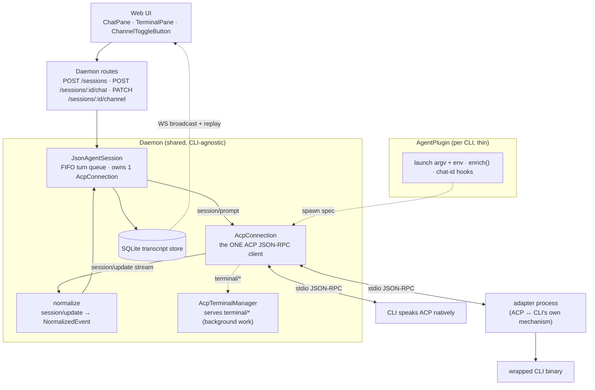
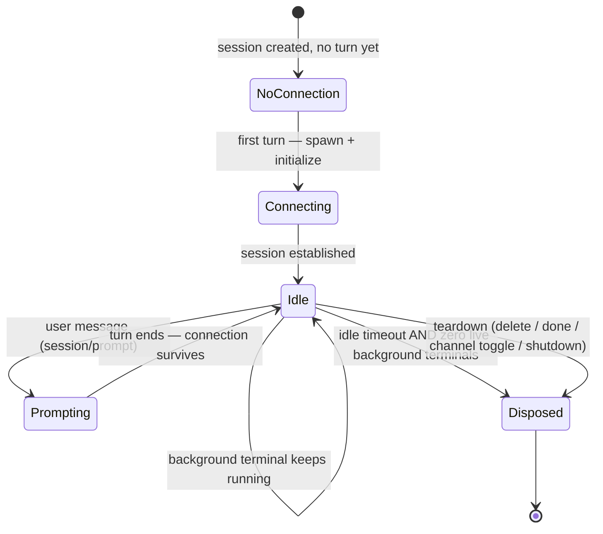
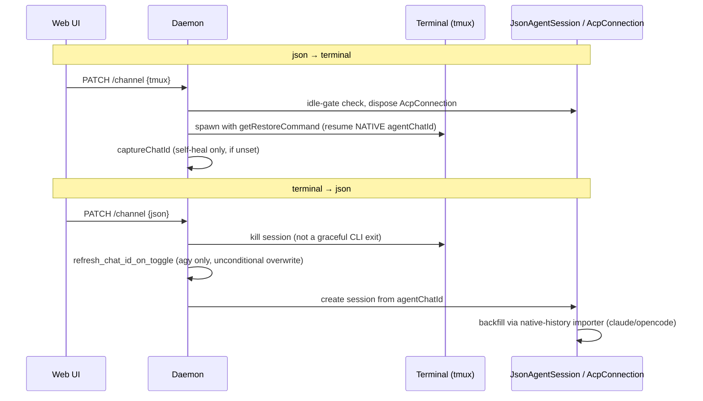
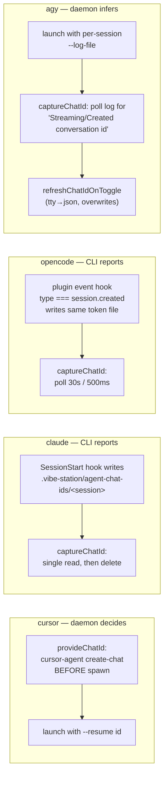
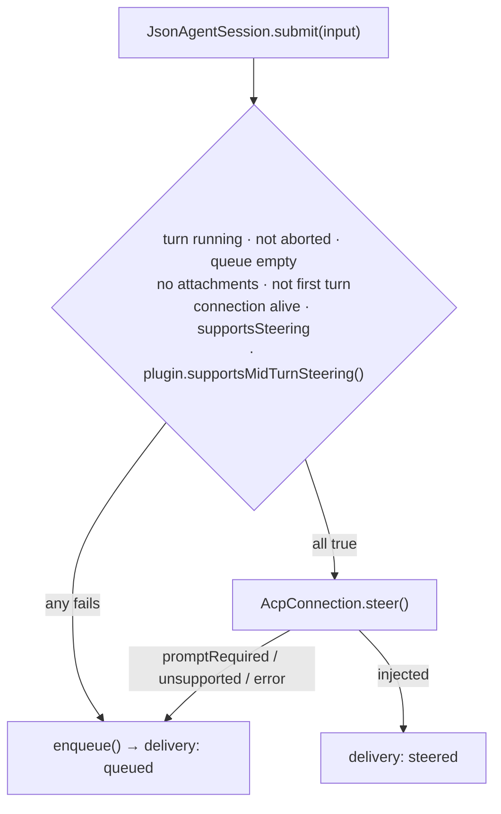

# Rich Chat over ACP

How Rich Chat (the `json` channel in code) drives every coding-agent CLI
through the **Agent Client Protocol (ACP)** — a JSON-RPC 2.0 wire format over
stdio. Condensed from the former `ACP-TRANSPORT-OVERVIEW`, `JSON-CHAT-ARCHITECTURE`,
`AGENT-CONTEXT`, `CLI-SUPPORT` and `AGENT-CHAT-ID-CAPTURE` docs. Implementation
lives in `rust/vst-agents` (plugins, `acp_connection.rs`, `json_agent_session/`).

> The daemon implements the ACP client **once**. Per-CLI code is limited to
> launch argv/env, an `enrich()` event hook, and chat-id handling. Nothing in
> shared code branches on which CLI is running (see `AGENTS.md` → Agent plugin).

## 1. Architecture

| Layer | Owns | Shared / per-CLI |
|---|---|---|
| `JsonAgentSession` | FIFO turn queue, transcript persistence, first-turn bookkeeping | Shared |
| `AcpConnection` | Process spawn/liveness, `initialize`, `session/new`/`load`/`prompt`/`cancel`, idle-TTL disposal | Shared |
| `normalize` | Base `session/update → NormalizedEvent` mapping | Shared + per-plugin `enrich()` |
| `AcpTerminalManager` | Host-managed child processes for ACP `terminal/*`, so background work (e.g. a dev server) outlives the turn | Shared |
| Plugin file | Launch command/args/env, `enrich()`, chat-id capture | Per-CLI |
| Transcript store | Everything both channels write; pagination, fork-supersede, `tool_result` size cap | Shared |

## 2. Connection lifecycle — one process per session, not per turn

A turn ends when the `session/prompt` call **resolves**, not when a process
exits. Stop sends `session/cancel` over the same connection, so the connection
and any background terminal survive.

## 3. Two channels, one session

A session is on exactly one channel: `tmux`/`pty` (live TTY process) or `json`
(Rich Chat). Both are persistent-process models. The toggle is idle-gated and
preserves the conversation.

### 3.1 History across the toggle (native import)

On terminal → json the daemon imports native-transcript turns Rich Chat does
not have yet (claude/opencode/codex importers; cursor/agy have none). Rules:

- User text is the first text block that is not the vst system-prompt marker
  (`# vibe-station Agent Skill`) — claude appends the system prompt as a 2nd
  block of the first prompt.
- Harness-injected autonomous user lines (`turnOrigin` task_notification /
  scheduled, `origin.kind: task-notification`) start their own turn group (with
  a status row); compaction summaries are skipped.
- Skip rule (the import is idempotent and safe to re-run). A group containing
  tool use is skipped iff its turn id or any of its tool-use ids already exists.
  A tool-less group is skipped iff its turn id exists or its content fingerprint
  (`u:` + user text, or `a:` + concatenated assistant text for user-less
  autonomous groups) matches an existing turn; turns with a cancelled/silent
  user row never contribute a fingerprint, so a re-typed prompt is imported.
  Identical text-only groups therefore dedupe.
- Known limitation: live out-of-band bursts split on a 30 s gap while the importer
  splits per autonomous native line, so two wake-ups within 30 s can import a
  duplicate text-only group.

### 3.2 Out-of-turn updates

Claude Code can keep working after a prompt resolves (task-notification and
scheduled wake-ups). Those `session/update`s arrive with no prompt in flight; the
connection routes them to an out-of-band sink (attached only after
`session/load`, so the adapter's history replay is not persisted again). They are
persisted under synthetic `notif-*` turns (a status row opens each burst) and
broadcast like normal events. Usage and command-list updates only touch session
meta. Lifecycle state is deliberately **not** changed by these updates.

### 3.3 Replay on open / reconnect

`chat:open` with `sinceSeq` returns a delta (max 200 rows). If the delta
overflows, the daemon answers with the normal tail frame instead, and the client
drops its stale cache via gap detection; on WS reconnect the client re-arms gap
detection from its last seen seq.

### 3.4 History across start-fresh / switch

`POST /api/sessions/:id/reset` archives the old session and spawns a
replacement. `carryOver` decides what history survives:

| `carryOver` | What the daemon does | Break card |
|---|---|---|
| `none` (Start fresh default) | No rows copied, no `session_break` row. The replacement starts empty ("View previous session" in the empty state). | none |
| `summary` (Switch default) | The old agent writes a summary first, or the caller supplies it as `handoffText`; rows are copied plus a `session_break` marker. | "Fresh start" / "Switched to <mode>", summary behind "Show summary" |
| `transcript` | Instant Markdown export of the old chat; rows are copied plus a marker whose `text` is the read-the-file instruction. | same card, instruction behind "Show instruction" |

- **Wire precedence**: `carryOver` if present; else `handoffText` ⇒ summary;
  else `handoff: true` ⇒ summary; else none. `handoff`/`handoffText` stay
  accepted for older clients.
- **Copied kinds** (single list): `user`, `thinking`, `text`, `tool_use`,
  `tool_result`, `result`, `error`, `status`, `message_generated`,
  `session_break`. `usage`/`model`/`agentChatId`/`logSeq` are cleared and
  `session_id` is re-stamped to the new session. **Dropped**: `session_init`,
  `usage`, `mode_update`, `commands_update` (the last two are captured by the
  mode at spawn, not by an imported row).
- **Marker**: a `session_break` row records `breakKind: "reset" | "switch"`,
  `fromProvider`/`toProvider` (CLI strings, for the pill icons),
  `fromMode`/`toMode` (mode display names) and `carryOver`. `switch` iff the
  MODE id differs — not merely the CLI, so opus-planner → sonnet-implementer
  on the same CLI is a switch. `text` is the summary or the transcript
  instruction (absent for `none`).
- **Stop-first**: when the agent is mid-turn the reset stops it through the
  same path as the Stop button (Rich Chat keeps the ACP connection, queued
  turns are withdrawn into holds), then waits ≤ 10 s for idle. A terminal
  agent is interrupted with `AgentPlugin::interrupt_keys` (default
  `Escape`) only while `Working`, then polled. `whenBusy: "wait"` (opt-in)
  skips the stop and waits for the turn *and its queue* to drain instead;
  `queued: "carry" | "drop"` decides whether the messages this reset withdrew
  are handed to the replacement. A `busy_timeout` 409 restores exactly the
  turns this reset moved; turns the user was already editing stay held.
- **Cancel with a point of no return**: `POST /api/sessions/:id/reset/cancel`
  answers `{ ok, cancelled }`; `false` once the reset has committed (after the
  summary/export succeeded, before the old runtime is released). Cancelling
  earlier restores the withdrawn turns, removes the not-yet-used replacement
  data dir (including a written `previous-chat.md`) and leaves the old session
  untouched (its turn may already be stopped). The 409 codes are
  `reset_cancelled`, `handoff_failed`, `busy_timeout` and `reset_in_progress`.
- **One timeout**: `HANDOFF_TIMEOUT` (`vst-lifecycle/src/handoff.rs`) is 120 s
  for both channels.
- **Transcript export**: `vst-agents/src/transcript_export.rs` writes
  `<new session data dir>/previous-chat.md` (created before the old runtime is
  released, so the file lives in the replacement's dir and is removed with the
  session). Owner-only `0o600` on unix. Compact Markdown: no thinking blocks,
  tool results trimmed to 800 chars with `[trimmed N chars]`, and an
  `## Index` of turns with line numbers. The replacement's first message is
  the instruction to read the last 3 turns in full, use the index for earlier
  parts, not act on anything, and reply with a three-line recap.
- **First-turn flag**: the agent's `first_turn_done = count_since_last_break() >
  0` — counted from rows *after* the last `session_break`, so a carried
  transcript never suppresses the system prompt / `session_init` for the new
  agent.
- **No hidden token cost**: `session_output` (vst agent output / replay) cuts
  at the last `session_break`, so an outside observer of a restarted agent sees
  only the new conversation. The carried rows exist for chat replay only.
- **Best-effort**: a copy failure logs and the reset proceeds (losing history
  is the status quo; aborting a reset is worse).
- **Terminal**: the summary path is interrupt-and-poll; `transcript` exports
  the tmux scrollback (`capture_pane`, 10 000 lines) and is labelled as a
  rough export, not a structured transcript. A non-tmux (direct pty) terminal
  answers 400 for `transcript`. The chain is also surfaced via the persisted
  `supersededBy` + `handoffSummary` fields in "Previous sessions".
- **Fork**: has no production caller, so no fork guard is built; revisit if
  forking is revived.

## 4. Context delivery at spawn

Three layers compose the system prompt: **L1** base `vst` instructions
(`agent-system-prompt.md`), **L2** project/worktree context (names, paths,
branch, base branch, sibling sessions, mode), **L3** project-level rules
(`<project>/AGENTS.md` or `.vibe-station/rules.md`).

| Env var injected on every spawn | Value |
|---|---|
| `VST_SESSION` | session id |
| `VST_WORKTREE` | worktree id (worktree sessions only) |
| `VST_PROJECT` | project id |
| `VST_DATA_DIR` | `~/.vibe-station/projects/<project-id>` |
| `VST_DAEMON_URL` | `http://127.0.0.1:<port>` |

Agents use these to call `vst agent send`, `vst agent output`, etc.

## 5. Two session identities

A session that has run a Rich Chat turn carries **two** ids:

| Field | Layer | Minted by | Understood by |
|---|---|---|---|
| `acpSessionId` | Protocol | ACP `session/new` | `session/load` / `session/prompt` on the same ACP connection only |
| `agentChatId` | CLI | the CLI (hook, pre-mint, log, or adapter store) | the CLI's own `--resume`/`--session`/`--conversation` flag and native transcript store |

**Invariant:** `agentChatId` is always the *native* id, never the ACP one.
Whether the two coincide is a per-CLI fact (established by a live spike), and
each plugin declares it only by which optional methods it implements:

| CLI | Strategy | ACP id == native id? | `capture_native_chat_id` | `supports_json_to_terminal_resume` | json→tty toggle |
|---|---|---|---|---|---|
| claude | `identical` | Yes | not implemented | `true` (default) | Resumes correctly |
| opencode | `identical` | Yes | not implemented | `true` (default) | Resumes correctly |
| agy | `identical` | Yes — the ACP `sessionId` is agy's `init.conversation_id` (the `vst agy-stream-acp` agent reports it verbatim; `session/load` of an id agy does not own fails instead of forking) | not implemented | `true` (default) | Resumes correctly (`agy --conversation <id> --log-file 
`) |
| cursor | `unavailable` | No, and no bridge exists (`cursor-agent acp` stores sessions in `~/.cursor/acp-sessions/<id>/store.db`, separate from what `--resume` reads) | best-effort cwd-keyed guess | **`false`** (`cursor.rs`) | Starts a **fresh** terminal conversation (no crash, no bogus `--resume`); UI warns beforehand via `GET /supported-clis`. Rich Chat transcript is unaffected (lives in SQLite) |
| codex | `bridged` | No — but `codex-acp`'s `session/new` sets `sessionId` directly to codex's native `thread_id`, so the native id is trivially recoverable with no separate lookup | `capture_native_chat_id` (trivial: adopts ACP session id verbatim) | `true` (default) | Resumes correctly via `codex resume <id>` |
| pi | no ACP / no json channel | N/A — no ACP layer exists for pi | not implemented | `true` (default, but meaningless — json channel is never offered for pi) | N/A — terminal only |
| omp | `identical` | Yes | not implemented | `true` (default) | Resumes correctly via `omp --resume <id>` |

> **History import for omp:** omp's terminal turns are imported into Rich Chat
> after a tty→json toggle (`historyImported: true`) by reading its session
> `.jsonl` directly — an active-branch walk (leaf → root via `parentId`) — with
> the watermark sealed on json→tty so ACP-written turns are never re-imported.
> Implemented via `AgentPlugin::native_history_importer()`; see
> `rust/vst-agents/src/omp_import.rs` and the "History import" section of
> `docs/PLUGINS.md`.

Per-CLI native-id resolvers live in `rust/vst-agents/src/native_chat_id.rs`; opencode's
absence there is meaningful (its id never needs out-of-band discovery).

## 6. How the native id is first learned (terminal start)

| CLI | Pre-mint | Terminal-start capture | Toggle self-heal (tty→json) | Resume/restore self-heal (→tty) |
|---|---|---|---|---|
| claude | No | `SessionStart` hook → session-scoped file, single read | Not needed | `capture_chat_id`, only if unset |
| cursor | **Yes** (`create-chat`) | N/A — known before spawn | Not needed | Not needed |
| opencode | No | plugin `session.created` hook → session-scoped file, polled | Not needed | `capture_chat_id`, only if unset |
| agy | No | none (no hook exists); polls per-session `--log-file` | **`refresh_chat_id_on_toggle`**, unconditional overwrite, single read | `capture_chat_id`, only if unset |
| codex | No | `SessionStart` hook (`.codex/vibe-recorder.sh`) writes the thread id to `.vibe-station/agent-chat-ids/<sessionId>`; `capture_chat_id` / `get_restore_command` read it (per session, so two agents in one worktree never share a thread) | Not needed (ACP session id IS the native thread_id) | `capture_chat_id`, only if unset |
| pi | No | Pre-assigned: launched with `--session-id <vst session id>` (pi creates it if missing, resumes it otherwise); `capture_chat_id` returns that id | N/A — no Rich Chat | `capture_chat_id`, only if unset |

Rules that matter:
- Every JSON turn's `session_init.agentChatId` is adopted **only if unset** (or
  during `--fork-session`). It is not an ongoing correction mechanism.
- Token files are keyed by our own session id, so a miss is `null`, never
  someone else's id.
- For a CLI with no hook, prefer a signal written **as a side effect of the
  conversation** (live log, per-turn callback) over one flushed **on exit** —
  vibe-station force-kills terminals on teardown. agy's earlier
  `last_conversations.json` cache design failed for exactly this reason (only
  written on graceful `/quit`, and keyed by cwd with no session identity).
- Known gap: agy's "Do you trust this folder?" prompt in a brand-new worktree
  isn't bypassed by `--dangerously-skip-permissions`; capture times out to
  `null` and self-heals at toggle time.

## 7. Mid-turn steering

"Steering" = the user sends a message during a running turn and it reaches the
agent **without cancelling the turn** (via the `_session/steering` ACP
extension); otherwise the message is queued (cancel-and-resend is the ceiling).

| CLI | Steering | Notes |
|---|---|---|
| claude | **Supported, verified end-to-end** | `claude-agent-acp` ≥ 0.70.0 (vendored: 0.98.0); reports `_meta.steering.supported: true` in `initialize`. One of two plugins implementing `supports_mid_turn_steering()` |
| opencode | **Disabled deliberately** | Advertises steering and replies `injected`, but the text never reaches the model (silently swallowed). Re-enable only after a fixed version is verified |
| agy | Not supported | `agy` stream-json stdin accepts only `user` events (anything else is ignored) and `initialize` does not advertise steering; the daemon queues. No competitor steers agy mid-turn |
| cursor | Not supported | Closed binary, no steering surface; cancelling starts a fresh conversation |
| codex | Not supported | `codex-acp` has no `_session/steering` extension |
| omp | **Supported, verified omp 18.12.6 (injected + promptRequired)** | Model re-streams the answer so text can appear duplicated |
| pi | N/A | Terminal only — no Rich Chat channel at all |

**Two gates, both required:** `supportsSteering` (what the CLI *claims* in
`initialize`) **and** `plugin.supportsMidTurnSteering()` (what we *verified*,
opt-in). Advertising steering is not enough — verify end-to-end, then opt in.

`delivery` is returned in the `POST /sessions/:id/chat` 202 body; the Composer
send button's `aria-label` reads "Interrupts and steers the running turn" when
`meta.canSteer` is true.

## 7b. agy stream-json agent

agy Rich Chat is the `vst-agy-stream-acp` crate, run as the hidden subcommand
`<current_exe> agy-stream-acp [--model <m>]` of `vst` / `vst-daemon`.

- Invocation: one long-lived `agy --input-format stream-json --output-format
  stream-json --print= --dangerously-skip-permissions [--conversation <id>]
  [--model <m>]` per ACP session, run in the cwd of `session/new|load`.
- Id rule: ACP `sessionId` == `init.conversation_id` == `agentChatId` == stored
  `acpSessionId`. Reconnect prefers `agentChatId`; both ids are rewritten after
  any load fallback.
- Usage is the sum of per-step `agent_response` usage (`result.usage` is
  conversation-cumulative and is not used).
- Cancel = SIGINT -> `result{ERROR,"interrupted"}` -> `stopReason cancelled`;
  the next prompt lazily respawns `--conversation <id>`.
- Silence of up to ~10 s before the first delta is normal.
- Tools are auto-approved (same as the terminal launch) and `ask_question` is
  unsupported; `denied_actions` are surfaced as a trailing note.
- File-edit diffs: agy's stream events for `write_file`/`edit_file` carry only
  `Path`, so the agent reads the arguments from agy's own
  `~/.gemini/antigravity-cli/brain/<conversation_id>/.system_generated/logs/transcript_full.jsonl`
  (read-only, `src/transcript.rs`). A `write_file` that overwrites an existing
  file shows as all additions because the stream gives no pre-image; any lookup
  miss just shows the tool without a diff.
  An `edit_file` diff covers only the replaced snippet (Target to Replacement) but is numbered with the real file lines: agy's transcript result row (`Made N replacement(s) in <path> starting at line L`) gives the first replacement's line, and since agy replaces ALL occurrences of Target, N>1 yields one diff per located occurrence (only the first when they cannot be located exactly). Without a result row a line is used only when Replacement occurs exactly once in the file, otherwise the card carries no diff. Later-call guard: the file is read only when no other non-read tool call follows that edit in the transcript (and the transcript did not grow during the read); with parallel or later tool calls the file may already hold their changes, so the card shows the first replacement only (its reported line is exact) or, with no result row, no diff. Numbers are therefore never guessed. A `_meta` is honoured only when BOTH `oldStart` and `newStart` are valid. Generic convention for any ACP agent: set `_meta: {"oldStart": n, "newStart": n}` (1-based, both required) on a `Diff`; the daemon (`normalize.rs`) maps it to `ToolDiff.oldStart/newStart` and passes the diff through untrimmed. Agents that send no `_meta` are unaffected.
- Whether `--model` changes the model in stream-json mode is unverified.

### Turn timeouts

Two timers guard a Rich Chat turn, both idle (silence) based and both reset by
any `session/update`:

- **Connection idle limit** (`acp_connection.rs::do_send_prompt`,
  `AcpLaunchSpec::prompt_timeout_ms`, default 60 min): rejects the
  `session/prompt` after that long with no update. On expiry the daemon now
  sends `session/cancel` and waits up to ~45 s (never longer than the limit) for the agent to answer
  before returning the (unchanged) idle-timeout error, so the agent is not left running
  an abandoned turn whose later updates would surface as out-of-band work.
  The idle-timeout `session/cancel` is now sent for every plugin; for cursor a
  cancel starts a fresh conversation, so a turn silent for the full idle window
  loses its context (previously the abandoned turn kept running out-of-band) —
  an accepted trade-off. Claude's adapter may also stop background subagents it
  was waiting on at that point.
- **Stuck-turn watchdog** (`acp_run_turn.rs`, 10 min): fires only while NO tool
  call is open; it reads the connection's open-tool set (`has_open_tools()`).
- **Open-tool cap** (`AcpLaunchSpec::open_tool_idle_timeout_ms`, default `None`):
  while at least one tool call is open, the connection idle limit is this value
  instead. Only agy opts in (12 h; its `schedule` tool can stay open for hours).
  Claude is deliberately unchanged: its adapter has known never-completing tool
  calls, so a long cap would turn them into hour-long hangs. Clamped to 7 days;
  measured on a monotonic clock, which pauses across system sleep.

The open set lives in the connection (`Shared::open_tools`), maintained by
`apply_tool_update` and cleared at turn start/end, on dispose and on
new/load session.

## 8. Context window

| CLI | Window | Knob exposed? | Notes |
|---|---|---|---|
| claude | Up to 1M via `betas: ["context-1m-2025-08-07"]` | **Passed** — `claude.rs` `acp_meta()` sends the beta and the model on `session/new` (the same `_meta` also carries `extraArgs.chrome` and `env.CLAUDE_CODE_ARTIFACT=1`, giving terminal parity for Claude-in-Chrome and claude.ai Artifacts; the adapter honours those on `session/load` too) | The adapter ranks `ANTHROPIC_MODEL` above everything else; inherited from the user's shell (e.g. `claude-sonnet-4-6`), it was re-asserted on `session/load`, so a `sonnet` mode ran 4-6 at 200k. `acp_model_env()` pins the var to the session's model (left alone when the mode has none). `_meta` is also ignored on load, so `acp_initial_config_option()` re-pins the model with `session/set_config_option` after every load, and a status event says so |
| opencode / cursor / agy | CLI-managed | None | No ACP field exposes it |
| codex | CLI-managed | None | No ACP field exposes it |
| omp | CLI-managed | None | No ACP field exposes it |
| pi | CLI-managed | None | Terminal only — no ACP |

Update sections 5–8 when a CLI ships a new ACP version or the daemon wires a
new capability.
